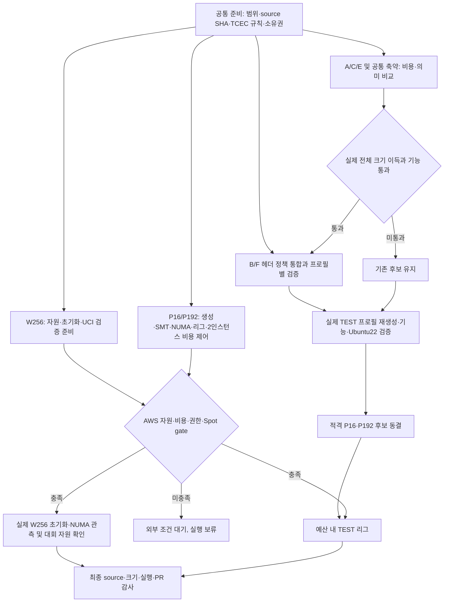
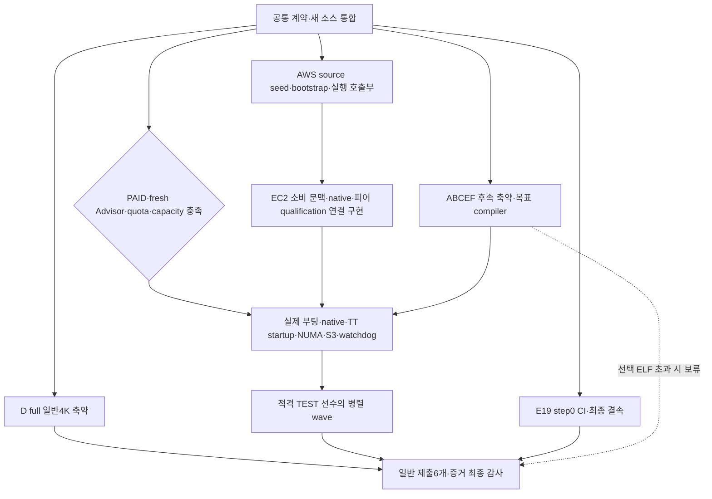
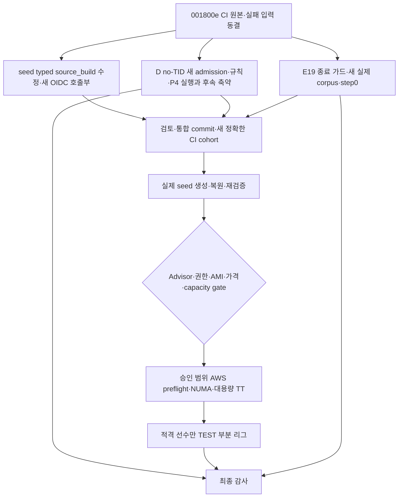

# Rove4k C A–F 구현·제출 실행 계획

## 현재 유효 범위: 일반 4K A/B/C/E/F (2026-10-28)

사용자 요청에 따라 이후 작업 계획에서 D와 ELF를 제외한다. 아래의 이전 A–F·ELF
내용과 실험 결과는 당시의 기록이며 현재 작업 범위를 확장하는 지시가 아니다.
Rust 엔진 경로는 폐기 상태다. 이 범위에서 목표는 A/B/C/E/F 각각의 full 기능을
유지한 일반 4K 제출 후보, 실제 환경 검증 및 적격 후보의 TEST 리그다.

### 리그·자원 조건 갱신 (2026-10-27)

사용자는 별도의 **P16 / P192 / W256** 프로필을 지정했다. P16은 엔진 각각
16 worker로 한 경기 양측이 같은 16 vCPU와 하나의 NUMA 노드를 번갈아 공유한다.
한 192 vCPU 인스턴스에서 11경기를 병렬로 진행하는 것이 원칙이다. 폰더링은
끄고 설정이 불가능하면 진행하되 그 상태를 기록한다. 엔진 양측의 TT와 사적
메모리는 한쪽이 쉬는 동안에도 동시에 존재한다. P192 상위 경기에서는 양쪽
엔진 각각 192 worker로 같은 192 vCPU를 공유해 NUMA 효율을 관측한다. 별도
전용 CPU가 없는 controller의 공유와 간섭을 계측한다. W256은 별도 잠정 제출
프로필이다. 사용자가 지정한 엔진당 TT 상한은 P16 16 GiB, P192 192 GiB다.
기존 24 B 항목과 2의 거듭제곱 entry 수를 적용한 P16 12 GiB를 허용한다.
11개 P16 경기 양측 TT는 12 GiB 구현이면 합계 264 GiB이며, 16 GiB 상한을
모두 쓸 경우 352 GiB다. P192 한 경기 양측 TT 상한은 합계 384 GiB다. 각
프로세스·운영체제의 추가 메모리는 별도로 계산하고 실제 구현에서 확인한다.

경기는 30분+3초의 TCEC 4K 경기 규칙을 적용한 예산 내 자체 리그다. 기존
P4→P28 선발은 새 리그의 정본이 아니다. 11경기/16 vCPU/NUMA와 자체 리그
형식은 사용자의 시험 조건이며 공식 대회 전체 형식을 재현했다는 뜻이 아니다.
공식 규칙상 기본 활성 폰더링을 끌 수 있어야 하므로 설정 불가 시 진행하더라도
실제 활성·비활성과 규칙 적합 여부는 분리해 기록한다.

`m6a.48xlarge`의 192 vCPU는 96개 물리 코어의 SMT 2스레드이며 메모리는
768 GiB다. 실제 guest의 CPU/NUMA/cpuset과 sibling을 관측해 각 경기의 16개
CPU가 한 노드 안에 들어가고 11개 슬롯 및 controller 영역이 공존하는지 확인한다.
W256의 엔진당 약 192 GiB TT를 P16 22개 프로세스에 그대로 적용할 수 없다.
P16 및 P192 엔진·상대편 별 고정 자원, 실행기 admission, 재생성, 규칙·크기·
실행 검증이 필요하다. 기존 P4/P28 및 W256 결과를 새 프로필에 승계하지 않는다.

추가 리전은 확인 대상이지 실행 승인이나 가용성 증명이 아니다. 2026-10-27 조회에서
Sydney의 유형 제공과 192 vCPU Spot quota는 확인했으나 다른 리전의 유형·quota
조회는 프로젝트 Organizations SCP가 명시적으로 거부했다. 실제 Spot capacity,
신규 리전 권한·quota·가격·Advisor·AMI 및 공유 크레딧은 미확인이다. 기존 전체
$120 비용 한도는 유지하고 두 인스턴스의 실제 비용을 합산한다. 기존 누적
12 instance-hour 제한은 사용자 요청으로 폐기한다. 비용이 한도를 넘으면 새
경기는 시작하지 않고 이미 시작한 모든 경기를 마친 뒤 추가 예산 조달을 기다린다.
비용 기록·종료·fresh Advisor 등 나머지 gate는 유지한다. 두 인스턴스 합산과
한도 초과 후 신규 경기 차단을 표현하는 공유 예산 reducer 및 조건부 원장 시제품은
구현했지만, 실제 cloud 원장과 실행기의 권위 있는 GO 제어·복구·종료 경로는
아직 연결·검증하지 않았다. 기존 실행 경로의 12시간 제한도 새 리그에 적용되지
않도록 제거하고 실측해야 한다. 시제품의 단위 검사만으로 비용 통제를 승인하지 않는다.

아래 추정은 새 P16/P192·리그 구현의 거친 범위이며, 외부 리전 권한·실제
capacity와 전체 대국 수는 아직 확인되지 않았다. 새 근거에 따라 다시 산정한다.

기준 `fe20d35f6a730f9a7a025e07ad5c6fb18e0cbb18`의 유지 선택에서 실제 전체 파일
크기는 다음과 같다. W256은 생성·재승인·내보내기만 검증됐고 대형 TT 실행이나
대회 적격성을 뜻하지 않는다. 이벤트의 실제 자원·운영 조건은 별도 확인한다.

| 계열 | TEST-P4 | TEST-P28 | 잠정 제출 W256 |
|---|---:|---:|---:|
| A | 3781 B | 3790 B | 3782 B |
| B | 4071 B | 4081 B | 4072 B |
| C | 3907 B | 3920 B | 3908 B |
| E | 3870 B | 3882 B | 3871 B |
| full F | 3587 B | 3602 B | 3589 B |

`415a22326d25d8c449a6434f101cbc3d8690508f`의 별도 P16/P192 control은
[CI 40520433230](https://github.com/daejunnom/Rove4k/actions/runs/40520433230)에서
10개 조합 모두 2회 생성·5개 산출물 비교·source inverse·규칙·엄격 소스
재승인을 통과했다. 원 엔진·TT·물리 배치·대국은 실행하지 않았다.
같은 head의 유지 엔진 CI는 비D 22개 작업과 verifier 58검사·strength 419검사를
통과했으며, 공유 예산 reducer 단위 검사는 실제 cloud 원장·GO 연결의 증거가 아니다.

| 계열 | P16 control | P192 control |
|---|---:|---:|
| A | 3834 B | 3835 B |
| B | 4203 B | 4206 B |
| C | 3982 B | 3983 B |
| E | 3926 B | 3928 B |
| full F | 3646 B | 3645 B |

B 두 control은 4096 B를 초과하므로 참가 자격이 없다. 기존 B 축약을 새
프로필에 옮길 때 실제 source/native·전체 크기·규칙·runtime을 각각 검증한다.
다른 계열의 크기 통과 역시 192 vCPU 실제 실행이나 리그 적격성을 뜻하지 않는다.
같은 head의 [castle 비용 CI](https://github.com/daejunnom/Rove4k/actions/runs/40520433628)는
A/C/E W256에서 각각 +3/+7/+7 B로 손해여서 해당 후보를 선택하지 않는다.

후속 `17e6d05c42ef6706d7cea6192043bf6fcde09101`의
[실제 비교 CI](https://github.com/daejunnom/Rove4k/actions/runs/40522741567)는
B의 `tcec-final-lf` 후보에서 P16 4086 B(-117), P192 4097 B(-109)를 기록했다.
P192는 1 B 초과이고 P16은 10 B 여유다. 두 파일의 소스·규칙 재승인은 통과했으나
원 엔진·TT 실행, 실제 NUMA, 점수 리그와 유지 선택은 아직 확인하지 않았다.
후속 `fd01ab185c5cee3eebd7c3dd77867d1dba66e9b3`의
[비교 CI 40528196964](https://github.com/daejunnom/Rove4k/actions/runs/40528196964)는
19개 작업을 통과했다. 실제 중간 source를 고정한 `league-atomic` 후보의 전체
제출 파일은 P16 **4073 B**, P192 **4081 B**로 각각 23 B, 15 B의 여유가 있다.
동일 호스트 재포장 비교에서 `tcec-final-lf` 대비 atomic 변경은 각각 13 B,
16 B 감소했고, 뒤이은 unused-include 정리의 추가 이득은 0 B였다. 두 후보 모두
소스·규칙 재승인을 통과했으나 원 엔진·TT 실행, 실제 NUMA 배치, 경기 및
제출 유지 선택은 검증되지 않았다. 크기 통과를 실제 리그 적격성과 구분한다.
이어 `766d101df358fa1b06a878fc79e58a9b377f41b1`의
[P16/P192 CI 40530103670](https://github.com/daejunnom/Rove4k/actions/runs/40530103670)는
21개 작업을 통과했다. 여기에는 B `league-atomic`의 고정된 P16·P192 소스를
별도 Ubuntu 22 환경에서 각각 재컴파일하고 규칙을 확인한 두 작업이 포함된다.
같은 SHA의 [엔진 CI 40530103489](https://github.com/daejunnom/Rove4k/actions/runs/40530103489)도
공통 회귀 행렬을 포함한 26개 작업을 통과했다. 이 결과는 B 새 TEST 후보의
실제 UCI 검색·대용량 TT·NUMA 물리 배치·경기나 제출 채택을 입증하지 않는다.

후속 `1957587e44d95fbadcdcb0fe3c8c884890776069`의
[P16/P192 CI 40535259241](https://github.com/daejunnom/Rove4k/actions/runs/40535259241)는
29개 작업을 통과했다. Ubuntu 22의 별도 소비자는 A/C/E/full F의 control과 B의
`league-atomic` 각각 P16·P192, 총 10개 조합에 대해 strict 소스 재승인·컴파일·
규칙 검사를 통과했다. 같은 SHA의
[Fastchess gate CI 40535258917](https://github.com/daejunnom/Rove4k/actions/runs/40535258917)는
실제 실행기와 모의 UCI 엔진을 사용한 GO2 게이트·wave 사례를 통과했다.
[엔진 CI 40535258797](https://github.com/daejunnom/Rove4k/actions/runs/40535258797)도
공통 회귀 행렬을 포함한 26개 작업을 통과했다. 이 근거는 실제 Rove4k TEST
후보의 UCI 검색, 대용량 TT, NUMA, 실 대국이나 score GO 승인을 뜻하지 않는다.

후속 `e1395cb690818b3282f84b0a14f3ac1a47c07b83`의
[P16/P192 CI 40537413312](https://github.com/daejunnom/Rove4k/actions/runs/40537413312)는
61개 작업을 통과했다. 다음 16개 후보 각각에 대해 실제 전체 제출 파일을 같은
실행의 control과 비교했으며 모두 더 작고 4096 B 이하다. 각 후보의 독립
Ubuntu 22 컴파일·규칙 검사도 통과했다. 표의 값은 `control → 후보` 전체 바이트다.

| 후보 | P16 | P192 |
|---|---:|---:|
| A square-successor | 3834 → 3821 | 3835 → 3819 |
| C square-successor | 3982 → 3970 | 3983 → 3972 |
| C legal-maker | 3982 → 3979 | 3983 → 3978 |
| E legal-maker | 3926 → 3916 | 3928 → 3917 |
| A atomic-assignment | 3834 → 3826 | 3835 → 3825 |
| C atomic-assignment | 3982 → 3971 | 3983 → 3973 |
| E atomic-assignment | 3926 → 3918 | 3928 → 3918 |
| full F atomic-assignment | 3646 → 3637 | 3645 → 3637 |

후속 `27bd6e50f9cf67bc54ebeeb14143e1ab2c37c74d`의
[P16/P192 CI 40542265378](https://github.com/daejunnom/Rove4k/actions/runs/40542265378)는
85개 작업 모두 통과했다. 아래 결합 후보 12개는 같은 실행의 control 및 구성
후보와 실제 전체 파일을 비교했고 각각 독립 Ubuntu 22 컴파일·규칙 검사도
통과했다. 같은 SHA의 [source-compaction CI](https://github.com/daejunnom/Rove4k/actions/runs/40542265285)는
18개, [엔진 CI](https://github.com/daejunnom/Rove4k/actions/runs/40542265506)는
26개 작업 모두 통과했으며, [Fastchess gate CI](https://github.com/daejunnom/Rove4k/actions/runs/40542265338)도
통과했다. 표의 값은 `control → 결합 후보` 전체 바이트다.

| 결합 후보 | P16 | P192 |
|---|---:|---:|
| A square-atomic | 3834 → 3810 | 3835 → 3812 |
| C square-atomic | 3982 → 3962 | 3983 → 3964 |
| C square-ep | 3982 → 3966 | 3983 → 3967 |
| C ep-atomic | 3982 → 3970 | 3983 → 3971 |
| C square-ep-atomic | 3982 → 3955 | 3983 → 3956 |
| E ep-atomic | 3926 → 3907 | 3928 → 3908 |

이 비교는 제출 후보 선택이나 실제 엔진의 UCI 검색·대용량 TT·NUMA·경기 검증을
대신하지 않는다. 각 계열과 프로필의 유지 선택은 그 검증 이후에 결정한다.

남은 작업은 공통 제출 규칙·자원·소스 소유권을 고정한 다음 병렬로 진행한다.

1. **B/F 압축**: B `league-atomic`의 선택된 TEST 소스는 독립 Ubuntu 22
   재컴파일·규칙 확인을 통과했으며, 실제 실행 및 물리 배치를 추가 검증한다.
   기존 payload를 보존하는 작은 헤더는 P4/P28/W256에서 B 18 B,
   F 9 B 이득을 관측했다. 아직 실험 선택이다. 별도 wrapper 컴파일 정책과 실제
   native 동등성을 연결하고 각 TEST의 재생성·규칙·실행 및 W256 준비를 검증한
   후에만 유지 선택 여부를 결정한다.
2. **A/C/E와 공통 압축**: 캐슬링 후보의 W256 전체 크기는 A/C/E에서 각각
   3/7/7 B 증가해 유지하지 않는다. 위 16개 후보는 각각 실제 전체 크기가
   감소했고 12개 결합 후보도 별도로 비용·규칙 검사를 마쳤다. 실행 검증과
   유지 선택을 진행한다. 추가 후보에서 이득이
   있으면 다른 계열에도 적용 가능성을 살피고 프로필별 독립 검증을 거친다.
   추가 후보도 full 기능과 실제
   제출 전체 크기 기준으로 평가한다.
3. **일반 제출 실행**: 256 worker 및 잠정 192 GiB TT의 크기·인덱스·초기화와
   시작 시간, shutdown·UCI·합법 수 및 실제 resource 계약을 검증한다. 상속하는
   외부 NUMA 정책과 실제 페이지·worker 배치를 관측하며 이벤트 환경과의 일치를
   확인 전까지 별도 미확인으로 둔다. P4/P28 결과를 W256에 승계하지 않는다.
4. **평가와 리그**: P16/P192 생성·SMT admission·양측 공유 CPU·폰더링·NUMA,
   두 인스턴스 합산 ledger와 비용 초과 시 진행 중 경기 완료 정책을 완성한다.
   NUMA의 CPU affinity와 메모리 정책은 엔진 실행기가 초기화 전에 적용하며,
   허용 topology·실제 worker 배치·페이지 관측을 기록한다. Rove4k 엔진은
   외부 정책을 상속하고, 실제 TCEC 4K 서버의 설정은 별도 확인 대상으로 둔다.
   평가기·대국 준비 및 데이터/학습 준비의 남은 계약을 감사한다.
   실제 학습이나 기력 향상은 주장하지 않는다. fresh Advisor·quota·capacity·IAM·
   AMI·비용/종료 gate 충족 뒤 승인된 범위에서만 실제 환경을 사용한다. 동결된
   4KiB 적격 TEST 후보로 리그를 실행하고 인프라 실패와 엔진 결과를 구분한다.
5. **최종 통합**: 고정한 source SHA와 각 프로필의 생성·전체 크기·기능·대상 환경·
   자원·리그 근거를 감사하고 PR 검토 및 필요한 회귀 CI 결과를 확인한다.

재개 후 구현·준비의 거친 조건부 추정은 공통 준비 1–2시간 → max(엔진 프로필·
압축 및 검증 8–20시간, P16/P192 실행기·비용 제어 10–24시간, 데이터 계약 감사
1–3시간) → 최종 통합 감사 2–4시간으로 **약 13–30시간 + 공유 runner·외부 조건
대기 + 실제 대국 시간**이다. 실제 대국 시간은 확정된 게임 수·경기 소요·중단과
재시도에 따라 별도 산정한다. 이 추정은 자원 확보와 제한적인 재작업을 가정하며
추가 축약 발견이나 대회 적격성 완료를 보장하지 않는다. 병렬 작업의 시간을 단순
합산하지 않는다.

`3d857ba`의 [P16/P192 source CI](https://github.com/daejunnom/Rove4k/actions/runs/40524181759)는
15개 작업을 통과했고, 후속 `59b15ab`의 공통 source-contract 실패는 수정 후
위 `fd01ab` CI에서 재검증했다. `e1395cb`의 P16/P192 CI는 위 16개
추가 후보의 독립 Ubuntu 22 컴파일·규칙 검사도 포함하지만 실제 대용량 TT 실행·
NUMA 관측·경기 검증은 아니다. B/F 헤더 정책은 여전히 실험 선택이며 제출
선택에 연결하지 않았다. 예약은 사용하지 않고 작업과 검증을 진행한다.

2026-10-25 사용자 확정 계획을 구현하는 현재 기준이다. 기존 외부 핸드오프는
참고자료이며 현재 사용자 결정·AGENTS.md·엔지니어링 계약을 대체하지 않는다.
같은 feature/rove4k-engines-af와 Draft PR #12(develop 대상)를 재사용한다.
시작 head는 391fad6f162265317c016aa4b6e700f9575c69ee, tree는
70f8a28cdfe4f99067ed9173b39c308d0d1dec49다. Rust 폐기·미통합 실험의
로컬 변경을 보존하고 현재 구현과 구분한다.

## 1. 목표·완료 범위

| 구분 | 적용 기준 |
|---|---|
| 일반 4K | C A–F 여섯 계열 각각의 TCEC 제출 프로필을 full 기능으로 적격화한다. C/D/F도 일반 부문에 포함한다. |
| ELF | A–F 모두 검토하지만 4096B 초과 시 deferred_size로 보류한다. 일반 완료를 막지 않는다. |
| 형식 | source-JIT / packed-native / self-contained-ELF와 일반/ELF 부문 자격을 분리한다. 같은 ELF bytes는 양 부문 자격을 가질 수 있다. |
| 필수 기능 | 계열 고유 검색·평가·learner, N/B/R/Q 생성·replay, EP/castling·draw context·clock·live-state 재사용을 유지한다. |
| 언어 | 엔진 Rust 전체 폐기 유지. NVCompact Rust와 공유 개발 도구는 별도다. |
| 객체화 | C의 상태·수명과 개발 도구 책임을 캡슐화한다. 제출에 동적 다형성·불필요 필드·런타임 계열 선택기를 넣지 않는다. |
| 병렬 정책 | 현재 제출 정책을 우선한다. 추가 root/groups/PALS/hybrid 출품·기력 연구는 후속이다. |
| 테스트 | TEST-P4/P28은 제출과 별도다. 기능·계측은 크기 제한 없이 수행하되 점수 리그는 full 4KiB 적격 선수만 입장한다. |
| 필수 크기 gate | 잠정 TCEC 일반 제출 여섯 개가 필수다. TEST 12개의 크기 미달은 해당 리그 제외로 처리하며 제출 완료를 막지 않는다. |
| 학습 | 실제 corpus/model/trainer/export 준비 후 production optimizer step0·초기 weights SHA 불변에서 정지한다. |
| AWS | 승인한 m6a Spot 평가·보존·비용 종료를 구현한다. 실제 launch는 구현·연결·자원·비용 사전 gate 후 수행한다. |
| 예약 | Codex 예약·주기 작업 금지 유지. 비용 안전용 한시적 외부 종료 장치만 포함한다. |
| 현재 우선순위 | 2026-10-27 사용자 지시에 따라 D의 새 압축은 잠시 정지한다. A/B/C/E/full F 구현·압축과 ELF 생산/소비 경로를 먼저 완성한다. D4737/BSS4689 및 실패·검증 자료는 보존하며 자동 재개하지 않는다. |

일반 4K는 단일 파일 전체 4096B 이하, 시작 60초 이내, 자기 생성 임시파일
정리, 허용 의존성, 4K 최소 UCI가 기준이다. stop/ucinewgame은 미지원이어도
안전하게 소비한다. FEN·perft·stats·공개 Hash/Threads를 일반 리그에서 자동
의무화하지 않는다. book/ponder는 기본 비활성이다. ELF는 자체 포함과 외부
프로그램 금지·허용 동적 라이브러리를 별도로 확인한다.

- 규칙: https://wiki.chessdom.org/Rules#TCEC_4k_rules
  (2026-10-26 확인, Rules revision9524; 일반 리그의 UCI 요구와 구분한다.)
- 공개 환경: https://wiki.chessdom.org/index.php?title=TCEC_Season_Further_information&oldid=8475

파일명·설정에 코드나 모델을 숨기지 않는다. startup/사용 가능 상태에서
임시파일을 확인하고 quit/EOF·물리 종료도 독립 관측한다.

## 2. 소스·객체·자원 계약

### 계열별 production authority

기존 계열별 production root를 재사용한다. 정본은 engine.c 하나가 아니라
그 계열 source·fragment·명시적 transform closure다. C SIMD와 E19/inline
ordering의 실제 소비 경로를 포함한다. 범용 engines/c는 reference/dev이며
실제 제출 core의 대체물이 아니다. generic의 TT16/32B를 compact의 TT24/16B로
오인하지 않는다. D는 실제 0x88 mailbox·PVS·atomic128 TT·no-libc runtime·
persistent worker pool을 유지한다.

계열마다 GameContext / SearchJob / WorkerState / TTState / RuntimeState에
대응하는 소유권을 식별한다. 같은 거대 struct·동일 레이아웃을 강요하지 않는다.
learner는 logical worker의 process 수명, game prefix는 search 중 불변,
recursive path는 private 수명이다. generation·deadline·취소·완료 publication·
OS handle과 메모리 재사용 barrier를 객체 경계에 연결한다.

도구의 EngineSpec / ResourceProfile / ArtifactPlan은 engine source, pure
tool dependency, test input을 분리한다. 다른 계열 helper의 재사용과 그 계열
검색·평가 source를 payload에 넣는 것을 구분한다. source allowlist·전처리 결과·
실제 packer 입력·복원 bytes를 연결한다. DEV/학습/계측/다른 계열 코드는
submission closure에서 제외한다.

PR #18 통합에서는 계열 template과 `engines/common`의 선언된 C 조각을 engine
입력으로, `source_composition.py`를 tool 입력으로 각각 고정한다. 조립 결과는
기존 canonical C와 일치해야 하며 source factory·frozen snapshot·sealed transport·
AWS seed 모두 같은 역할 경계를 유지한다. retired 경로의 archive 이동은 현재
source authority나 실패 결과를 새 적격성으로 승격하지 않는다.

선택형 spelling과 기본 unused-includes를 함께 사용할 때 순서는 resource →
phase/B → E19(E만) → spelling → dependency cleanup이다. 역변환은 dependency를
먼저 복원한 뒤 spelling/E19/phase/B/resource를 복원한다. 기존 pre-cleanup 입력
핀을 최종 C에 맞춰 바꾸지 않으며 전체 파일 비용·실제 compiler stdin·expanded
입력·native·diagnostics를 새 체인에서 재검증한다. 공통화로 제거한 저장소 중복
바이트와 제출 파일 절감량은 따로 보고한다.

하위 생성기의 spelling·scan·EP 기본값은 control로 유지한다. 유지 CI는 ACE에 compound,
F에 compound-v2, A/C에 추가 square-successor, C/E에 legal-maker EP, B에 best, D에 control을 명시하며 generation 영수증의 선택과 dependency 정책이 요청과
정확히 같아야 다음 단계로 넘어간다. Ubuntu22 소비자는 봉인된 소스를 사용하며
선택을 다시 하거나 그 호스트에서 source factory를 재실행하지 않는다.

PR #18 통합 뒤 resource/phase/E19/spelling/dependency를 모두 재생성한 현재
full 후보와 후속 A/C 순회식·C/E EP·full F v2의 전체 파일 비용은 다음과 같다. 각 셀을 두 번 재생성했으며, W256은
크기·타입·소스 계약 범위이고 실제 대용량 실행이나 대회 자원 확정은 아니다.

| 계열 | TEST-P4 | TEST-P28 | TCEC 잠정 W256 |
|---|---:|---:|---:|
| A compound+scan | 3781 B | 3790 B | 3782 B |
| B | 4071 B | 4081 B | 4072 B |
| C compound+scan+EP | 3907 B | 3920 B | 3908 B |
| E compound+EP | 3870 B | 3882 B | 3871 B |
| F full compound-v2 | 3587 B | 3602 B | 3589 B |

compound는 기존 spelling 자리의 대안이며 best 뒤에 다시 적용하지 않는다.
F의 실제 코드 변경은 별도 F-compound-clock-gcc13-v1 정책과 세 프로필의 새
asserted-source/native gate로 검증한다. 이전 native 기대값을 바꾸지 않는다.
다섯 P4의 실제 rules·초기화 장벽·source-JIT 종료 검사를 새 증거로 통과했고,
물리 배치와 기력은 여전히 별도 자격이다.

A/C의 이전 compound 기준은 각각3794/3804/3793 B와3927/3940/3928 B였다.
새 scan은 resource→phase→compound 뒤에만 적용하고 dependency cleanup은 마지막에
유지한다. 여섯 새 source/native 문맥을 별도로 승인하고 old native map은 바꾸지 않았다.
새 A/C P4/P28 네 실제 경로는 규칙·초기화 메커니즘·전체 source-JIT runtime을 통과했다.
각 경로24 GO/22 합법 응답, 합계96 GO/88 응답이며16개 그룹이 자연 종료했다.
이는 로컬 기능 자격이고 W256 실행·물리 배치·기력은 미검증이다. 새 선택을 사용하는
정확한 CI·독립 Ubuntu22 소비자와 새 cohort 운송도409062f에서 통과했다.

001800e의 engine CI40228534420은26개 작업을 모두 통과했다. P4/P28 각각
여섯 source factory와 여섯 독립 Ubuntu22/GCC11 소비자가 실제 실행을 끝냈고,
foundation은 source 계약372·E19 21·평가기283개, 합계676개 검사를 통과했다.
이는 해당 CI 프로필의 기능·규칙·worker CPU·자원 관측이며 실제 TCEC 배치나
점수 리그 적격성의 대체물이 아니다. D의 CI 입력은 별도 source-JIT control이다.

D의 새 공통 소스 P4 control은 5429 B다. process-owner 5373 B는 독립 규칙과
전체 P4 기능 검사를 통과했지만 크기·물리 배치·선택은 통과하지 않았다. 새로
재생성한 search 조합 5261 B도 별도 typed admission·새 CPP/native/package
재생성·독립 규칙과 전체 P4 기능 검사를 통과했다. 이 경로의 active quit/EOF
0–1개 마지막 출력은 로컬 최소 종료 계약이며 공식 이벤트 승인의 뜻이 아니다.
기존 owner의 마지막 출력 1개 계약과 과거 실패는 그대로 유지한다. 5261 B는
크기·물리 배치·기력·이벤트 자격·선택 모두 false이고, 4KiB까지 1165 B가 남는다.
native operand 필터 네 경우와 typed scalar-atomic 두 경우는 전체 비용 손해로
채택하지 않았다. 닫힌 TU의 미사용 선언·본문 1205 B 제거는 native를 GCC13과
감사된 GCC11 SDK에서 그대로 유지하며 source-JIT 7004→6689 B로 줄였다.
이는 아직 별도 미선택 source 경로이며 최저 native 포장 5261 B를 줄이지 않는다.
다른 계열에 적용할 수 있는지는 각 표현의 실제 소비·전체 비용으로 재측정한다.

후속 no-TID 비용 실험은 현재 즉시 thread-group 종료 경로에서 읽지 않는
kernel TID 인자만 제거해 whole5261→5245 B를 측정했다. logical worker ID와
clone thread/guarded stack/검색/학습기/TT128은 유지한다. 비복귀 callback 꼬리는
추가 whole 이득이 없어 제외한다. 5245 B의 새 typed admission·독립 규칙·실제
P4 실행도 새 증거로 통과했다. 이전5261 B native map이나 종료 계약을 변경해
통과시키지 않았다. 이 후보도4096 B보다1149 B 크므로 제출 적격은 아니다.
F의 기법을 D의 정확한 clock-token 계약으로 옮긴 두 경우는 native가 작아져도
whole5261→5273 B로 손해여서 미채택한다. source-JIT 두 경로도 각각21 B 커졌다.

같은 유효 칸 순회식을 D에 전이한 별도 비용 실험은 현재 no-TID의 여섯 원본을
재생성한 control과 비교했다. source7114→7101 B, compressed6972→6956 B,
packed5245→5233 B로 세 경로 모두 줄었다. native7104/linked7456 B의 길이는 같지만
바이트가 달라 새 Search→NoTid→Square typed admission을 구성했다. 새3인자
초기화 장벽, plain/UBSan 규칙105사례·2858합법 수와 실제128MiB P4 실행을
통과했다. 네 그룹은24 GO/22합법 응답, 지속5TID·네 worker positive CPU와
자연 종료를 확인했다. 전체53개 소유 명령과 독립499파일 감사도 통과했다.
5233 B는 로컬 full P4 기능 검증 후보이며 여전히4KiB보다1137 B 크다.
새 세 qualification helper의 순수16검사를 CI에 등록하며 새 head 실행 결과는
별도 확인한다. 이전5245 B 근거나 proper-alpha 계보를 새 결과로 바꾸지 않는다.
이 P4 차이를 W256 제출의 남은 차이로 표시하지 않는다.

후속 Move16은 promotion 표시·decode·정렬 jitter까지 보존하는 별도 비용 후보로
측정했다. source7101→7140 B, compressed6956→7000 B, packed5233→5377 B로
모두 손해였다. 실제 compiler output의 search frame은4376→3352 B로 줄고
page probe가 없어졌지만 native는7104→7232 B로 커졌다. 원본 control·반복·inverse와
15개 명령의 자연 종료를 검증하고 이 class를 종료했다. 엔진 실행·TT 할당·새
규칙/semantic bridge는 수행하지 않았다. qualified5233 B는 유지한다.

이후 사용자 결정으로 **D는 구조적 압축만 진행한다.** 작은 철자·타입·상수표·
지역 수식·ABI 포장만의 독립 비용 실험은 중단한다. 준비했던 rights-table도 실제
C/압축 실행 전에 중단했다. 다음 D 후보는 실제 코드 책임과 삭제·추가할 구조를
먼저 제시한다. 현재 native7104 B는 ELF/PHDR232 B + text6695 B + 정렬1 B +
rodata176 B다. text는 보드/평가2147 B, search2103 B, 그 밖의 혼합 실행 경로2445 B로
나뉜다. 마지막 묶음에는 검색/게임 책임도 포함되므로 전부 제거 가능한 runtime으로
계산하지 않는다. walker815 B는 attacked/gen이 이미 공유하고 Board176 B 복사는
약13 B의 코드다. BSS/TT 용량이나 worker padding 감소를 payload 절감으로 세지 않는다.
고정 bootstrap213 B 아래 payload5020→3883 B, 즉22.65%의 압축 payload 감소가 필요하다.
작은 ABI 변경을 구조 해법으로 재명명하지 않고 보드·검색 소비·runtime의 전체 책임
예산으로 후보를 고른다. 기능 제거로 목표를 통과시키지 않는다.

[PR #21](https://github.com/daejunnom/Rove4k/pull/21)의 최종87c78c5를
2db714b에 통합했다. 같은 고정 HC3 SINGLE 레시피의 부모 실측은 P4/P28/W256
whole4737/4745/4733 B, native6464/6480/6464 B다. 저자의 W2564729 B는 이 레시피에서
재현되지 않았다. 같은 레시피 control 대비152/160/152 B를 줄였으며 4KiB 초과분은
각각641/649/637 B다. 초기144ad의4909/4921/4905 B는 자기 codec 문맥으로 보존한다.

48개 LF Git blob을 동결해 control/fast native·DEFAULT·SINGLE을 각각 두 번 생성하고
전체 역변환·EOF를 확인했다. P4 plain/UBSan 규칙105위치/2858합법 수, material418878,
검색 및 packed 두 session의20 GO/18합법 응답·startup mapping을 독립 감사했다.
이는 상위 자격·production 선택·물리 배치·기력은 아니다. 상세 recipe·실패 diagnostics·
원본 보존 범위는 ENGINE-IMPLEMENTATION.md의 D 현재 체크포인트를 따른다.

실제 선택 구조는 incremental material, sentinel/material-table/시작 상태 선계산,
TT 이후 gen/check·413용량, fixed worker entry/NUL 파싱이다. parallel TT first-touch와
full NBRQ/EP/castling/draw/PVS/QS/세 learner/atomic128 TT를 유지한다. material owner
중복은 변환 전에 거부하며 no_RWX 관측의 앞선 감사 오류는 실제 공통 호출 경로로
정정했다. 원 메모와 receipt는 덮어쓰지 않는다.

새 Structural upper3file은 순수29검사·3.10 AST·source/data probe·독립 정적 검토를
통과했다. 별도 실제93명령+generic R는 아직0회다. Search→NoTid→Square의 새 실제
부모에서 initial-full과 fast-capacity를 같은 책임 안에 연결하고 native·whole·startup·
구성요소·규칙을 확인한 뒤 R로 넘긴다. 기존 native 허용 목록 완화로 인수하지 않는다.
실행 예산은 setup·R·정리 포함 총900s, parent CPU600/660·AS4GiB, child80CPU/
90wall·2GiB이며 R은 남은 시간 중 최대300s를 쓴다. 런타임에서 예산을 초기화하지 않는다.

unrenamed hosted-C 시제품은5869 B로4737 B보다1132 B 커서 해당 단일 형태를
LOSS로 닫았다. 표기/CRT/linker가 다른 비교이므로 hosted 구조 전체의 결론은 아니다.
32-bit move-effects 구조의 첫 bounded cost는 숫자 U 접미사를 식별자로 잘못 읽은
외부 guard에서 중단됐고 그대로 보존했다. 같은 lexer owner를 쓰는 새 caller의
수정 관측은 native6560/whole4825 B, 기준보다+96/+88 B로 LOSS 종료했다. 두 native/
whole 재현·역변환·9개 명령의 자연 종료와 독립 감사를 확인했으며 후보 엔진/TT는
실행하지 않았다. 두 helper는 production 선택이 아니다.
D는 구조적 압축만 계속하고 기능 축소나 수백 바이트 절감의 미확인 약속으로 목표를
대체하지 않는다. 기존144ad·fafeb 검토/실패는 자기 소스와 원본 근거로 보존한다.

### 프로필

| ID | 검색 worker | 엔진당 TT 상한 | 용도 |
|---|---:|---:|---|
| test-p4 | 4 | 128MiB | 기능·성능·적격 테스트 리그 |
| test-p28 | 28 | 512MiB | 고코어 비교·적격 테스트 리그 |
| tcec-provisional | 256 | 256GiB | 잠정 실제 제출 후보 |
| 진단 | 8/56 또는 96/192 | 별도 고정 | SMT·전체 인스턴스, 점수/제출 증거와 분리 |

target sizeof에서 상한 이하 최대 2의 거듭제곱 entry 수를 사용한다. 현재
compact ABCEF=24B이면 TEST TT22/24 및 제출 TT33=192GiB, D=16B이면
TEST TT23/25 및 제출 TT34=256GiB다. actual OS threads와 main 역할도 기록한다.

공개 최대 자원을 특정 4K 이벤트 배정으로 표시하지 않는다. Ubuntu22.04/
GCC11.4 호환을 잠정 기준으로 삼고 실제 cc·ISA·운영 자원이 달라지면 재생성한다.
event_target_confirmed는 아직 별도 확인 대상이다.

### 큰 TT·W256

할당뿐 아니라 shift/mask/index/count/loop/byte multiplication/metadata/
observer를 64bit로 감사한다. W256의 pending·완료 counter도 wrap하지 않아야 한다.
초기화 worker는 entry/page 공배수 경계로 나눈 비중첩 구간을 실제로 초기화하고
완료 barrier 후 UCI를 사용 가능하게 한다. 첫 GO로 초기화를 미루지 않는다.

D의 새 큰 프로필은 dynamic anonymous TT를 우선하며 기존 작은 static-TT
control은 보존한다. giant BSS의 relocation·주소 거리·geometry를 상수 확대로
숨기지 않는다. qualifier의 예산과 host admission은 프로필에서 계산한다.
로컬 약15GiB에서 큰 TT를 예약/touch하지 않는다.

NUMA 기본판은 외부 policy 상속이다. 평가기는 wrapper exec 전에 CPU/task
memory policy를 적용하고 requested/effective 및 최종 worker/page 배치를
관측한다. N1 pinning/N2 TT-only는 관측 후 선택 후보다. 실제 여러 node가
없으면 numa_multi_node_validated는 pending이다. TCEC 실제 운영 배치와
동일하다는 주장은 확인 전 하지 않는다.

## 3. 남은 작업·의존성

~~~mermaid
flowchart TD
    P["P 공통 준비: 규칙·profile·source/context·64bit/초기화 계약"]
    P --> G["G1 A/B/C/E/F 일반4K·개선 전파"]
    P --> D["G2 D 일반4K native/source-JIT·core/runtime"]
    P --> R["R 평가기·NUMA·Fastchess·AWS·원장·종료"]
    P --> M["M E19 corpus/model/trainer/export step0"]
    G --> S["S 계열별 제출 후보 또는 blocker 판정"]
    D --> S
    G --> Q["Q TEST 적격 선수집합 동결·부분 리그"]
    D -. "적격 시" .-> Q
    S --> C["C 가용 후보 대용량 preflight"]
    R --> C
    Q --> L["L 예산 내 TEST 리그"]
    R --> L
    C --> L
    S --> A["A 최종 감사·전달"]
    M --> A
    C --> A
    L --> A
    G -.-> E["선택 ELF A–F 비용 판정·채택/보류"]
    D -.-> E
    E -. "상태 기록, 필수 gate 아님" .-> A
~~~

S는 계열별 판정이며 모든 계열 통과를 뜻하지 않는다. D 미완료 중에도
적격 테스트 선수로 부분 리그를 동결할 수 있지만 D 일반 blocker는 유지한다.

### G1/G2

B4088 후보를 현재 producer와 연결해 재생성/JIT 후 판단한다. prefix/dense
history·query deferral·metadata·parser·상수/keyword·compiler/codec을 실제
whole과 shipping 성능으로 비교한다. C SIMD/scalar 비교를 실행하고 E는 현재
E19, F는 MTD horizon/수렴/witness를 유지한다. source 자체를 먼저 줄이며
NVCompact 성능만으로 목표를 대체하지 않는다. 통과 후에도 축약을 이어가되
동결한 리그 artifact를 경기 중 바꾸지 않는다.

D는 정본 kernel-executable native 압축, 같은 D C/S/linker source-JIT, core/
runtime 축약을 비교한다. zero232 restored image와 CHECKPOINT debug loader는
직접 실행할 정본 native가 아니다. packet 자체가4096B를 넘으므로 loader 교체만의
절감으로 완료를 예측하지 않는다. 다른 계열을 D로 재명명하지 않는다.

모든 개선은 A–F 적용성 표를 갖는다: 적용/변형적용/이미적용/부적합/
별도검색연구/미검토. 채택 전 여섯 계열을 검토하되 같은 patch를 강제하지 않는다.
input pin·의미·whole·성능·미채택 이유를 남기고 조합 이득은 실측한다.

### ELF

private pathname만 entry unlink를 수행하고 memfd/direct는 outer 제출물을
삭제하지 않는다. A–F 각각 첫 native/loader/whole 비용을 확인한다. 4096B 초과는
deferred_size로 보류하고 다음 재측정 조건을 남긴다. 들어오는 후보만 복원·
의존성·startup·소유권·검색 실행을 확인해 elf_qualified로 올린다. 선택 ELF가
필수 일반 분기의 CPU/memory queue를 늘리지 않게 한다.

### R

ice4v6.1 2bd7a54f9bb47a61a7cd97f3db9f52eadd4e2c19와 c4kev3.0
22e318f59b3a9eed1d2b8161da832222d4a51033을 고정한다. official tiny /
resource-tiny / native를 구분하며 리그에 native 대체를 넣지 않는다.
외부 엔진 source/binary는 저장소 밖에 둔다.

opening은 CC0 lichess-org/chess-openings a6189a30dc273ccb21fc2536a9a2fefd5592a67a
기반의 합법 standard-start PGN이다. seed20261025와 first8ply family를 고정하고
broad/high/update 묶음과 학습 holdout을 분리한다. FEN-only bank는 사용하지 않는다.

Fastchess ebfd64cb7fac80d4822c50b07dca4fe934779d21의 POSIX 절대 deadline과
양측 초기화 후 pre-clock READY/GO를 보강한다. fresh process/restart=on,
affinity=false, tc30:00+3/timemargin0, initialclock1803000ms를 고정한다.
pair의 양색은 별도 slot의 games1/rounds1/concurrency1/noswap child로 실행하고
engine순서만 뒤집는다. gate는180초이며 이전 wave cleanup 후 다음 초기화를 한다.

P4 전체1DRR 뒤 P28 적격 Rove 중 P4상위2와 적격 peer를 비교한다. 동점 선발은
head-to-head→Sonneborn-Berger→고정familyID로 한다. 마지막 기준은 운영용이다.
8인 기준 broad28/high6/선택update각2쌍, 계획최대38쌍이며 완주 보장이 아니다.
W/D/L·pair·후보군·실측 처리량/RSS를 보고하고 정밀 Elo/동등성/확정1–8위는
후속으로 둔다. TEST결과를 W256 제출 기력으로 승계하지 않는다.

AWS는 m6a48Spot 한 대, 누적12instanceh/최대128pairs/$120 전체($100EC2+$20reserve),
단가guard$8/h, 최신Advisor<5%·quota192vCPU·실제capacity·role/AMI를 확인한다.
npmOIDC를 AWS연결로 간주하지 않는다. controller 독립 한시적 종료와 exact
소유ID/불변원장을 검증한다. move/clock/attempt를 지속 저장하고 원격확인 후
완료 결과/pair를 한번 집계한다. 엔진패와 인프라중단을 분리하고 중단 child만
opening에서 새attempt로 재시도한다. 예산/시간은 초기화하지 않는다.
OnDemand/SKU자동전환·Codex예약은 없다. 로컬SHA보존+cloud30일, 실제종료 확인과
잔류자원 정리를 수행한다. instance를 켠 채 코딩을 기다리지 않는다.

m6a192logical<W256이므로 큰 제출 프로필 실행은 기능·대용량 초기화·coldstart
관측이며 TCEC256physical의 기력/scaling 증거가 아니다.

### M

E19단일입력→readable19→physical21(zero0/6)→inlineordering→shipping을 연결한다.
논리5..13만 학습대상, material0..4와 ordering14..18은 고정한다.
signed16과 나누기 전 signed32 bounds를 매 모델 계산하며 독립C oracle로 확인한다.

Lichess standard-rated2013-01/02 CC0 전체파일과 URL/license/bytesSHA를 동결한다.
양측등급1600이상,base+40inc>=180초,합법startpos완료경기만 사용한다. variant/setup/
동일계정/불법수순을 제외하고 optionalPGNmetadata 부재를 오류로 만들지 않는다.
seed20261025,최대50000games,16positions/game,ply24..160,gameweight1이다.
first8plyfamily80/10/10 split과 리그holdout제외,positiondedup test>val>train을 적용한다.

dev전용chess1.11.2,CPUfloat64,sigmoid(score/400)weightedMSE,L2initial1e-4,
SGDlr1e-3,batch256을 준비기본값으로 고정한다. 정수export는 nearest/ties-away-zero다.
floatrelaxation과C정수식은 구분한다. 실제data forward/loss/gradient 및 trainloop/
export를 연결하되 productionoptimizer0/step0/parameterSHA불변에서 정지한다.
toyupdate검사는 분리한다. 데이터 부족 시 필터를 자동 완화하지 않는다.

## 4. 검증·상태

규칙/source경계→의미→독립재생성/whole→startup/resource→실행/성능→TEST리그 순서다.
혼입거부는 컴파일 전에, 최종payload/복원bytes/전처리결과를 연결한다. 실제shipping의
NBRQ/특수수/draw/clock/고유검색/cancel/publication/reuse를 확인한다.
counter·범위·초기화barrier·실제worker·positiveCPU·memory·tmp/outer파일과 물리종료도
관측한다. noisytimeout·gateclock·반쪽pair·중복upload·controller소멸·예산종료·
소유cleanup은 실제소비경로에서 검사한다. test/dev모델의 좁은통과를 production의
출력동등성·적격·기력으로 확대하지 않는다.

| 상태 | 조건 |
|---|---|
| general_candidate_ready[A-F] | 잠정제출의 실제일반4K파일·규칙·실행통과 |
| event_target_confirmed | 해당4K이벤트자원/compiler/환경확인 |
| general_submission_ready | 여섯후보가 확인된이벤트조건과일치하고 필요한재검증통과 |
| elf_qualified/deferred_size | 계열별독립판정,일반완료비차단 |
| test_qualified | 해당TEST프로필의 full4KiB리그입장조건통과 |
| evaluation_ready/campaign_complete | 평가경로검증/동결대진완료를구분 |
| training_prepared | 실제data/model/trainer/export·productionstep0 |
| numa_multi_node_validated | 실제여러node관측,없으면pending |

CI/local/target/PR통합/공개배포를 분리한다. 未실행/실패/보류를 성공으로 채우지 않는다.
원시결과·생성물·실패근거는 저장소 밖에, source/test/workflow/소비자문서만 공유한다.

## 5. 병렬 배정·일정·현재 체크포인트

통합1명, ABCEF생산경로, D, 평가/AWS, E19, 독립감사를 병렬로 배정한다.
sharedprofile/recipe/doc는 통합소유, 계열별source는 해당담당소유다. compile/encoder는
physical-core·memory lease로 제한하고 채택timing은quietwindow에서 수행한다.

| 구간 | 첫 계획 범위 |
|---|---:|
| P 공통준비 | 8–14h |
| G1 ABCEF 계열별병렬 | 8–24h |
| G2 D일반 | 20–40h |
| R 평가/AWS | 18–30h |
| M E19 | 16–28h |
| Cloud 부팅/preflight/대국/재시도/종료 | 누적8–12instanceh상한내 |
| Q 실제공유자원대기reserve | 4–10h |
| A 최종감사 | 4–8h |
| 선택ELF 첫비용판정 | 계열별1–2h,필수경로비차단 |

    G = max(G1,G2)
    T = P + max(M, max(G,R)+Cloud) + Q + A
    lower = 8+max(16,max(20,18)+8)+4+4 = 44h
    upper = 14+max(28,max(40,30)+12)+10+8 = 84h

이는 첫통합·대용량검증·blocker판정window이며 전계열4KiB수렴 완료약속이 아니다.
부분TEST리그를 먼저동결하면 D로컬후속작업과겹칠수있다. 외부quota/capacity/운영자
대기는 별도변수다. D포장양쪽초과·큰프로필구조변경·B등margin상실 시 실제남은
DAG/최장경로를 다시 산정한다. 작업별시간을 단순합산하지 않는다.

2026-10-25 12:20 UTC 실행 체크포인트(시작 후 약2h14m):
- P 자원·closure·host gate, 실제 계열별 생산 경로와 축소 TT 초기화 검사를 구현했다.
- G1 다섯 잠정 제출 whole은 A3836/B4087/C3981/E3928/F3645B다.
  B는 명시적 tcec-final-lf 변환이며 TEST-P28은4095B로1B 여유다.
- G2 D는 full 기능을 유지한 prefix packed5425B로 일반4K 미달이다. P4의
  packed5429/JIT7812B는 실제 실행·규칙을 통과했으며, source-reduce6819B는 비용 후보다.
- R 로컬 여섯 계열 기능·규칙과 평가기145 tests, 실제 Fastchess 실패 fixture,
  두 외부 피어의4물리코어 P4 기능 검사가 통과했다. scored 입장·기력은 미확인이다.
- M 실제 데이터·model·trainer·export와 production step0 준비가 완료됐다.
  초기 정수 weight SHA와13개 소스 입력 일치는 재확인했다.
- AWS Rove4k 프로젝트·CLI/MCP 인증은 확인했다. FREE 요금제와 오래된 Advisor
  공개 객체 때문에 유료 m6a 실행 gate는 미충족이다. 자동 업그레이드·리전 변경은 없다.
- 기본cc는 GCC13이다. GCC11.4 SDK의 host-loader escape를 거부하고 별도v2를
  감사한 뒤 원래 여섯 잠정 프로필의 실제 compile/type/ELF 검사가 통과했다.
  후속phase·Ubuntu22 실제 실행·TCEC 운영자 자원 확인은 서로 다른 gate다.
  D의 GCC11 packed5461B는 GCC13의5425B와 구분한다.
- 로컬8logical은4physical/SMT2/15594MiB이며 대용량 TT를 실행하지 않았다.
  D의256-worker 검사는 TT12 계측 범위다. 상세 증거 범위는 ENGINE-IMPLEMENTATION.md에 있다.

다음 통합·실측 창의 남은 추정은 P0.5–2h, G1 4–10h, G2 12–36h,
R12–24h, M0.5–2h, 공유 자원 대기 Q1–4h, 최종 감사 A3–6h다.
Cloud는 기존 누적8–12instanceh 상한을 유지한다.

    G_remaining = max(G1_remaining,G2_remaining)
    T_remaining = P_remaining + max(M_remaining,max(G_remaining,R_remaining)+Cloud) + Q + A
    lower = 0.5+max(0.5,max(12,12)+8)+1+3 = 24.5h
    upper = 2+max(2,max(36,24)+12)+4+6 = 60h

약25–60h는 다음 검증 창의 추정이며 D4K 수렴 완료 약속이 아니다. 요금제,
최신 Advisor·quota·capacity·TCEC 운영자 응답 같은 외부 대기는 별도 미정 변수다.
부분 적격 TEST 리그는 D 후속 축약과 병렬화하고, 실제 공유 자원 wait를 다시 반영한다.

후속 AWS 사용자 결정과 실제 조회: PAID ACTIVE·잔여100USD를 확인했다. 적격
크레딧을 우선 적용하고 부족·미적용 금액의 자동 청구를 기존 차감 전 총120USD
한도 안에서 허용한다. EC2 생성20USD 등 다섯 활동의 조건부100USD는 모두
NOT_STARTED이므로 가용 예산에 더하지 않는다. 개별 grant의 Spot 적용·만료 조회는
관리형 SCP가 거부해 미확인이다. 한 번 요청한 Standard Spot192vCPU 증액은
2026-10-26 재조회에서 CASE_CLOSED·실제 적용192vCPU를 확인했다. 공식 Advisor
객체는 여전히 2026-03-20자로 오래됐고 Sydney/Linux/m6a.48xlarge는 15–20%
구간이므로 최신 Advisor<5% 실행 gate를 통과하지 못했다. 다른 SKU·리전·구매
방식으로 자동 변경하지 않으며 실제 사용량·가격·capacity는 실행 직전에 확인한다.
Standalone m6a의 실제 bootstrap·attestation·배치는 GitHub Ubuntu22 참조와
별도 구현·검증하며 GITHUB 환경을 주입해 CI 호스트로 위장하지 않는다.

새 OIDC 호출부는 dispatch 전용 aws-evaluation 환경과 direct web-identity 세션을
사용한다. 새 IaC의 ControllerRole MaxSessionDuration은21600초이며 trust·권한은
늘리지 않는다. hosted job은 최대6h이고 실제 캠페인 마감은 그보다 최소15분
앞으로 제한한다. 이는 누적12instanceh/$120 상한을 늘리거나 초기화하지 않는다.
자체 credential broker·static key·profile 파일은 추가하지 않는다. 표준 action의
비밀 출력 없이 실제 STS 만료가 관측되지 않으면 관측값을 만들지 않고, 성공한
직접21600초 요청과 실제 job/action 시작에 근거한 더 이른 안전 사용 시각을
명시한다. 기존 불변 plan/stack 마감을 고쳐 맞추거나 자동으로 연장하지 않는다.

e07e89d 후속 소스 감사에서는 AWS lifecycle 포트에 production caller가 없고,
UserData는 종료 시각만 예약하며, freeze_plan은 이미 적격인 registry를 소비하는
후단 bundle임을 확인했다. 따라서 현재 평가기 테스트·개별 포트 구현을 end-to-end
AWS 준비 완료로 해석하지 않는다. 별도 source seed와 EC2 소비자 결속, bootstrap,
실제 lifecycle journal 인계, 입력·proof·최종 보고서의 원격 보존, watchdog 코드·배포
동일성 연결을 구현한다. 기존 wave·ACK·pair·복구·종료 관측은 재사용한다.
R 추정을12–24h로 조정했으며 D 분기가 아직 최장 경로라 전체 창은 약25–60h다.

PR #18 이후 위 연결의 소스·서비스 포트 구현은 존재하지만, 실제 CI 원본으로
전체 seed를 준비·소비하는 최초 검증은 진행 중이다. PR API의 branch head와
실제 merge checkout, canonical manifest bytes, peer 출력 경로를 각각 검증하며
원본 메타데이터를 고쳐 맞추지 않는다. 현재 14-job CI의 봉인된 Rove source는
TEST-P4뿐이었다. 새 workflow는 P4의 기존 경로를 유지하면서 P28 source 6개와
Ubuntu22 target 6개를 분리해 총26개 작업으로 확장한다. P28은 실제 W28과
ABCEF384MiB/D512MiB를 사용하며, 전체 초기화·실제 main 장벽의 로컬 검사를
통과했다. source-JIT와 target의 전체 기능·positive CPU·원격 CI 성공은 새
26-job 작업001800e에서 확인했다. P4 영수증이나 자원 필드를 P28로 변환할 수 없다.

seed 전송 한도128MiB·개별32MiB·manifest4MiB·총항목20000은 유지한다.
확장 합계만 정확한 A–F×P4/P28의12개 Rove 조합에서256MiB를 허용하며 그 밖의
합법 cohort는128MiB다. peer P28은 이 권한을 만들지 않는다. producer·inspector·
materializer·revalidator·bootstrap은 manifest와 전체 크기를 payload 읽기 전에
대조한다. 실제 새26-job 원본으로 총량을 재측정한 뒤 seed를 준비해야 한다.

001800e 원본24개 artifact는25,236,455 B이며 서버 digest와 길이가 일치한다.
실제 입력 inventory는 manifest 포함 예정6177항목·확장230,224,011 B·manifest
1,952,721 B로 한도 이내다. 그러나 최초 seed.prepare는 directory+build.json pin인
target reference의 source_build를 일반 파일 pin으로 오인해 출력 생성 전에
실패했다. 실제 파일 참조1982개와 directory 참조60개를 구분하고, exact target
format·계열·프로필·CI 문맥·봉인된 build root/manifest를 확인하는 좁은 수정이
필요하다. 원본 영수증·경로·핀은 바꾸지 않는다. seed producer는 실제 Git 소스와
결속하므로 수정 뒤 새 commit/CI 원본 cohort에서 prepare→inspect→materialize→
revalidate를 다시 수행한다. 이전 cohort에 수정 helper를 끼워 넣지 않는다.

현재 COMPOUND E의 봉인된 main.c7815 B는 기존 checker 그대로 새 UBSan/C
추론 검사를 통과했다. 기존 실제 데이터의32 FEN과 합성 상태를 구분하며 optimizer
step0·초기 float/integer SHA는 유지한다. 별도로 실제 parser 재현에서 자동5회
반복·75수 종료 후 계속 두는 게임을 기존 intake가 수용함을 확인했다. 매 수 전에
is_game_over(claim_draw=False)를 검사하는 수정·경계 테스트·새 immutable corpus와
step0 준비를 수행한다. 청구 가능한3회 반복·50수를 자동 종료로 바꾸지 않는다.

다음 실행 순서는 공통 원본/소스 동결 후 병렬 분기와 실제 공유 자원 대기를 따른다.

CI 전 소스/국소 검증 창은 공통 준비 후 max(seed/호출부, D 검증, E19 재생성)와
공유 CPU/통합 대기 및 최종 감사를 더해 산정한다. 각 작업 시간을 합산하지 않는다.
다음 소스 통합과 seed 재시도만의 계획 범위는 공통 준비0.25–0.5h, 병렬 분기의
seed/OIDC 호출부2–6h·no-TID 검증1–3h·E19 가드/재생성0.25–1h, 새 CI0.25–0.75h,
seed 생성/복원0.25–1h, 공유 자원 대기0.5–1.5h, 감사0.5–1h다. 따라서 다음
검증 체크포인트는0.25+max(2,1,0.25)+0.25+0.25+0.5+0.5=3.75h에서
0.5+max(6,3,1)+0.75+1+1.5+1=10.75h, 약4–11h의 추정이다. 이는 D4K 달성·AWS
실행·리그 완주 시간을 포함하지 않으며 새 실패의 실제 대기는 다시 반영한다.
앞선 약25–60h는 전체 다음 검증 창의 범위이며, 남은 D4K 수렴이나 외부 Advisor·
대회 운영자 응답까지 완료된다는 약속이 아니다. 실제 AWS 실행은 최신<5% 조건이
충족될 때까지 대기하며 대기 시간을 내부 구현 시간에 숨기지 않는다.

28ae2fc 후속 상태: 새26-job CI·NVCompact·repository가 모두 통과했고 foundation은
386+27+288=701개 검사를 통과했다. 실제 seed는6177 ZIP항목·230,379,790 B 확장·
62,216,321 B wire로 prepare→inspect→새 materialize→전체 revalidate를 통과했다.
36개 원래 경로는 대응 계획을 검증했으며 GitHub 절대 경로로 실제 복원하지 않았다.
오프라인 운송 완료와 실제 S3 게시·EC2 source/native·배치·리그 승인은 구분한다.

현재0cd1324의 새26-job CI·NVCompact·repository도 모두 통과했다. 실제 foundation
job121303838777은449+27+354=830개 검사를35개 suite에서 통과했다. 새 AWS 호출부의
등록·로컬 검사와 실제 workflow dispatch·OIDC·배포 성공은 구분한다.
후속 비용 도구 체크포인트7d2db44도 세 workflow와 engine26개 작업이 모두 통과했다.
이는 아직 다음 A/C 생산 통합 소스의 CI 성공과 구분한다.

생산 통합2ea2015의 실제 engine CI40285532382는21개 생성 작업 중19통과·1실패·
1건너뜀으로 끝났다. A/P28의 callback fixture가 자연 return2로 종료해 P28 Ubuntu22
aggregate가 건너뛰어졌다. foundation857개와 NVCompact·repository의 성공으로 이를
대체하지 않으며 새 seed는 생성하지 않았다. 원래 실패 ZIP·중첩 영수증·소스는 보존했다.
로컬 제한 재현15회는 성공해 원래 할당/스레드 실패 지점은 미확정이다.

후속 공통 P28 진단 코드는 실패 때만 실제 alloc/create/join 반환값·errno·가능한
커널 제한/VM 정보를 보존한다. 정상 출력, 원본 제출 prefix, 28worker·384MiB TT,
AS2GiB·exit/join 계약은 바꾸지 않았다. 실패 주입4개는 원래 native return2를
유지한 채 검증했고, 새 물리 경로의 실제 A/P28 CIPlan 전체 단계는 로컬에서 통과했다.
이는 관측 누락의 수정이며 원래 CI 원인 확정이나 새 원격 CI 성공을 뜻하지 않는다.

E19 종료 가드 뒤 새 실제 말뭉치는48,189게임·740,062위치다. 이전 유지 게임124개가
제외됐고 새로 추가된 게임/위치는 없다. 새 step0 준비의 전체 integrity walk와 현재
COMPOUND E 추론 검사가 통과했고 초기 parameter/integer SHA 및 optimizer0을
유지한다. M의 이 준비 범위는 완료됐으며 학습된 기력이나 제출 승인은 아니다.

D no-TID5245 B는 새 typed admission·실제64KiB 초기화 메커니즘·독립 규칙·실제
128MiB P4 네 세션을 통과했다. proper-alpha의6467/6327 B source-JIT 두 경로도
파일 입력 compiler 메커니즘과 계측 없는 실제 P4 여덟 세션을 통과했다. source
wrapper의 live image는 linked7488 B이고 canonical stripped7136 B는 별도다.
기본/old native map을 바꾸지 않으며 두 경로 모두 크기·물리 배치·기력·이벤트·선택은
false다. 일반 제출 W256에 P4 결과를 승계하지 않는다.

추가 공통 축약은 실제 sparse-square 순회식을 A/B/C P4에서 각각 측정했다.
A3794→3781 B와 C3927→3915 B만 유지하고 B4071→4072 B는 중단한다. 새 native는
길이가 같아도 SHA가 달라 별도 정책을 요구한다. 새 pre-cleanup 여섯 프로필 실측은
A P4/P28/W256=3781/3790/3782 B, C=3915/3926/3915 B로 모두11–14 B 줄었으며,
전체 비용·타입·CPP·소스/역변환과 독립 증거 감사가 통과했다. 다음 분기는 공유
R/문법의 새 유한 정책 통합→새 P4 rules/메커니즘/runtime→새 선택 CI와 감사다.
비용 결과만으로 runtime·rules·선택을 승격하지 않았다. 후속 생산 통합은 별도 새
P4/P28 실제 규칙·초기화·runtime 증거로 통과했으며 새 선택 CI와 운송 검증이 남았다.
관련 compiler/target/sealed/seed 소비자의 공동 회귀331개도 통과했다. P28 소스는 실제 TEST cohort에서
읽을 수 있지만 W256은 seed에 없으므로 기존15-profile 고정 기록 또는 명시한
fresh canonical factory의 별도 compile-only 생성으로 핀을 확정한다. 런타임이 임의
입력 핀을 학습하게 하지 않는다. 기존 resource→phase→compound→scan→dependency
순서와 old compound/default control을 보존한다. resolver 조합은 아직 포함하지 않는다.

실제 AWS 호출부는 새 dispatch workflow·임시 direct OIDC·원본 Git blob/격리된
materializer·전체 journal·remote ownership 종료를 연결한다. 초기 private S3의
seed/request는 검증한 bootstrap principal의 조건부1회 게시와 실제 VersionId·전체
readback SHA로 준비할 수 있다. frozen seed.publish의 ControllerRole 검사를 완화하거나
초기 게시를 그 publisher의 통과로 표시하지 않는다. 첫 새 template 서비스 검증은
로컬 세션 만료로 실패했다. 사용자 로그인 갱신 뒤 CLIv2 STS로 프로젝트292341339363을
확인했고 새21600초 template의 실제 ValidateTemplate은 통과했다. 이전 실패를 보존하며
이는 문법·파라미터·capability 검사로 한정한다. 실제 기본 VPC·세 subnet·DNS/IGW/NACL,
Canonical Ubuntu22 AMI·192vCPU quota 한도·관측 시점 가격을 조회했지만 quota headroom,
SSM/HTTPS 연결·capacity·개별 credit 만료/Spot 적용·배포 권한은 입증하지 않았다.

새 차단 조건은 관리형 PAID의 SCP다. 실제 GitHub OIDC 제공자 조회가 명시적으로
거부됐으며, 공식 PAID 정책도 `iam:*Provider*`와 Spot 요청/Spot market 실행을 제한한다.
PAID·quota·가격 조회 성공으로 Spot 권한을 추정하지 않는다. 사용자에게 별도로 승인받은
Advanced 전환은 사용자가 team `daejunnom`으로 활성화를 완료했다. 이 전환은
되돌릴 수 없고 기존 AWS spend limit이 제거되므로 캠페인 로컬 상한과 구분한다.
화면 제어 초기화 실패로 현재 spend limit·다른 프로젝트 비용·관리 이메일을 읽거나
콘솔을 작성하지 못했다. 공식 절차·확인/미확인값·전환 영향은 외부 인계에 기록했다.
전환 후에도 실제 OIDC/정책·Outputs·버전 고정 게시·Advisor 등 gate를 다시 확인한다.

초기 GitHub 조회에서 기본 branch main의 AWS workflow는404였다. 이후 표준
release PR #19의 두 파일을 main4fc00d9에 병합해 수동 workflow 등록을 확인했고,
PR #20으로 같은 bytes를 develop901afce에 역통합했다. 두 PR의 exact-head
Node22/24 lifecycle CI가 통과했으며 AWS dispatch는 아직0회다.
이 등록의 runtime 최소 범위는 workflow와 stdlib controller
두 파일이며 실제 엔진 source는 별도 검증된 SHA checkout으로 분리한다. 전체66개
검사는 외부34파일 unit fixture를 사용하고, 이를 main 자동 CI나 production seed로
표시하지 않는다. main 직접 push·등록 우회·자동 AWS 실행은 하지 않는다.

- 관리형 정책: https://docs.aws.amazon.com/accounts/latest/reference/scps-and-rcps-for-projects.html
- Advanced 전환: https://docs.aws.amazon.com/accounts/latest/reference/activate-advanced-features.html
- 수동 workflow 등록: https://docs.github.com/en/actions/how-tos/manage-workflow-runs/manually-run-a-workflow

### 현재 체크포인트와 병렬 실행, 2026-10-27

보존된 edb 기준의 engine40372403620는26/26, NVCompact40372403668와
repository40372403567 및 별도 Experimental D40372404131도 통과했다. foundation121746308175는542+27+405=
974개/39suite이며 별도 순수24검사와 native 실패 주입4개를 구분한다. 12개 source와
12개 독립 Ubuntu22 소비자는 F compound-v2를 포함한다. 이 CI의 D는 유지된 이전
producer이며 실험4737 B를 실행하거나 상위 인수한 결과가 아니다.

F-v2의 실제 P4/P28/W256 비용은3587/3602/3589 B다. native는 각 v1과 동일하고
P4/P28은 생성·초기화 기전·규칙·runtime24 GO/22합법 응답/4그룹을 통과했다.
W256은 compile/type/source-only로 대형 TT/엔진은 실행하지 않았다. ABCE resolver
손실 후보는 미채택이며 D의 미세 축약으로 옮기지 않는다.

d954 새 offline seed는 prepare→전체 inspect→새 Linux materialize→전체 재검증과
독립 감사를 완료했다. ZIP62,580,403 B/manifest1,954,243 B/index42,558 B이며 정확한
SHA·actual Git merge·원본24ZIP·268source/898assertion은 IMPLEMENTATION에 기록한다.
원 CLI의 materialized-member 검증/semantic flag=false와 별도 trusted canonical
workflow 재결합=true를 구분한다. 이전409 seed와 c800 API-base 실패를 덮어쓰지 않는다.

four-role caller는 PR22→main6af1eab, PR23→develop949453a에 병합됐고 두 exact-head
Node22/24 CI를 통과했다. feature025b53b의 develop 병합은 d954와 같은 tree다.
Advanced readiness 구현·실제 동일 프로젝트 읽기·서비스 ValidateTemplate도 완료했다.
앞선 PAID/100USD는 현재 잔액이 아니다. 실제 변경은 OIDC provider와 Spot service role
두 객체이며 campaign stack·versioned publication·실제 controller OIDC·EC2·리그는0회다.
Sydney/단일m6a.48xlarge Spot/192vCPU/누적12instance-hour/총USD120 조건을 유지한다.

P4-only D producer는 독립 검토·순수7검사·AST32개 이후 별도 Ubuntu24 실험 CI에서
실제 native6464/packed4737/JIT7072 B를 생성했다. 원본 artifact12668410748는
402960 B/SHA14e424d7cc9478f5df523f6ce5b5482416279cebb42d9d43cead09a841b46cd8다.
독립 감사는40개 LF 입력·95 member/1222189 expanded B·8명령/16stdio·CPP1·
10ELF·native2파일과 두 route를 대조해 CLEAR다. package 영수증2행은 있지만
route별 최종 whole은1개씩 보존돼 감사자는 각각1회 decode했으며 재encode는0이다.
240s 작업+20s cleanup/전체 job10분으로 생성만 확인했고 엔진·TT는 실행하지 않았다.
기존 engine26-job/seed·D 기본/P28 선택·상위 기능 자격과 새 Ubuntu22 소비자 검증을
이 generation 결과로 대체하지 않는다.

A/E는 실제 선택 payload에 terminal 합법수 owner 공유와 check/gen/eval 지연을
적용한 별도 helper를 준비했다. 독립 source 검토·순수112검사/전체 역변환을 통과했고
원시 source는+93/+94 B다. 아래 한정 비용은 확인했지만 C 의미·강도는 미검증이다.
기존 nullable/QS 손실을 이 조합의 성과로 재명명하지 않는다. 최초 pure caller의
표준 라이브러리 guard 실패와 변환0회를 보존하고 새 caller 결과와 구분한다.

이후9dd의 한정 비용 CI40380758820와 독립 DATA 감사에서 A whole3781→3812(+31),
E3882→3911(+29)로 둘 다 손실을 확인해 이 조합을 미채택으로 종료했다. Native는
18568 B 동률이나 bytes는 다르다. D CI40380758642는 같은4737 control 뒤 BSS P4
native6368(-96)·whole4689(-48)을 재현했고, TT33의128GiB NOBITS/TT-last ELF
데이터도 통과했다. 엔진·TT는 실행하지 않았으며 BSS 후보의4KiB 잔여는593 B다.
독립 DATA 감사는42입력/24명령과 실제 바이트를 대조했으며 로컬 payload codec는
실행하지 않았다. Kernel-zero/late-worker/첫GO·상위 소비자·채택은 별도 잔여다.

BSS 후속은 다음 경계로 구현한다. generation DATA나 build.json에서 private
Structural token을 재구성하지 않는다. 먼저 producer의 raw CPP·single compile/strip
연산을 기존 fresh-admission callback 아래에서 공유한다. Upper의 기존 cumulative
600/660 CPU·900s 실행 소유자는 유지하고 generation Host의1200/1260을 설치하지 않는다.
기존 fast 경로는 dynamic-TT의 작은 RW geometry 검사를 유지한다. BSS 경로에만
정확한 profile TT 크기·마지막 NOBITS/NOLOAD·작은 globals-before-TT·RX/RW/NX stack·
linked→stripped 관계를 검사하는 variant consumer를 둔다.

BSS startup component는 실제 kernel-zero TT를 확인하고 실제 worker 하나를 첫GO
너머까지 지연한 뒤 첫/다음 job 완료와 output reservation을 확인해야 한다. 기존
prefault barrier fixture나 initialization_join_before_uci=true를 재사용하지 않는다.
TT12 search/UBSan fixture는 array/static_assert/ASM을 명시적 역변환 가능한 diagnostic
projection으로 다루며 실제 TT23 kernel-zero 근거와 분리한다. 이후 persisted R·
profile verifier·compiler·rules·source bundle·Ubuntu22가 같은 Structural artifact
owner를 사용하도록 연결한다. Packed stripped native와 source-JIT linked image의
계약은 별도로 고정하며 생성 명령·format 이름만 바꾸는 연결은 완료가 아니다.

9dd의 repository/NVCompact/실험2워크플로는 통과했고 유지 engine CI는 E P28 진단
fixture의28번째 pthread_create EAGAIN/관측ENOMEM으로 실패했다. 원본은 자연
return2·강제정리0이며2GiB AS cap과16MiB default stack에서 VmSize2085728KiB였다.
다른19 job은 통과했고 P28 소비자 matrix는 skip이다. Worker·TT·검사를 줄이거나
상한을 올리지 않고 fixture의 descriptor를 id별 immutable 고정 slot과 단일 held slot으로
수정했다. 실제 create 실패에는 claim을 복구하고 rc/errno를 보존한다. 독립 source
검토 후644d5bb에서 local pure30/AST15가 동일14핀·금지호출0으로 통과했다. 새
engine40383937622의 E28 job121787100175는 functional complete/24GO/22legal로
성공했고 foundation121787099764는975/39 및6fault의 의도한return2·정상 정리를
확인했다. 원래4fault receipt를6개 통과로 재표시하지 않는다. 전체 workflow·독립
소비자 결론은 해당 source/run의 원본 상태와 PR12의 최신 체크포인트에서 확인한다.

로컬 compiler/codec는 host memory gate를 지키며 effects를 완료·반환했다. 이후
physical1074384KiB/virtual2477112KiB에서 upper를 시작하지 않았고, 사용자가
소스·CI 우선을 선택했다. 새 local upper는 보류하며 자동 memory polling/dispatch를
하지 않는다. 동결된66 source/1163 data/900s 실행기 준비는 보존하고, 추후 새 지시와
source·memory admission에서 다시 판단한다. 다른 프로그램·cache·WSL 설정은 변경하지
않는다. 지금은 source 검토·작은 순수 검사·독립 클라우드 CI를 병렬로 진행한다.

~~~mermaid
flowchart TD
  DONE[완료: e186 아홉 CI / C·E EP 유지 선택 / D 정지] --> PREP[공통 준비: 고정 소스·representation·규칙·소유자]
  PREP --> ELF[ELF 생산·의존성·argv0 소유권·소비 경로]
  PREP --> MATE[완료·미채택: mate8개 비용 손실 / F 이미 적용]
  PREP --> EP[C·E EP: 유지 선택 반영 / 새 유지 CI에서 재검증]
  PREP --> HEADER[B·F: P4 header 비용 PASS / P28·W256까지6문맥 실제 비교]
  PREP --> CASTLE[A·C·E: ordered castle loop / W256 비용·원시 생성 순서·규칙 비교]
  PREP --> LEAGUEFIX[완전 동률의 고정 계열 ID 선발·실제 caller 연결]
  PREP --> W256[별도 W256 compile/package 준비 / 대형 TT 실행 없음]
  ELF --> SIZE{실제 ELF 전체4096B 이하}
  ELF --> ELF22[원래 ELF의 sealed Ubuntu22 전달·설치 의존성·비점수 실행]
  ELF --> PARSE[같은 디코더의 optimal64 토큰 선택 / 실제 whole 비용 비교]
  SIZE -->|초과| DEFER[계열별 deferred_size·재측정 조건 보존]
  SIZE --> ELFR[실제 복원·startup·전체 기능·R·소유권 / 초과는 비점수 관측]
  MATE --> COST[동일 기준 native·whole 반복 비교 / 의미·기능 gate]
  EP --> COST
  HEADER --> COST
  CASTLE --> COST
  PARSE --> COST
  ELF22 --> CI
  LEAGUEFIX --> CI[실제 caller·순수·source-bound CI]
  COST --> CI
  ELFR --> CI
  DEFER --> NEXTAUDIT[후속 기능·산출물·consumer 최종 감사]
  W256 --> NEXTAUDIT
  CI --> NEXTAUDIT
  PREP -.-> DHOLD[사용자 선택: D 새 압축 정지·local upper 보류]
  DHOLD -.-> RESUME[새 사용자 지시 후 별도 재개 판단 / 자동 polling 없음]
  NEXTAUDIT --> SELECT[실제 프로필 기능 인수 후 생산 선택·필요 CI/seal]
  SELECT --> GATE{fresh Advisor·비용·권한·AMI·capacity gate}
  GATE -->|충족| LIVE[기한 배포·S3 VersionId·실제 OIDC/종료 확인]
  LIVE --> NUMA[Spot 배치·NUMA·대용량 초기화]
  NUMA --> LEAGUE[full4KiB 적격 선수의 점수 TEST 리그]
~~~

D/A/E 비용 controller·Ubuntu24 workflow의 구현·독립 검토·CI·DATA 감사를 완료했다.
D pure15/AST35는 동일44개 source 핀·금지 호출0·정상 종료로 통과했고 A/E pure5/AST3도
동일 핀·금지 호출0으로 통과했다. 기존 selected/P28 D는 유지하며 A/E 이번 조합은
손실로 닫는다. BSS의48 B는 실제 비용 이득이며 kernel-zero·late-worker·NUMA·첫 검색
지연의 근거가 아니다. D 압축 및 BSS 확대 분기는 현재 사용자 지시로 정지하며 해당
후속 설계·기존 seal을 보존한다. 공통 ELF 연결에서 기존 D를 다룰 필요가 생겨도 새
D 압축·recipe 탐색을 자동 재개하지 않는다. 다른 계열의 full 기능과 개별 정본을 유지한다.

NUMA는 엔진 내부 설정 없이 운영자의 부모 task policy를 상속하는 조건부 경로를
사용할 수 있다. ice4 v6.1/현재 HEAD와 c4ke v3.0/현재 HEAD의 실제 TCEC 입력·launcher는
직접 NUMA/affinity 정책을 설치하지 않으며, Linux는 task policy를 fork/exec·이후 생성
thread에 상속한다. 실제 TCEC 실행 명령은 아직 확인하지 못했다. kernel BSS zero와
물리 prefault/분포/첫 검색 지연은 다르며 허용 node mask만으로 interleave를 확정하지
않는다. 제출 내부에 numactl을 추가하지 않고 운영 설정·TT numa_maps를 별도로 확인한다.
근거와 고정 source 링크는 IMPLEMENTATION의 현재 NUMA 문단에 둔다. 외부 엔진 source는
저장소에 복사하지 않는다.

비용 비교·E28 교정 및692 전체5 CI는 완료했다. 새 우선순위의 첫 구현·실측 창은
공통 준비0.2–0.5h → max(ELF 생산/소비·첫 비용1–3h, 공통 mate 두 형태1–2h,
동률 계열 선발 교정0.5–1h)+공유 runner/검토 대기 → 최종 감사0.5–1h로 약1.7–4.5h+
공유 대기다. ELF는 같은 파일 전체 크기·허용 라이브러리·외부 프로그램 미사용과
private-path/direct-memfd의 서로 다른 cleanup 계약을 판정한다. 초과는 정책대로
deferred_size이며 source-JIT 크기를 ELF 크기로 승계하지 않는다. 분기 시간을 합산하지
않는다. 정지한 D의4KiB 수렴·local upper·프로필별 최종 생산 전환·필요 seed·외부
AWS gate·리그와 전체 계획 완료는 이 첫 창의 완료 약속이 아니다.

Oct27 KST 공식 Advisor 조건부 조회는304/Last-Modified2026-03-20이었다. 현재 공식
frontend 경로 조사도 끝났으나 검증된 새 데이터 URL은 없었다. HTML200의 Oct20 날짜는
데이터 freshness가 아니며 pricing iframe/bundle은403이다. 과거15–20%를 현재 위험도로
확정하거나 fetch 시각을 freshness로 바꾸지 않는다. 최근7일/<5% gate는 미충족이다.
같은 응답의 반복 polling·Codex 예약과 승인 없는 SKU/Region/위험 기준 변경은 하지 않는다.

새 우선순위의 d62eba7 체크포인트에서 기존5 workflow와 engine26/26이 통과했다.
Foundation은982검사/40 suite와 의도한6 fault의 return2·정상 정리를 확인했다.
후속 소스는 ABCEF P4/P28의 실제 ELF producer/admission/rules/runtime/qualification,
공통 R의 typed anonymous-memfd 계약, ABCE mate 두 형태의 실제 비용 CI를 연결한다.
독립 source 검토는 통과했으며 실제 새 ELF·mate 실행 결과는 별도 CI에서 판정한다.
ELF 전체 크기 초과에도 비점수 기능 관측은 수행할 수 있지만 deferred_size와 physical
TEST placement 실패를 지우지 않는다. 기존 engine production 선택은 아직 바뀌지 않는다.
W256은 TEST runtime에 추가하지 않고 별도 compile/package 준비 endpoint로 마무리한다.
이 endpoint와 ELF Ubuntu22 전달·실행, 실제 cancellation 관측은 후속 잔여다.

첫 실제 실행 a3/merge be8에서 기존5 workflow·engine26/26과988검사/40 suite가
통과했다. 새 ELF는 A/C/E/F P4/P28의8개 실제 경로를 통과했으나 whole10946–11629 B로
모두 deferred_size이고 named physical placement도 미확정이다. B2개는 선택된
tcec-final-lf에 없는 ABI probe를 요구한 소비자 오류로 실패했다. 원래 실패는 보존하고
strict parent 뒤 semantic proof owner를 확인하는 실제10명령 경로로 수정한다.
Mate의 A/C/E 두 형태는 fatal UBSan·반복 비용을 통과했지만 whole이1–21 B 증가해
P4에서는 미채택이다. B는 best parent에 없는 compound 도구를 필수로 요구한 closure
오류를 수정한다. 부모 전체를 보존하고 추가 도구와 겹치는 모든 핀을 검사한다.
두 B 수정과 실제 취소 진단의 소스 검토는 통과했으며 후속 CI 실행이 남아 있다.

이후8d4613f는7 workflow 모두 통과했다. ELF40474533463은10개 full P4/P28 경로와
두 실제 취소 진단을 통과했으며 B ELF는13776/13763 B로 보류다. Mate40474533478의
B도 실제+2/+25 B여서 P4의8개 가설 모두 미채택이다. 기존 engine40474533541도26/26이다.
W256 준비 소비자와5계열 compile/package CI를 별도로 구현·등록하며 실제 새 endpoint의
실행은 후속 CI에서 판정한다. 이미 지원한 profile_build를 유일 producer로 유지하고,
내보내기 전후 strict admission·실제 바이트·선택·크기·의존성을 검사한다. TEST runtime에
W256을 추가하지 않으며 일반/ELF/runtime/event/league/strength 승인으로 표시하지 않는다.
후속 압축은 C/E EP 정규화의 기존 maker 공유와 내부 ELF의 불필요한 unwind/build-id·
symbol metadata 축소를 각각 opt-in으로 구현·비교한다. 기본 선택과 D 정지는 유지한다.
다음 한정 창은 공통 준비0.1–0.2h → max(C/E EP0.7–1.5h, ELF metadata0.7–1.5h,
W256 준비0.3–0.5h)+공유 runner 대기 → 감사0.2–0.5h로 약1–2.2h+대기다. 이는 ELF4KiB
수렴·독립 Ubuntu22 ELF·대회 자원·AWS gate·리그 등 전체 잔여의 완료 약속이 아니다.

W256 준비의15ab682/CI40476243172는 순수 정책 검사와 실제5계열 생성·재승인·내보내기를
통과했다. Compile/package 준비 완료이며 W256 runtime/event/league 자격은 아니다.
다음 opt-in 소스는 C/E EP maker 공유의4개 P4/P28 입력과 P4 비용2개, 내부 ELF lean
정책의 P4 비용·기능5개를 구현한다. 앞선 기본 ELF10개와 기존 production 선택을 유지한다.
Lean은 source-JIT control compiler를 변경하지 않고 파생 ELF의 unwind/build-id·B symbol
metadata만 줄인다. 실제 크기·full 기능은 후속 CI에서 판정하며 새 개선으로 미리 채택하지 않는다.

7ce153c는8 workflow 모두 통과했다. P4 lean ELF는 A10326/B11265/C10589/E10606/
F10049 B로906–2511 B 줄고 기능도 통과했으나 모두 deferred_size다. C/E EP는 실제
whole3907/3870 B(-8/-12)와105/2858 fatal UBSan을 통과해 후속 인수 대상으로 남긴다.
실제 파일·반복·type/native·16명령/32stdio 핀을 대조했고 native policy는 이 실제 두
P4 행만 새 이름으로 등록한다. 다른 profile의 기존 control native를 덮어쓰지 않는다.
EP source stage·R·rules·기존 mechanism/집계·seal·Ubuntu22 opt-in을 구현하고,6 profile
비용 및 표적192쌍/160trial의 plain/fatal UBSan을 등록한다. 해당 실행 전에는 기존
production 기본 선택을 유지하며 P28/W256 EP 생산은 미측정 정책으로 명시 거절한다.
W256 ELF도15문맥/10개 baseline·lean compile/admit 전용으로 확장한다. TEST2문맥만
실행할 수 있고 W256은 codec/native admission·RAM 조회 전에 실행 소비자에서 거절한다.
이는192GiB TT 실행이나 ELF 대회 적격성이 아니며 실제 W256 ELF 크기는 다음 CI에서 확인한다.

56faedb는9 workflow 모두 성공했고 engine26/26·foundation994/40·실제6fault 정상 정리를
확인했다. ELF27 job은 TEST full15·W256 prepare/admit10·source·실제취소 진단을 포함한다.
EP6개와 표적192 Board쌍/160 trial의 plain/fatal UBSan이 모두 통과했으며 실제whole은
C3907/3920/3908 B(P4/P28/W256), E3870/3882/3871 B다. P4 실제생산·mechanism·rules·R·
봉인·독립 Ubuntu22도4 job 모두 통과했다. 감사한 새4문맥 source/native 행만 별도 EP
정책에 추가하고 기존6개 native control은 그대로 둔다. 이제 P28 full·Ubuntu22 및
W256 EP 내보내기를 실제검증한다. 그 전에는 기본 production 선택을 control로 유지한다.

2d35f4d의9 workflow가 모두 성공했다. EP40499907162의 C/E P4/P28 producer4개와
독립 Ubuntu22 소비자4개, W25640499907296의 기존 control5개·EP2개가 실제 통과했다.
P28 전체는 C3920/E3882 B, W256 내보내기는 C3908/E3871 B로 앞선 비용과 일치한다.
Engine40499907270도26/26이며 foundation은994검사/40 suite다. 이 근거로 유지 CI의
C/E만 legal-maker를 명시 선택한다. 공개 생성기 기본값과 과거 control·비용 비교는
보존하고 새 선택 CI 결과는 별도로 확인한다. ELF는 원래 control source의 별도 경로다.

다음 병렬 창은 공통 준비0.1–0.2h → max(B/F header 비교0.5–1h,
ELF Ubuntu22 소비자0.8–1.5h, 같은 ELF codec의 토큰 선택0.7–1.5h)+공유 runner 대기
→ 최종 감사0.2–0.5h로 약1.1–2.2h+대기다. ELF가4096 B를 넘으면 출품 보류를 유지한다.
이 창은 D 자동 재개, W256 실행, AWS 유료 캠페인이나 점수 리그의 완료 약속이 아니다.

유지 선택 e186336도9 workflow 모두 성공했다. Engine40501229684는26/26과994검사/
40 suite, 선택된 W25640501229443은5계열 준비를 통과했다. ELF40501229677도27 job을
통과했다. W256 ELF named DATA의 baseline→lean은 A11322→10318, B13769→11247,
C11602→10572, E11622→10597, F10952→10045 B다. 모두 loader/header875 B이며
4096 B 초과·runtime/event/ELF 미승인을 유지한다.

다음 source cohort는 B/F P4 header의 원래 payload 재사용 비용과 실제 GCC13/11
CPP·native 동일성을 비교한다. B의 -std=c11/-pthread, F의 -pthread만 후보로 제거하며
생산 compiler whitelist는 바꾸지 않는다. ELF optimal64-v1은 입력256KiB·후보64개·
거리65535·길이130의 같은 stream 형식에서 build-time 토큰 선택만 바꾼다. 원래 greedy와
전체 native 복원을 보존하며 실제 이득은5계열 lean P4에서 측정한다. 독립 Ubuntu22의
새 소비자는 같은 workflow의 봉인된 원래 ELF를 받으며 installed loader/DSO·GCC11·
glibc2.35·native ABI 확인 뒤 기존 rules/runtime을 비점수로 관측한다. 새37개 ELF job과
header5개 job은 등록·요청·성공을 구분하고 결과 전에는 개선량이나 출품 자격을 주장하지 않는다.

879bfaa의9 workflow는 성공했고 ELF40505808154는4개 B/C/E/F export에서 실패했다.
생성·기능 검사 뒤 raw transport ZIP을 기존8MiB 도구 파일 제한 안에서 쓴 원인이다.
A export는 통과했으나 의존 Ubuntu22 matrix는 skip되어 실행 근거가 없다. 원 실패와
partial ZIP을 보존한다. 공통 transport 준비 단계를 Host 앞에 두어 exporter ZIP과
consumer member 기록을16MiB member/128MiB archive 및 실제 inherited FSIZE 안에서
처리하며, 기존 도구8MiB·합산출력16MiB와 실제명령·정리 뒤 seal 발행은 유지한다.

B/F P4 header는 실제GCC13/11 네 경로와 named DATA 감사가 통과했다. B4071→4053 B,
F3587→3578 B이며 source/payload는 같다. 호스트 내부 CPP/native만 같고 GCC11과13
서로의 native는 다르다. Replay 비용은 기존GCC13 payload 재사용으로 구분한다.
생산 compiler 정책은 바꾸지 않고 P28/W256까지6개 producer·6개 replay로 확장 검증한다.

Optimal64의5개 lean P4 실제 full과 DATA 감사도 통과했다. A9763/B10657/C10022/
E10041/F9533 B로 기존보다563/608/567/565/516 B 작고 source/native는 실제로 같다.
모두 deferred_size다. 전송 수명 수정 뒤 독립 Ubuntu22는 이 best 측정 ELF5개를 소비하며
기존 greedy15개·W256 준비10개를 보존한다. A/C/E의 별도 castle18명령 비용3개는
표준105와 고정30 FEN의 실제 raw g 순서·전체 Board 불변·legal T/v를 plain/fatal UBSan으로
비교한다. 원시33/31/33 B 감소는 실제 제출 이득이나 채택이 아니다.
### NUMA 실행 소유권과 검증

NUMA 정책의 소유자는 **엔진 실행기**다. P16은 실제 허용 CPU·노드·SMT 형제와
각 노드의 메모리를 확인해 한 게임의 양 엔진이 공유하는 비중복 16 vCPU 슬롯을
만들고, 각 슬롯이 하나의 NUMA 노드 안에 있는지 검사한다. 실행 전 CPU affinity와
메모리 정책을 지정하고 초기화 전 자식 프로세스에 상속시킨다. 실제 배치가 11개
슬롯과 양측 상주 메모리를 수용하지 못하면 11게임 가능으로 표시하지 않는다.
P192는 양 엔진과 controller가 같은 192 vCPU를 사용하므로 controller 간섭을
기록한다. 메모리 정책의 requested/effective 값과 실제 worker affinity, TT
`numa_maps` 또는 동등한 페이지 관측을 기록해 설정과 실측을 구분한다.

일반 TCEC 경기에서 운영자의 실행 명령 `numactl --all --localalloc ./stockfish`가
기록된 사례는 [공식 PGN](https://github.com/TCEC-Chess/tcecgames/blob/3dd69a40b3cf6ccc74144df7411ef4e8e2140286/master-archive/TCEC_Season_28_-_Starting_Position_Vvltc_Bonus.pgn)으로 확인했다.
이는 4K의 운영 명령을 증명하지 않는다. [4K VI 결승 PGN](https://github.com/TCEC-Chess/tcecgames/blob/3dd69a40b3cf6ccc74144df7411ef4e8e2140286/master-archive/TCEC_Season_29_-_4k_Vi_Minifinal.pgn)은
스레드·해시만 기록하며 NUMA 명령을 밝히지 않는다. 또한 `--localalloc`은 CPU
고정이나 균등 페이지 배치를 보장하지 않는다. TCEC 실제 4K 서버 설정은 별도
확인 대상으로 남긴다. 제출 파일의 명시적 허용 명령 목록에는 `numactl`이 없으므로
서버·테스트 실행기 쪽 설정과 제출 파일 내부 명령을 구분한다.
