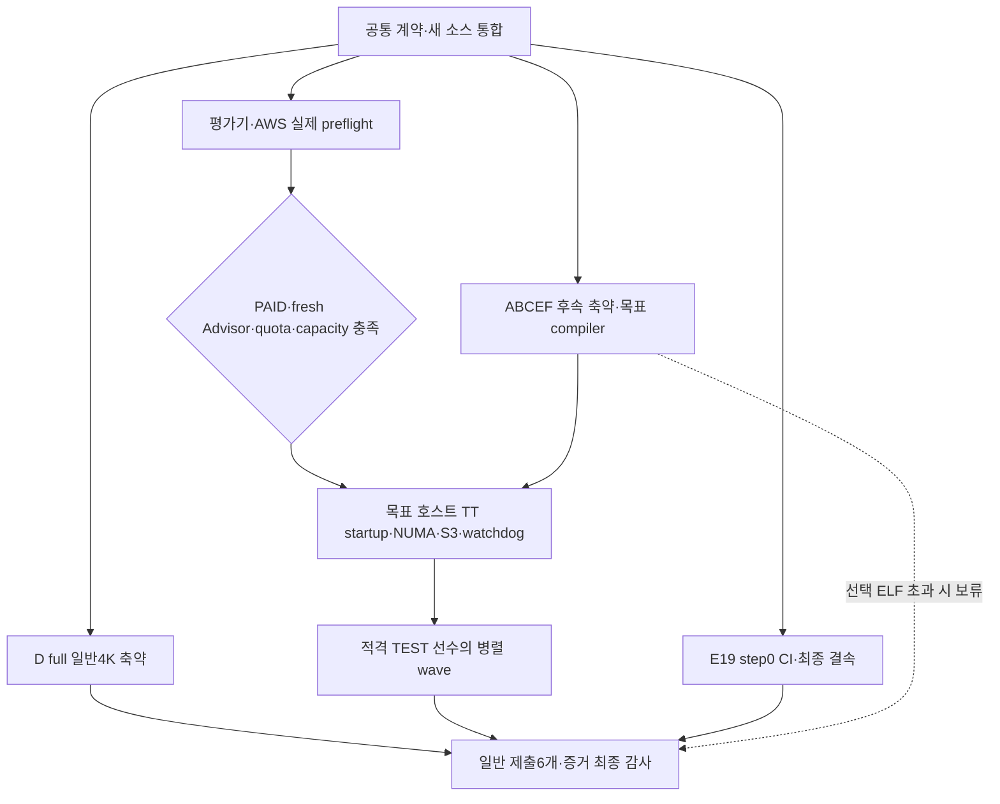

# Rove4k C A–F 구현·제출 실행 계획

2026-10-25 사용자 확정 계획을 구현하는 현재 기준이다. 기존 외부 핸드오프는
참고자료이며 현재 사용자 결정·AGENTS.md·엔지니어링 계약을 대체하지 않는다.
같은 feature/rove4k-engines-af와 Draft PR #12(develop 대상)를 재사용한다.
시작 head는 391fad6f162265317c016aa4b6e700f9575c69ee, tree는
70f8a28cdfe4f99067ed9173b39c308d0d1dec49다. Rust 폐기·미통합 실험의
로컬 변경을 보존하고 현재 구현과 구분한다.

## 1. 목표·완료 범위

| 구분 | 적용 기준 |
|---|---|
| 일반 4K | C A–F 여섯 계열 각각의 TCEC 제출 프로필을 full 기능으로 적격화한다. C/D/F도 일반 부문에 포함한다. |
| ELF | A–F 모두 검토하지만 4096B 초과 시 deferred_size로 보류한다. 일반 완료를 막지 않는다. |
| 형식 | source-JIT / packed-native / self-contained-ELF와 일반/ELF 부문 자격을 분리한다. 같은 ELF bytes는 양 부문 자격을 가질 수 있다. |
| 필수 기능 | 계열 고유 검색·평가·learner, N/B/R/Q 생성·replay, EP/castling·draw context·clock·live-state 재사용을 유지한다. |
| 언어 | 엔진 Rust 전체 폐기 유지. NVCompact Rust와 공유 개발 도구는 별도다. |
| 객체화 | C의 상태·수명과 개발 도구 책임을 캡슐화한다. 제출에 동적 다형성·불필요 필드·런타임 계열 선택기를 넣지 않는다. |
| 병렬 정책 | 현재 제출 정책을 우선한다. 추가 root/groups/PALS/hybrid 출품·기력 연구는 후속이다. |
| 테스트 | TEST-P4/P28은 제출과 별도다. 기능·계측은 크기 제한 없이 수행하되 점수 리그는 full 4KiB 적격 선수만 입장한다. |
| 필수 크기 gate | 잠정 TCEC 일반 제출 여섯 개가 필수다. TEST 12개의 크기 미달은 해당 리그 제외로 처리하며 제출 완료를 막지 않는다. |
| 학습 | 실제 corpus/model/trainer/export 준비 후 production optimizer step0·초기 weights SHA 불변에서 정지한다. |
| AWS | 승인한 m6a Spot 평가·보존·비용 종료를 구현한다. 실제 launch는 구현·연결·자원·비용 사전 gate 후 수행한다. |
| 예약 | Codex 예약·주기 작업 금지 유지. 비용 안전용 한시적 외부 종료 장치만 포함한다. |

일반 4K는 단일 파일 전체 4096B 이하, 시작 60초 이내, 자기 생성 임시파일
정리, 허용 의존성, 4K 최소 UCI가 기준이다. stop/ucinewgame은 미지원이어도
안전하게 소비한다. FEN·perft·stats·공개 Hash/Threads를 일반 리그에서 자동
의무화하지 않는다. book/ponder는 기본 비활성이다. ELF는 자체 포함과 외부
프로그램 금지·허용 동적 라이브러리를 별도로 확인한다.

- 규칙: https://wiki.chessdom.org/index.php?title=TCEC_4k_Rules&oldid=7853
- 공개 환경: https://wiki.chessdom.org/index.php?title=TCEC_Season_Further_information&oldid=8475

파일명·설정에 코드나 모델을 숨기지 않는다. startup/사용 가능 상태에서
임시파일을 확인하고 quit/EOF·물리 종료도 독립 관측한다.

## 2. 소스·객체·자원 계약

### 계열별 production authority

기존 계열별 production root를 재사용한다. 정본은 engine.c 하나가 아니라
그 계열 source·fragment·명시적 transform closure다. C SIMD와 E19/inline
ordering의 실제 소비 경로를 포함한다. 범용 engines/c는 reference/dev이며
실제 제출 core의 대체물이 아니다. generic의 TT16/32B를 compact의 TT24/16B로
오인하지 않는다. D는 실제 0x88 mailbox·PVS·atomic128 TT·no-libc runtime·
persistent worker pool을 유지한다.

계열마다 GameContext / SearchJob / WorkerState / TTState / RuntimeState에
대응하는 소유권을 식별한다. 같은 거대 struct·동일 레이아웃을 강요하지 않는다.
learner는 logical worker의 process 수명, game prefix는 search 중 불변,
recursive path는 private 수명이다. generation·deadline·취소·완료 publication·
OS handle과 메모리 재사용 barrier를 객체 경계에 연결한다.

도구의 EngineSpec / ResourceProfile / ArtifactPlan은 engine source, pure
tool dependency, test input을 분리한다. 다른 계열 helper의 재사용과 그 계열
검색·평가 source를 payload에 넣는 것을 구분한다. source allowlist·전처리 결과·
실제 packer 입력·복원 bytes를 연결한다. DEV/학습/계측/다른 계열 코드는
submission closure에서 제외한다.

### 프로필

| ID | 검색 worker | 엔진당 TT 상한 | 용도 |
|---|---:|---:|---|
| test-p4 | 4 | 128MiB | 기능·성능·적격 테스트 리그 |
| test-p28 | 28 | 512MiB | 고코어 비교·적격 테스트 리그 |
| tcec-provisional | 256 | 256GiB | 잠정 실제 제출 후보 |
| 진단 | 8/56 또는 96/192 | 별도 고정 | SMT·전체 인스턴스, 점수/제출 증거와 분리 |

target sizeof에서 상한 이하 최대 2의 거듭제곱 entry 수를 사용한다. 현재
compact ABCEF=24B이면 TEST TT22/24 및 제출 TT33=192GiB, D=16B이면
TEST TT23/25 및 제출 TT34=256GiB다. actual OS threads와 main 역할도 기록한다.

공개 최대 자원을 특정 4K 이벤트 배정으로 표시하지 않는다. Ubuntu22.04/
GCC11.4 호환을 잠정 기준으로 삼고 실제 cc·ISA·운영 자원이 달라지면 재생성한다.
event_target_confirmed는 아직 별도 확인 대상이다.

### 큰 TT·W256

할당뿐 아니라 shift/mask/index/count/loop/byte multiplication/metadata/
observer를 64bit로 감사한다. W256의 pending·완료 counter도 wrap하지 않아야 한다.
초기화 worker는 entry/page 공배수 경계로 나눈 비중첩 구간을 실제로 초기화하고
완료 barrier 후 UCI를 사용 가능하게 한다. 첫 GO로 초기화를 미루지 않는다.

D의 새 큰 프로필은 dynamic anonymous TT를 우선하며 기존 작은 static-TT
control은 보존한다. giant BSS의 relocation·주소 거리·geometry를 상수 확대로
숨기지 않는다. qualifier의 예산과 host admission은 프로필에서 계산한다.
로컬 약15GiB에서 큰 TT를 예약/touch하지 않는다.

NUMA 기본판은 외부 policy 상속이다. 평가기는 wrapper exec 전에 CPU/task
memory policy를 적용하고 requested/effective 및 최종 worker/page 배치를
관측한다. N1 pinning/N2 TT-only는 관측 후 선택 후보다. 실제 여러 node가
없으면 numa_multi_node_validated는 pending이다. TCEC 실제 운영 배치와
동일하다는 주장은 확인 전 하지 않는다.

## 3. 남은 작업·의존성

~~~mermaid
flowchart TD
    P["P 공통 준비: 규칙·profile·source/context·64bit/초기화 계약"]
    P --> G["G1 A/B/C/E/F 일반4K·개선 전파"]
    P --> D["G2 D 일반4K native/source-JIT·core/runtime"]
    P --> R["R 평가기·NUMA·Fastchess·AWS·원장·종료"]
    P --> M["M E19 corpus/model/trainer/export step0"]
    G --> S["S 계열별 제출 후보 또는 blocker 판정"]
    D --> S
    G --> Q["Q TEST 적격 선수집합 동결·부분 리그"]
    D -. "적격 시" .-> Q
    S --> C["C 가용 후보 대용량 preflight"]
    R --> C
    Q --> L["L 예산 내 TEST 리그"]
    R --> L
    C --> L
    S --> A["A 최종 감사·전달"]
    M --> A
    C --> A
    L --> A
    G -.-> E["선택 ELF A–F 비용 판정·채택/보류"]
    D -.-> E
    E -. "상태 기록, 필수 gate 아님" .-> A
~~~

S는 계열별 판정이며 모든 계열 통과를 뜻하지 않는다. D 미완료 중에도
적격 테스트 선수로 부분 리그를 동결할 수 있지만 D 일반 blocker는 유지한다.

### G1/G2

B4088 후보를 현재 producer와 연결해 재생성/JIT 후 판단한다. prefix/dense
history·query deferral·metadata·parser·상수/keyword·compiler/codec을 실제
whole과 shipping 성능으로 비교한다. C SIMD/scalar 비교를 실행하고 E는 현재
E19, F는 MTD horizon/수렴/witness를 유지한다. source 자체를 먼저 줄이며
NVCompact 성능만으로 목표를 대체하지 않는다. 통과 후에도 축약을 이어가되
동결한 리그 artifact를 경기 중 바꾸지 않는다.

D는 정본 kernel-executable native 압축, 같은 D C/S/linker source-JIT, core/
runtime 축약을 비교한다. zero232 restored image와 CHECKPOINT debug loader는
직접 실행할 정본 native가 아니다. packet 자체가4096B를 넘으므로 loader 교체만의
절감으로 완료를 예측하지 않는다. 다른 계열을 D로 재명명하지 않는다.

모든 개선은 A–F 적용성 표를 갖는다: 적용/변형적용/이미적용/부적합/
별도검색연구/미검토. 채택 전 여섯 계열을 검토하되 같은 patch를 강제하지 않는다.
input pin·의미·whole·성능·미채택 이유를 남기고 조합 이득은 실측한다.

### ELF

private pathname만 entry unlink를 수행하고 memfd/direct는 outer 제출물을
삭제하지 않는다. A–F 각각 첫 native/loader/whole 비용을 확인한다. 4096B 초과는
deferred_size로 보류하고 다음 재측정 조건을 남긴다. 들어오는 후보만 복원·
의존성·startup·소유권·검색 실행을 확인해 elf_qualified로 올린다. 선택 ELF가
필수 일반 분기의 CPU/memory queue를 늘리지 않게 한다.

### R

ice4v6.1 2bd7a54f9bb47a61a7cd97f3db9f52eadd4e2c19와 c4kev3.0
22e318f59b3a9eed1d2b8161da832222d4a51033을 고정한다. official tiny /
resource-tiny / native를 구분하며 리그에 native 대체를 넣지 않는다.
외부 엔진 source/binary는 저장소 밖에 둔다.

opening은 CC0 lichess-org/chess-openings a6189a30dc273ccb21fc2536a9a2fefd5592a67a
기반의 합법 standard-start PGN이다. seed20261025와 first8ply family를 고정하고
broad/high/update 묶음과 학습 holdout을 분리한다. FEN-only bank는 사용하지 않는다.

Fastchess ebfd64cb7fac80d4822c50b07dca4fe934779d21의 POSIX 절대 deadline과
양측 초기화 후 pre-clock READY/GO를 보강한다. fresh process/restart=on,
affinity=false, tc30:00+3/timemargin0, initialclock1803000ms를 고정한다.
pair의 양색은 별도 slot의 games1/rounds1/concurrency1/noswap child로 실행하고
engine순서만 뒤집는다. gate는180초이며 이전 wave cleanup 후 다음 초기화를 한다.

P4 전체1DRR 뒤 P28 적격 Rove 중 P4상위2와 적격 peer를 비교한다. 동점 선발은
head-to-head→Sonneborn-Berger→고정familyID로 한다. 마지막 기준은 운영용이다.
8인 기준 broad28/high6/선택update각2쌍, 계획최대38쌍이며 완주 보장이 아니다.
W/D/L·pair·후보군·실측 처리량/RSS를 보고하고 정밀 Elo/동등성/확정1–8위는
후속으로 둔다. TEST결과를 W256 제출 기력으로 승계하지 않는다.

AWS는 m6a48Spot 한 대, 누적12instanceh/최대128pairs/$120 전체($100EC2+$20reserve),
단가guard$8/h, 최신Advisor<5%·quota192vCPU·실제capacity·role/AMI를 확인한다.
npmOIDC를 AWS연결로 간주하지 않는다. controller 독립 한시적 종료와 exact
소유ID/불변원장을 검증한다. move/clock/attempt를 지속 저장하고 원격확인 후
완료 결과/pair를 한번 집계한다. 엔진패와 인프라중단을 분리하고 중단 child만
opening에서 새attempt로 재시도한다. 예산/시간은 초기화하지 않는다.
OnDemand/SKU자동전환·Codex예약은 없다. 로컬SHA보존+cloud30일, 실제종료 확인과
잔류자원 정리를 수행한다. instance를 켠 채 코딩을 기다리지 않는다.

m6a192logical<W256이므로 큰 제출 프로필 실행은 기능·대용량 초기화·coldstart
관측이며 TCEC256physical의 기력/scaling 증거가 아니다.

### M

E19단일입력→readable19→physical21(zero0/6)→inlineordering→shipping을 연결한다.
논리5..13만 학습대상, material0..4와 ordering14..18은 고정한다.
signed16과 나누기 전 signed32 bounds를 매 모델 계산하며 독립C oracle로 확인한다.

Lichess standard-rated2013-01/02 CC0 전체파일과 URL/license/bytesSHA를 동결한다.
양측등급1600이상,base+40inc>=180초,합법startpos완료경기만 사용한다. variant/setup/
동일계정/불법수순을 제외하고 optionalPGNmetadata 부재를 오류로 만들지 않는다.
seed20261025,최대50000games,16positions/game,ply24..160,gameweight1이다.
first8plyfamily80/10/10 split과 리그holdout제외,positiondedup test>val>train을 적용한다.

dev전용chess1.11.2,CPUfloat64,sigmoid(score/400)weightedMSE,L2initial1e-4,
SGDlr1e-3,batch256을 준비기본값으로 고정한다. 정수export는 nearest/ties-away-zero다.
floatrelaxation과C정수식은 구분한다. 실제data forward/loss/gradient 및 trainloop/
export를 연결하되 productionoptimizer0/step0/parameterSHA불변에서 정지한다.
toyupdate검사는 분리한다. 데이터 부족 시 필터를 자동 완화하지 않는다.

## 4. 검증·상태

규칙/source경계→의미→독립재생성/whole→startup/resource→실행/성능→TEST리그 순서다.
혼입거부는 컴파일 전에, 최종payload/복원bytes/전처리결과를 연결한다. 실제shipping의
NBRQ/특수수/draw/clock/고유검색/cancel/publication/reuse를 확인한다.
counter·범위·초기화barrier·실제worker·positiveCPU·memory·tmp/outer파일과 물리종료도
관측한다. noisytimeout·gateclock·반쪽pair·중복upload·controller소멸·예산종료·
소유cleanup은 실제소비경로에서 검사한다. test/dev모델의 좁은통과를 production의
출력동등성·적격·기력으로 확대하지 않는다.

| 상태 | 조건 |
|---|---|
| general_candidate_ready[A-F] | 잠정제출의 실제일반4K파일·규칙·실행통과 |
| event_target_confirmed | 해당4K이벤트자원/compiler/환경확인 |
| general_submission_ready | 여섯후보가 확인된이벤트조건과일치하고 필요한재검증통과 |
| elf_qualified/deferred_size | 계열별독립판정,일반완료비차단 |
| test_qualified | 해당TEST프로필의 full4KiB리그입장조건통과 |
| evaluation_ready/campaign_complete | 평가경로검증/동결대진완료를구분 |
| training_prepared | 실제data/model/trainer/export·productionstep0 |
| numa_multi_node_validated | 실제여러node관측,없으면pending |

CI/local/target/PR통합/공개배포를 분리한다. 未실행/실패/보류를 성공으로 채우지 않는다.
원시결과·생성물·실패근거는 저장소 밖에, source/test/workflow/소비자문서만 공유한다.

## 5. 병렬 배정·일정·현재 체크포인트

통합1명, ABCEF생산경로, D, 평가/AWS, E19, 독립감사를 병렬로 배정한다.
sharedprofile/recipe/doc는 통합소유, 계열별source는 해당담당소유다. compile/encoder는
physical-core·memory lease로 제한하고 채택timing은quietwindow에서 수행한다.

| 구간 | 첫 계획 범위 |
|---|---:|
| P 공통준비 | 8–14h |
| G1 ABCEF 계열별병렬 | 8–24h |
| G2 D일반 | 20–40h |
| R 평가/AWS | 18–30h |
| M E19 | 16–28h |
| Cloud 부팅/preflight/대국/재시도/종료 | 누적8–12instanceh상한내 |
| Q 실제공유자원대기reserve | 4–10h |
| A 최종감사 | 4–8h |
| 선택ELF 첫비용판정 | 계열별1–2h,필수경로비차단 |

    G = max(G1,G2)
    T = P + max(M, max(G,R)+Cloud) + Q + A
    lower = 8+max(16,max(20,18)+8)+4+4 = 44h
    upper = 14+max(28,max(40,30)+12)+10+8 = 84h

이는 첫통합·대용량검증·blocker판정window이며 전계열4KiB수렴 완료약속이 아니다.
부분TEST리그를 먼저동결하면 D로컬후속작업과겹칠수있다. 외부quota/capacity/운영자
대기는 별도변수다. D포장양쪽초과·큰프로필구조변경·B등margin상실 시 실제남은
DAG/최장경로를 다시 산정한다. 작업별시간을 단순합산하지 않는다.

2026-10-25 12:20 UTC 실행 체크포인트(시작 후 약2h14m):
- P 자원·closure·host gate, 실제 계열별 생산 경로와 축소 TT 초기화 검사를 구현했다.
- G1 다섯 잠정 제출 whole은 A3836/B4087/C3981/E3928/F3645B다.
  B는 명시적 tcec-final-lf 변환이며 TEST-P28은4095B로1B 여유다.
- G2 D는 full 기능을 유지한 prefix packed5425B로 일반4K 미달이다. P4의
  packed5429/JIT7812B는 실제 실행·규칙을 통과했으며, source-reduce6819B는 비용 후보다.
- R 로컬 여섯 계열 기능·규칙과 평가기145 tests, 실제 Fastchess 실패 fixture,
  두 외부 피어의4물리코어 P4 기능 검사가 통과했다. scored 입장·기력은 미확인이다.
- M 실제 데이터·model·trainer·export와 production step0 준비가 완료됐다.
  초기 정수 weight SHA와13개 소스 입력 일치는 재확인했다.
- AWS Rove4k 프로젝트·CLI/MCP 인증은 확인했다. FREE 요금제와 오래된 Advisor
  공개 객체 때문에 유료 m6a 실행 gate는 미충족이다. 자동 업그레이드·리전 변경은 없다.
- 기본cc는 GCC13이다. GCC11.4 SDK의 host-loader escape를 거부하고 별도v2를
  감사한 뒤 원래 여섯 잠정 프로필의 실제 compile/type/ELF 검사가 통과했다.
  후속phase·Ubuntu22 실제 실행·TCEC 운영자 자원 확인은 서로 다른 gate다.
  D의 GCC11 packed5461B는 GCC13의5425B와 구분한다.
- 로컬8logical은4physical/SMT2/15594MiB이며 대용량 TT를 실행하지 않았다.
  D의256-worker 검사는 TT12 계측 범위다. 상세 증거 범위는 ENGINE-IMPLEMENTATION.md에 있다.

다음 통합·실측 창의 남은 추정은 P0.5–2h, G1 4–10h, G2 12–36h,
R6–14h, M0.5–2h, 공유 자원 대기 Q1–4h, 최종 감사 A3–6h다.
Cloud는 기존 누적8–12instanceh 상한을 유지한다.

    G_remaining = max(G1_remaining,G2_remaining)
    T_remaining = P_remaining + max(M_remaining,max(G_remaining,R_remaining)+Cloud) + Q + A
    lower = 0.5+max(0.5,max(12,6)+8)+1+3 = 24.5h
    upper = 2+max(2,max(36,14)+12)+4+6 = 60h

약25–60h는 다음 검증 창의 추정이며 D4K 수렴 완료 약속이 아니다. 요금제,
최신 Advisor·quota·capacity·TCEC 운영자 응답 같은 외부 대기는 별도 미정 변수다.
부분 적격 TEST 리그는 D 후속 축약과 병렬화하고, 실제 공유 자원 wait를 다시 반영한다.

후속 AWS 사용자 결정과 실제 조회: PAID ACTIVE·잔여100USD를 확인했다. 적격
크레딧을 우선 적용하고 부족·미적용 금액의 자동 청구를 기존 차감 전 총120USD
한도 안에서 허용한다. EC2 생성20USD 등 다섯 활동의 조건부100USD는 모두
NOT_STARTED이므로 가용 예산에 더하지 않는다. 개별 grant의 Spot 적용·만료 조회는
관리형 SCP가 거부해 미확인이다. Standard Spot192vCPU 증액을 한 번 요청했고
CASE_OPENED 상태이며, 실제 적용192와 최신 Advisor<5%는 여전히 실행 gate다.
Standalone m6a의 실제 bootstrap·attestation·배치는 GitHub Ubuntu22 참조와
별도 구현·검증하며 GITHUB 환경을 주입해 CI 호스트로 위장하지 않는다.
