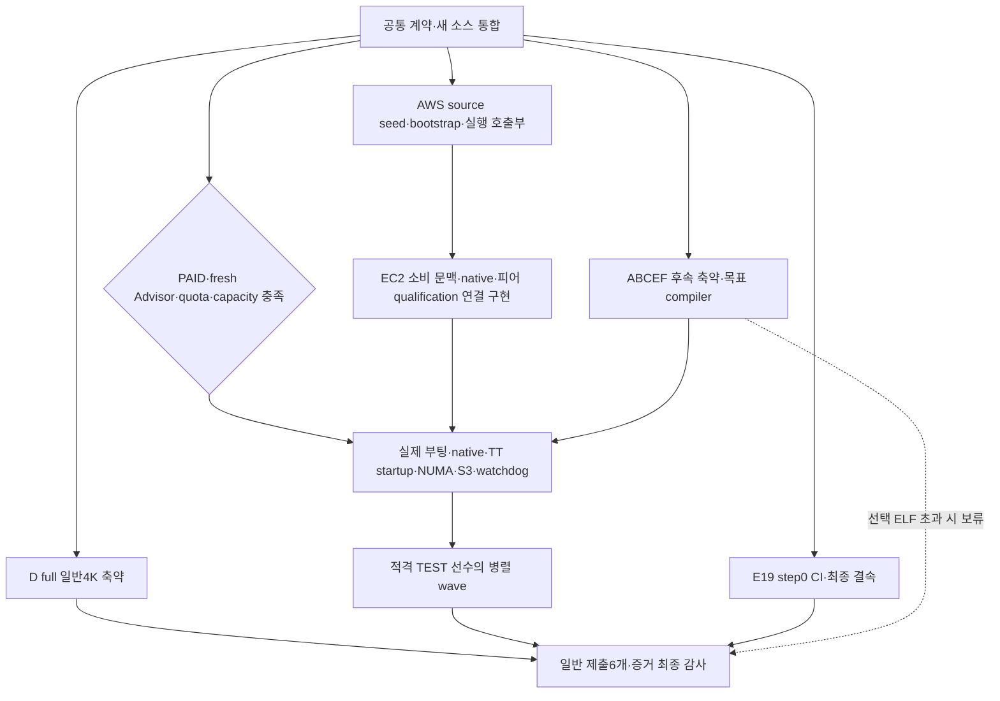
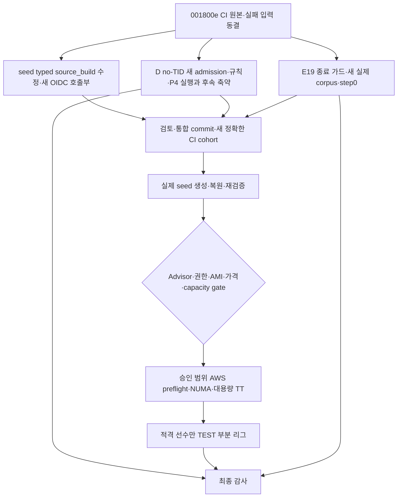
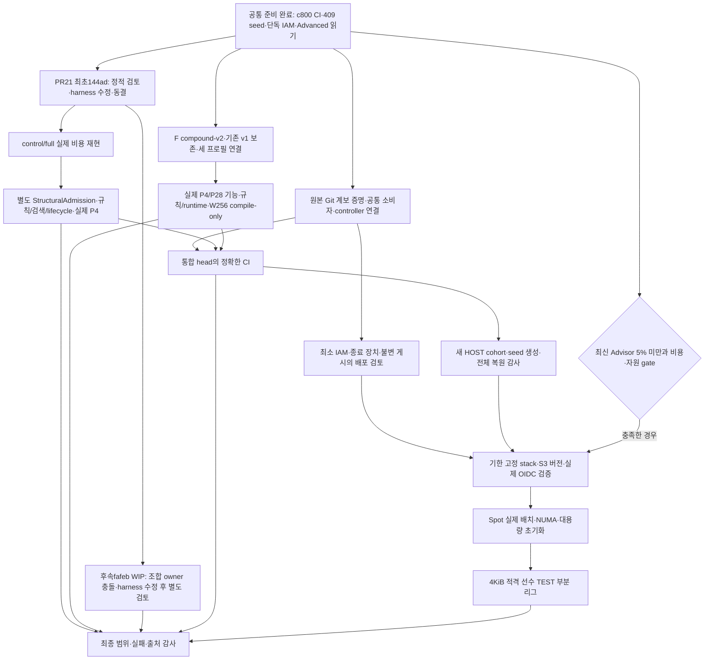

# Rove4k C A–F 구현·제출 실행 계획

2026-10-25 사용자 확정 계획을 구현하는 현재 기준이다. 기존 외부 핸드오프는
참고자료이며 현재 사용자 결정·AGENTS.md·엔지니어링 계약을 대체하지 않는다.
같은 feature/rove4k-engines-af와 Draft PR #12(develop 대상)를 재사용한다.
시작 head는 391fad6f162265317c016aa4b6e700f9575c69ee, tree는
70f8a28cdfe4f99067ed9173b39c308d0d1dec49다. Rust 폐기·미통합 실험의
로컬 변경을 보존하고 현재 구현과 구분한다.

## 1. 목표·완료 범위

| 구분 | 적용 기준 |
|---|---|
| 일반 4K | C A–F 여섯 계열 각각의 TCEC 제출 프로필을 full 기능으로 적격화한다. C/D/F도 일반 부문에 포함한다. |
| ELF | A–F 모두 검토하지만 4096B 초과 시 deferred_size로 보류한다. 일반 완료를 막지 않는다. |
| 형식 | source-JIT / packed-native / self-contained-ELF와 일반/ELF 부문 자격을 분리한다. 같은 ELF bytes는 양 부문 자격을 가질 수 있다. |
| 필수 기능 | 계열 고유 검색·평가·learner, N/B/R/Q 생성·replay, EP/castling·draw context·clock·live-state 재사용을 유지한다. |
| 언어 | 엔진 Rust 전체 폐기 유지. NVCompact Rust와 공유 개발 도구는 별도다. |
| 객체화 | C의 상태·수명과 개발 도구 책임을 캡슐화한다. 제출에 동적 다형성·불필요 필드·런타임 계열 선택기를 넣지 않는다. |
| 병렬 정책 | 현재 제출 정책을 우선한다. 추가 root/groups/PALS/hybrid 출품·기력 연구는 후속이다. |
| 테스트 | TEST-P4/P28은 제출과 별도다. 기능·계측은 크기 제한 없이 수행하되 점수 리그는 full 4KiB 적격 선수만 입장한다. |
| 필수 크기 gate | 잠정 TCEC 일반 제출 여섯 개가 필수다. TEST 12개의 크기 미달은 해당 리그 제외로 처리하며 제출 완료를 막지 않는다. |
| 학습 | 실제 corpus/model/trainer/export 준비 후 production optimizer step0·초기 weights SHA 불변에서 정지한다. |
| AWS | 승인한 m6a Spot 평가·보존·비용 종료를 구현한다. 실제 launch는 구현·연결·자원·비용 사전 gate 후 수행한다. |
| 예약 | Codex 예약·주기 작업 금지 유지. 비용 안전용 한시적 외부 종료 장치만 포함한다. |

일반 4K는 단일 파일 전체 4096B 이하, 시작 60초 이내, 자기 생성 임시파일
정리, 허용 의존성, 4K 최소 UCI가 기준이다. stop/ucinewgame은 미지원이어도
안전하게 소비한다. FEN·perft·stats·공개 Hash/Threads를 일반 리그에서 자동
의무화하지 않는다. book/ponder는 기본 비활성이다. ELF는 자체 포함과 외부
프로그램 금지·허용 동적 라이브러리를 별도로 확인한다.

- 규칙: https://wiki.chessdom.org/Rules#TCEC_4k_rules
  (2026-10-26 확인, Rules revision9524; 일반 리그의 UCI 요구와 구분한다.)
- 공개 환경: https://wiki.chessdom.org/index.php?title=TCEC_Season_Further_information&oldid=8475

파일명·설정에 코드나 모델을 숨기지 않는다. startup/사용 가능 상태에서
임시파일을 확인하고 quit/EOF·물리 종료도 독립 관측한다.

## 2. 소스·객체·자원 계약

### 계열별 production authority

기존 계열별 production root를 재사용한다. 정본은 engine.c 하나가 아니라
그 계열 source·fragment·명시적 transform closure다. C SIMD와 E19/inline
ordering의 실제 소비 경로를 포함한다. 범용 engines/c는 reference/dev이며
실제 제출 core의 대체물이 아니다. generic의 TT16/32B를 compact의 TT24/16B로
오인하지 않는다. D는 실제 0x88 mailbox·PVS·atomic128 TT·no-libc runtime·
persistent worker pool을 유지한다.

계열마다 GameContext / SearchJob / WorkerState / TTState / RuntimeState에
대응하는 소유권을 식별한다. 같은 거대 struct·동일 레이아웃을 강요하지 않는다.
learner는 logical worker의 process 수명, game prefix는 search 중 불변,
recursive path는 private 수명이다. generation·deadline·취소·완료 publication·
OS handle과 메모리 재사용 barrier를 객체 경계에 연결한다.

도구의 EngineSpec / ResourceProfile / ArtifactPlan은 engine source, pure
tool dependency, test input을 분리한다. 다른 계열 helper의 재사용과 그 계열
검색·평가 source를 payload에 넣는 것을 구분한다. source allowlist·전처리 결과·
실제 packer 입력·복원 bytes를 연결한다. DEV/학습/계측/다른 계열 코드는
submission closure에서 제외한다.

PR #18 통합에서는 계열 template과 `engines/common`의 선언된 C 조각을 engine
입력으로, `source_composition.py`를 tool 입력으로 각각 고정한다. 조립 결과는
기존 canonical C와 일치해야 하며 source factory·frozen snapshot·sealed transport·
AWS seed 모두 같은 역할 경계를 유지한다. retired 경로의 archive 이동은 현재
source authority나 실패 결과를 새 적격성으로 승격하지 않는다.

선택형 spelling과 기본 unused-includes를 함께 사용할 때 순서는 resource →
phase/B → E19(E만) → spelling → dependency cleanup이다. 역변환은 dependency를
먼저 복원한 뒤 spelling/E19/phase/B/resource를 복원한다. 기존 pre-cleanup 입력
핀을 최종 C에 맞춰 바꾸지 않으며 전체 파일 비용·실제 compiler stdin·expanded
입력·native·diagnostics를 새 체인에서 재검증한다. 공통화로 제거한 저장소 중복
바이트와 제출 파일 절감량은 따로 보고한다.

하위 생성기의 spelling·scan 기본값은 control로 유지한다. 유지 CI는 ACEF에 compound,
A/C에 추가 square-successor, B에 best, D에 control을 명시하며 generation 영수증의 선택과 dependency 정책이 요청과
정확히 같아야 다음 단계로 넘어간다. Ubuntu22 소비자는 봉인된 소스를 사용하며
선택을 다시 하거나 그 호스트에서 source factory를 재실행하지 않는다.

PR #18 통합 뒤 resource/phase/E19/spelling/dependency를 모두 재생성한 현재
full 후보와 후속 A/C 순회식의 전체 파일 비용은 다음과 같다. 각 셀을 두 번 재생성했으며, W256은
크기·타입·소스 계약 범위이고 실제 대용량 실행이나 대회 자원 확정은 아니다.

| 계열 | TEST-P4 | TEST-P28 | TCEC 잠정 W256 |
|---|---:|---:|---:|
| A compound+scan | 3781 B | 3790 B | 3782 B |
| B | 4071 B | 4081 B | 4072 B |
| C compound+scan | 3915 B | 3926 B | 3915 B |
| E | 3882 B | 3894 B | 3883 B |
| F full | 3590 B | 3602 B | 3590 B |

compound는 기존 spelling 자리의 대안이며 best 뒤에 다시 적용하지 않는다.
F의 실제 코드 변경은 별도 F-compound-clock-gcc13-v1 정책과 세 프로필의 새
asserted-source/native gate로 검증한다. 이전 native 기대값을 바꾸지 않는다.
다섯 P4의 실제 rules·초기화 장벽·source-JIT 종료 검사를 새 증거로 통과했고,
물리 배치와 기력은 여전히 별도 자격이다.

A/C의 이전 compound 기준은 각각3794/3804/3793 B와3927/3940/3928 B였다.
새 scan은 resource→phase→compound 뒤에만 적용하고 dependency cleanup은 마지막에
유지한다. 여섯 새 source/native 문맥을 별도로 승인하고 old native map은 바꾸지 않았다.
새 A/C P4/P28 네 실제 경로는 규칙·초기화 메커니즘·전체 source-JIT runtime을 통과했다.
각 경로24 GO/22 합법 응답, 합계96 GO/88 응답이며16개 그룹이 자연 종료했다.
이는 로컬 기능 자격이고 W256 실행·물리 배치·기력은 미검증이다. 새 선택을 사용하는
정확한 CI·독립 Ubuntu22 소비자와 새 cohort 운송도409062f에서 통과했다.

001800e의 engine CI40228534420은26개 작업을 모두 통과했다. P4/P28 각각
여섯 source factory와 여섯 독립 Ubuntu22/GCC11 소비자가 실제 실행을 끝냈고,
foundation은 source 계약372·E19 21·평가기283개, 합계676개 검사를 통과했다.
이는 해당 CI 프로필의 기능·규칙·worker CPU·자원 관측이며 실제 TCEC 배치나
점수 리그 적격성의 대체물이 아니다. D의 CI 입력은 별도 source-JIT control이다.

D의 새 공통 소스 P4 control은 5429 B다. process-owner 5373 B는 독립 규칙과
전체 P4 기능 검사를 통과했지만 크기·물리 배치·선택은 통과하지 않았다. 새로
재생성한 search 조합 5261 B도 별도 typed admission·새 CPP/native/package
재생성·독립 규칙과 전체 P4 기능 검사를 통과했다. 이 경로의 active quit/EOF
0–1개 마지막 출력은 로컬 최소 종료 계약이며 공식 이벤트 승인의 뜻이 아니다.
기존 owner의 마지막 출력 1개 계약과 과거 실패는 그대로 유지한다. 5261 B는
크기·물리 배치·기력·이벤트 자격·선택 모두 false이고, 4KiB까지 1165 B가 남는다.
native operand 필터 네 경우와 typed scalar-atomic 두 경우는 전체 비용 손해로
채택하지 않았다. 닫힌 TU의 미사용 선언·본문 1205 B 제거는 native를 GCC13과
감사된 GCC11 SDK에서 그대로 유지하며 source-JIT 7004→6689 B로 줄였다.
이는 아직 별도 미선택 source 경로이며 최저 native 포장 5261 B를 줄이지 않는다.
다른 계열에 적용할 수 있는지는 각 표현의 실제 소비·전체 비용으로 재측정한다.

후속 no-TID 비용 실험은 현재 즉시 thread-group 종료 경로에서 읽지 않는
kernel TID 인자만 제거해 whole5261→5245 B를 측정했다. logical worker ID와
clone thread/guarded stack/검색/학습기/TT128은 유지한다. 비복귀 callback 꼬리는
추가 whole 이득이 없어 제외한다. 5245 B의 새 typed admission·독립 규칙·실제
P4 실행도 새 증거로 통과했다. 이전5261 B native map이나 종료 계약을 변경해
통과시키지 않았다. 이 후보도4096 B보다1149 B 크므로 제출 적격은 아니다.
F의 기법을 D의 정확한 clock-token 계약으로 옮긴 두 경우는 native가 작아져도
whole5261→5273 B로 손해여서 미채택한다. source-JIT 두 경로도 각각21 B 커졌다.

같은 유효 칸 순회식을 D에 전이한 별도 비용 실험은 현재 no-TID의 여섯 원본을
재생성한 control과 비교했다. source7114→7101 B, compressed6972→6956 B,
packed5245→5233 B로 세 경로 모두 줄었다. native7104/linked7456 B의 길이는 같지만
바이트가 달라 새 Search→NoTid→Square typed admission을 구성했다. 새3인자
초기화 장벽, plain/UBSan 규칙105사례·2858합법 수와 실제128MiB P4 실행을
통과했다. 네 그룹은24 GO/22합법 응답, 지속5TID·네 worker positive CPU와
자연 종료를 확인했다. 전체53개 소유 명령과 독립499파일 감사도 통과했다.
5233 B는 로컬 full P4 기능 검증 후보이며 여전히4KiB보다1137 B 크다.
새 세 qualification helper의 순수16검사를 CI에 등록하며 새 head 실행 결과는
별도 확인한다. 이전5245 B 근거나 proper-alpha 계보를 새 결과로 바꾸지 않는다.
이 P4 차이를 W256 제출의 남은 차이로 표시하지 않는다.

후속 Move16은 promotion 표시·decode·정렬 jitter까지 보존하는 별도 비용 후보로
측정했다. source7101→7140 B, compressed6956→7000 B, packed5233→5377 B로
모두 손해였다. 실제 compiler output의 search frame은4376→3352 B로 줄고
page probe가 없어졌지만 native는7104→7232 B로 커졌다. 원본 control·반복·inverse와
15개 명령의 자연 종료를 검증하고 이 class를 종료했다. 엔진 실행·TT 할당·새
규칙/semantic bridge는 수행하지 않았다. qualified5233 B는 유지한다.

이후 사용자 결정으로 **D는 구조적 압축만 진행한다.** 작은 철자·타입·상수표·
지역 수식·ABI 포장만의 독립 비용 실험은 중단한다. 준비했던 rights-table도 실제
C/압축 실행 전에 중단했다. 다음 D 후보는 실제 코드 책임과 삭제·추가할 구조를
먼저 제시한다. 현재 native7104 B는 ELF/PHDR232 B + text6695 B + 정렬1 B +
rodata176 B다. text는 보드/평가2147 B, search2103 B, 그 밖의 혼합 실행 경로2445 B로
나뉜다. 마지막 묶음에는 검색/게임 책임도 포함되므로 전부 제거 가능한 runtime으로
계산하지 않는다. walker815 B는 attacked/gen이 이미 공유하고 Board176 B 복사는
약13 B의 코드다. BSS/TT 용량이나 worker padding 감소를 payload 절감으로 세지 않는다.
고정 bootstrap213 B 아래 payload5020→3883 B, 즉22.65%의 압축 payload 감소가 필요하다.
작은 ABI 변경을 구조 해법으로 재명명하지 않고 보드·검색 소비·runtime의 전체 책임
예산으로 후보를 고른다. 기능 제거로 목표를 통과시키지 않는다.

공개된 [PR #21](https://github.com/daejunnom/Rove4k/pull/21)의 최초144ad16은
full P4를5233→4937 B, 같은 native의 별도 codec으로4909 B라고 보고한다.
P28/W256의4921/4905 B는 작성자 비용 결과이며 실행 자격은 아니다. 부모에서의
qualified5233 B·함수 비용·소유권 기준은 새 기능 인수와 구분해 유지한다.
보드/검색과 runtime 변환의 정적 검토를 마쳤고, 비용 도구의 실제 Git 경로 판정·
cleanup 이후 완료 처리와 runtime 관찰기의 부분 Reader/신호 소유권을 수정했다.
새 helper 순수24검사와 실제 Python 자식을 쓰는 관찰기13사례는 통과했으며,
39개 실제 입력을 외부에 동결한144ad-safe-v1에서 control/full 비용은 재현됐다.
7104/6656 B native와4937/4909 B 후보 전체 파일이 작성자 핀과 일치하며,
두 번의 native 생성은 일치한다. 전체 패키지를 내부에서 두 번 생성했다는 주장은 아니다.
별도 동결된 관찰기 의존성을 보완해 실제 기능 검증을 진행한다.
새 native는 기존 Square 허용 목록에 넣지 않고 별도 StructuralAdmission과
실제 규칙·검색·lifecycle·P4 runtime으로 인수한다. 일반4K/ELF 목표는 아직 미달이다.

후속fafeb3d WIP는 검색/worker/보드·codec·ELF·다른 엔진 전이 도구를 추가한다.
기존144ad의 BEST와 기본 producer는 바꾸지 않는다. 보고된4865 B 등은 별도
수동 조합이며 아직 부모 실측이 아니다. 새 비용 도구에도 경로·완료·정리 문제가
있어 공통 owner 수정 전에는 실행하지 않는다. 최초 후보를 먼저 재현하고 후속
구조를 별도 감사한다. 예약/주기 작업은 만들지 않으며 AWS와 ABCE/F는 병렬로 계속한다.

### 프로필

| ID | 검색 worker | 엔진당 TT 상한 | 용도 |
|---|---:|---:|---|
| test-p4 | 4 | 128MiB | 기능·성능·적격 테스트 리그 |
| test-p28 | 28 | 512MiB | 고코어 비교·적격 테스트 리그 |
| tcec-provisional | 256 | 256GiB | 잠정 실제 제출 후보 |
| 진단 | 8/56 또는 96/192 | 별도 고정 | SMT·전체 인스턴스, 점수/제출 증거와 분리 |

target sizeof에서 상한 이하 최대 2의 거듭제곱 entry 수를 사용한다. 현재
compact ABCEF=24B이면 TEST TT22/24 및 제출 TT33=192GiB, D=16B이면
TEST TT23/25 및 제출 TT34=256GiB다. actual OS threads와 main 역할도 기록한다.

공개 최대 자원을 특정 4K 이벤트 배정으로 표시하지 않는다. Ubuntu22.04/
GCC11.4 호환을 잠정 기준으로 삼고 실제 cc·ISA·운영 자원이 달라지면 재생성한다.
event_target_confirmed는 아직 별도 확인 대상이다.

### 큰 TT·W256

할당뿐 아니라 shift/mask/index/count/loop/byte multiplication/metadata/
observer를 64bit로 감사한다. W256의 pending·완료 counter도 wrap하지 않아야 한다.
초기화 worker는 entry/page 공배수 경계로 나눈 비중첩 구간을 실제로 초기화하고
완료 barrier 후 UCI를 사용 가능하게 한다. 첫 GO로 초기화를 미루지 않는다.

D의 새 큰 프로필은 dynamic anonymous TT를 우선하며 기존 작은 static-TT
control은 보존한다. giant BSS의 relocation·주소 거리·geometry를 상수 확대로
숨기지 않는다. qualifier의 예산과 host admission은 프로필에서 계산한다.
로컬 약15GiB에서 큰 TT를 예약/touch하지 않는다.

NUMA 기본판은 외부 policy 상속이다. 평가기는 wrapper exec 전에 CPU/task
memory policy를 적용하고 requested/effective 및 최종 worker/page 배치를
관측한다. N1 pinning/N2 TT-only는 관측 후 선택 후보다. 실제 여러 node가
없으면 numa_multi_node_validated는 pending이다. TCEC 실제 운영 배치와
동일하다는 주장은 확인 전 하지 않는다.

## 3. 남은 작업·의존성

~~~mermaid
flowchart TD
    P["P 공통 준비: 규칙·profile·source/context·64bit/초기화 계약"]
    P --> G["G1 A/B/C/E/F 일반4K·개선 전파"]
    P --> D["G2 D 일반4K native/source-JIT·core/runtime"]
    P --> R["R 평가기·NUMA·Fastchess·AWS·원장·종료"]
    P --> M["M E19 corpus/model/trainer/export step0"]
    G --> S["S 계열별 제출 후보 또는 blocker 판정"]
    D --> S
    G --> Q["Q TEST 적격 선수집합 동결·부분 리그"]
    D -. "적격 시" .-> Q
    S --> C["C 가용 후보 대용량 preflight"]
    R --> C
    Q --> L["L 예산 내 TEST 리그"]
    R --> L
    C --> L
    S --> A["A 최종 감사·전달"]
    M --> A
    C --> A
    L --> A
    G -.-> E["선택 ELF A–F 비용 판정·채택/보류"]
    D -.-> E
    E -. "상태 기록, 필수 gate 아님" .-> A
~~~

S는 계열별 판정이며 모든 계열 통과를 뜻하지 않는다. D 미완료 중에도
적격 테스트 선수로 부분 리그를 동결할 수 있지만 D 일반 blocker는 유지한다.

### G1/G2

B4088 후보를 현재 producer와 연결해 재생성/JIT 후 판단한다. prefix/dense
history·query deferral·metadata·parser·상수/keyword·compiler/codec을 실제
whole과 shipping 성능으로 비교한다. C SIMD/scalar 비교를 실행하고 E는 현재
E19, F는 MTD horizon/수렴/witness를 유지한다. source 자체를 먼저 줄이며
NVCompact 성능만으로 목표를 대체하지 않는다. 통과 후에도 축약을 이어가되
동결한 리그 artifact를 경기 중 바꾸지 않는다.

D는 정본 kernel-executable native 압축, 같은 D C/S/linker source-JIT, core/
runtime 축약을 비교한다. zero232 restored image와 CHECKPOINT debug loader는
직접 실행할 정본 native가 아니다. packet 자체가4096B를 넘으므로 loader 교체만의
절감으로 완료를 예측하지 않는다. 다른 계열을 D로 재명명하지 않는다.

모든 개선은 A–F 적용성 표를 갖는다: 적용/변형적용/이미적용/부적합/
별도검색연구/미검토. 채택 전 여섯 계열을 검토하되 같은 patch를 강제하지 않는다.
input pin·의미·whole·성능·미채택 이유를 남기고 조합 이득은 실측한다.

### ELF

private pathname만 entry unlink를 수행하고 memfd/direct는 outer 제출물을
삭제하지 않는다. A–F 각각 첫 native/loader/whole 비용을 확인한다. 4096B 초과는
deferred_size로 보류하고 다음 재측정 조건을 남긴다. 들어오는 후보만 복원·
의존성·startup·소유권·검색 실행을 확인해 elf_qualified로 올린다. 선택 ELF가
필수 일반 분기의 CPU/memory queue를 늘리지 않게 한다.

### R

ice4v6.1 2bd7a54f9bb47a61a7cd97f3db9f52eadd4e2c19와 c4kev3.0
22e318f59b3a9eed1d2b8161da832222d4a51033을 고정한다. official tiny /
resource-tiny / native를 구분하며 리그에 native 대체를 넣지 않는다.
외부 엔진 source/binary는 저장소 밖에 둔다.

opening은 CC0 lichess-org/chess-openings a6189a30dc273ccb21fc2536a9a2fefd5592a67a
기반의 합법 standard-start PGN이다. seed20261025와 first8ply family를 고정하고
broad/high/update 묶음과 학습 holdout을 분리한다. FEN-only bank는 사용하지 않는다.

Fastchess ebfd64cb7fac80d4822c50b07dca4fe934779d21의 POSIX 절대 deadline과
양측 초기화 후 pre-clock READY/GO를 보강한다. fresh process/restart=on,
affinity=false, tc30:00+3/timemargin0, initialclock1803000ms를 고정한다.
pair의 양색은 별도 slot의 games1/rounds1/concurrency1/noswap child로 실행하고
engine순서만 뒤집는다. gate는180초이며 이전 wave cleanup 후 다음 초기화를 한다.

P4 전체1DRR 뒤 P28 적격 Rove 중 P4상위2와 적격 peer를 비교한다. 동점 선발은
head-to-head→Sonneborn-Berger→고정familyID로 한다. 마지막 기준은 운영용이다.
8인 기준 broad28/high6/선택update각2쌍, 계획최대38쌍이며 완주 보장이 아니다.
W/D/L·pair·후보군·실측 처리량/RSS를 보고하고 정밀 Elo/동등성/확정1–8위는
후속으로 둔다. TEST결과를 W256 제출 기력으로 승계하지 않는다.

AWS는 m6a48Spot 한 대, 누적12instanceh/최대128pairs/$120 전체($100EC2+$20reserve),
단가guard$8/h, 최신Advisor<5%·quota192vCPU·실제capacity·role/AMI를 확인한다.
npmOIDC를 AWS연결로 간주하지 않는다. controller 독립 한시적 종료와 exact
소유ID/불변원장을 검증한다. move/clock/attempt를 지속 저장하고 원격확인 후
완료 결과/pair를 한번 집계한다. 엔진패와 인프라중단을 분리하고 중단 child만
opening에서 새attempt로 재시도한다. 예산/시간은 초기화하지 않는다.
OnDemand/SKU자동전환·Codex예약은 없다. 로컬SHA보존+cloud30일, 실제종료 확인과
잔류자원 정리를 수행한다. instance를 켠 채 코딩을 기다리지 않는다.

m6a192logical<W256이므로 큰 제출 프로필 실행은 기능·대용량 초기화·coldstart
관측이며 TCEC256physical의 기력/scaling 증거가 아니다.

### M

E19단일입력→readable19→physical21(zero0/6)→inlineordering→shipping을 연결한다.
논리5..13만 학습대상, material0..4와 ordering14..18은 고정한다.
signed16과 나누기 전 signed32 bounds를 매 모델 계산하며 독립C oracle로 확인한다.

Lichess standard-rated2013-01/02 CC0 전체파일과 URL/license/bytesSHA를 동결한다.
양측등급1600이상,base+40inc>=180초,합법startpos완료경기만 사용한다. variant/setup/
동일계정/불법수순을 제외하고 optionalPGNmetadata 부재를 오류로 만들지 않는다.
seed20261025,최대50000games,16positions/game,ply24..160,gameweight1이다.
first8plyfamily80/10/10 split과 리그holdout제외,positiondedup test>val>train을 적용한다.

dev전용chess1.11.2,CPUfloat64,sigmoid(score/400)weightedMSE,L2initial1e-4,
SGDlr1e-3,batch256을 준비기본값으로 고정한다. 정수export는 nearest/ties-away-zero다.
floatrelaxation과C정수식은 구분한다. 실제data forward/loss/gradient 및 trainloop/
export를 연결하되 productionoptimizer0/step0/parameterSHA불변에서 정지한다.
toyupdate검사는 분리한다. 데이터 부족 시 필터를 자동 완화하지 않는다.

## 4. 검증·상태

규칙/source경계→의미→독립재생성/whole→startup/resource→실행/성능→TEST리그 순서다.
혼입거부는 컴파일 전에, 최종payload/복원bytes/전처리결과를 연결한다. 실제shipping의
NBRQ/특수수/draw/clock/고유검색/cancel/publication/reuse를 확인한다.
counter·범위·초기화barrier·실제worker·positiveCPU·memory·tmp/outer파일과 물리종료도
관측한다. noisytimeout·gateclock·반쪽pair·중복upload·controller소멸·예산종료·
소유cleanup은 실제소비경로에서 검사한다. test/dev모델의 좁은통과를 production의
출력동등성·적격·기력으로 확대하지 않는다.

| 상태 | 조건 |
|---|---|
| general_candidate_ready[A-F] | 잠정제출의 실제일반4K파일·규칙·실행통과 |
| event_target_confirmed | 해당4K이벤트자원/compiler/환경확인 |
| general_submission_ready | 여섯후보가 확인된이벤트조건과일치하고 필요한재검증통과 |
| elf_qualified/deferred_size | 계열별독립판정,일반완료비차단 |
| test_qualified | 해당TEST프로필의 full4KiB리그입장조건통과 |
| evaluation_ready/campaign_complete | 평가경로검증/동결대진완료를구분 |
| training_prepared | 실제data/model/trainer/export·productionstep0 |
| numa_multi_node_validated | 실제여러node관측,없으면pending |

CI/local/target/PR통합/공개배포를 분리한다. 未실행/실패/보류를 성공으로 채우지 않는다.
원시결과·생성물·실패근거는 저장소 밖에, source/test/workflow/소비자문서만 공유한다.

## 5. 병렬 배정·일정·현재 체크포인트

통합1명, ABCEF생산경로, D, 평가/AWS, E19, 독립감사를 병렬로 배정한다.
sharedprofile/recipe/doc는 통합소유, 계열별source는 해당담당소유다. compile/encoder는
physical-core·memory lease로 제한하고 채택timing은quietwindow에서 수행한다.

| 구간 | 첫 계획 범위 |
|---|---:|
| P 공통준비 | 8–14h |
| G1 ABCEF 계열별병렬 | 8–24h |
| G2 D일반 | 20–40h |
| R 평가/AWS | 18–30h |
| M E19 | 16–28h |
| Cloud 부팅/preflight/대국/재시도/종료 | 누적8–12instanceh상한내 |
| Q 실제공유자원대기reserve | 4–10h |
| A 최종감사 | 4–8h |
| 선택ELF 첫비용판정 | 계열별1–2h,필수경로비차단 |

    G = max(G1,G2)
    T = P + max(M, max(G,R)+Cloud) + Q + A
    lower = 8+max(16,max(20,18)+8)+4+4 = 44h
    upper = 14+max(28,max(40,30)+12)+10+8 = 84h

이는 첫통합·대용량검증·blocker판정window이며 전계열4KiB수렴 완료약속이 아니다.
부분TEST리그를 먼저동결하면 D로컬후속작업과겹칠수있다. 외부quota/capacity/운영자
대기는 별도변수다. D포장양쪽초과·큰프로필구조변경·B등margin상실 시 실제남은
DAG/최장경로를 다시 산정한다. 작업별시간을 단순합산하지 않는다.

2026-10-25 12:20 UTC 실행 체크포인트(시작 후 약2h14m):
- P 자원·closure·host gate, 실제 계열별 생산 경로와 축소 TT 초기화 검사를 구현했다.
- G1 다섯 잠정 제출 whole은 A3836/B4087/C3981/E3928/F3645B다.
  B는 명시적 tcec-final-lf 변환이며 TEST-P28은4095B로1B 여유다.
- G2 D는 full 기능을 유지한 prefix packed5425B로 일반4K 미달이다. P4의
  packed5429/JIT7812B는 실제 실행·규칙을 통과했으며, source-reduce6819B는 비용 후보다.
- R 로컬 여섯 계열 기능·규칙과 평가기145 tests, 실제 Fastchess 실패 fixture,
  두 외부 피어의4물리코어 P4 기능 검사가 통과했다. scored 입장·기력은 미확인이다.
- M 실제 데이터·model·trainer·export와 production step0 준비가 완료됐다.
  초기 정수 weight SHA와13개 소스 입력 일치는 재확인했다.
- AWS Rove4k 프로젝트·CLI/MCP 인증은 확인했다. FREE 요금제와 오래된 Advisor
  공개 객체 때문에 유료 m6a 실행 gate는 미충족이다. 자동 업그레이드·리전 변경은 없다.
- 기본cc는 GCC13이다. GCC11.4 SDK의 host-loader escape를 거부하고 별도v2를
  감사한 뒤 원래 여섯 잠정 프로필의 실제 compile/type/ELF 검사가 통과했다.
  후속phase·Ubuntu22 실제 실행·TCEC 운영자 자원 확인은 서로 다른 gate다.
  D의 GCC11 packed5461B는 GCC13의5425B와 구분한다.
- 로컬8logical은4physical/SMT2/15594MiB이며 대용량 TT를 실행하지 않았다.
  D의256-worker 검사는 TT12 계측 범위다. 상세 증거 범위는 ENGINE-IMPLEMENTATION.md에 있다.

다음 통합·실측 창의 남은 추정은 P0.5–2h, G1 4–10h, G2 12–36h,
R12–24h, M0.5–2h, 공유 자원 대기 Q1–4h, 최종 감사 A3–6h다.
Cloud는 기존 누적8–12instanceh 상한을 유지한다.

    G_remaining = max(G1_remaining,G2_remaining)
    T_remaining = P_remaining + max(M_remaining,max(G_remaining,R_remaining)+Cloud) + Q + A
    lower = 0.5+max(0.5,max(12,12)+8)+1+3 = 24.5h
    upper = 2+max(2,max(36,24)+12)+4+6 = 60h

약25–60h는 다음 검증 창의 추정이며 D4K 수렴 완료 약속이 아니다. 요금제,
최신 Advisor·quota·capacity·TCEC 운영자 응답 같은 외부 대기는 별도 미정 변수다.
부분 적격 TEST 리그는 D 후속 축약과 병렬화하고, 실제 공유 자원 wait를 다시 반영한다.

후속 AWS 사용자 결정과 실제 조회: PAID ACTIVE·잔여100USD를 확인했다. 적격
크레딧을 우선 적용하고 부족·미적용 금액의 자동 청구를 기존 차감 전 총120USD
한도 안에서 허용한다. EC2 생성20USD 등 다섯 활동의 조건부100USD는 모두
NOT_STARTED이므로 가용 예산에 더하지 않는다. 개별 grant의 Spot 적용·만료 조회는
관리형 SCP가 거부해 미확인이다. 한 번 요청한 Standard Spot192vCPU 증액은
2026-10-26 재조회에서 CASE_CLOSED·실제 적용192vCPU를 확인했다. 공식 Advisor
객체는 여전히 2026-03-20자로 오래됐고 Sydney/Linux/m6a.48xlarge는 15–20%
구간이므로 최신 Advisor<5% 실행 gate를 통과하지 못했다. 다른 SKU·리전·구매
방식으로 자동 변경하지 않으며 실제 사용량·가격·capacity는 실행 직전에 확인한다.
Standalone m6a의 실제 bootstrap·attestation·배치는 GitHub Ubuntu22 참조와
별도 구현·검증하며 GITHUB 환경을 주입해 CI 호스트로 위장하지 않는다.

새 OIDC 호출부는 dispatch 전용 aws-evaluation 환경과 direct web-identity 세션을
사용한다. 새 IaC의 ControllerRole MaxSessionDuration은21600초이며 trust·권한은
늘리지 않는다. hosted job은 최대6h이고 실제 캠페인 마감은 그보다 최소15분
앞으로 제한한다. 이는 누적12instanceh/$120 상한을 늘리거나 초기화하지 않는다.
자체 credential broker·static key·profile 파일은 추가하지 않는다. 표준 action의
비밀 출력 없이 실제 STS 만료가 관측되지 않으면 관측값을 만들지 않고, 성공한
직접21600초 요청과 실제 job/action 시작에 근거한 더 이른 안전 사용 시각을
명시한다. 기존 불변 plan/stack 마감을 고쳐 맞추거나 자동으로 연장하지 않는다.

e07e89d 후속 소스 감사에서는 AWS lifecycle 포트에 production caller가 없고,
UserData는 종료 시각만 예약하며, freeze_plan은 이미 적격인 registry를 소비하는
후단 bundle임을 확인했다. 따라서 현재 평가기 테스트·개별 포트 구현을 end-to-end
AWS 준비 완료로 해석하지 않는다. 별도 source seed와 EC2 소비자 결속, bootstrap,
실제 lifecycle journal 인계, 입력·proof·최종 보고서의 원격 보존, watchdog 코드·배포
동일성 연결을 구현한다. 기존 wave·ACK·pair·복구·종료 관측은 재사용한다.
R 추정을12–24h로 조정했으며 D 분기가 아직 최장 경로라 전체 창은 약25–60h다.

PR #18 이후 위 연결의 소스·서비스 포트 구현은 존재하지만, 실제 CI 원본으로
전체 seed를 준비·소비하는 최초 검증은 진행 중이다. PR API의 branch head와
실제 merge checkout, canonical manifest bytes, peer 출력 경로를 각각 검증하며
원본 메타데이터를 고쳐 맞추지 않는다. 현재 14-job CI의 봉인된 Rove source는
TEST-P4뿐이었다. 새 workflow는 P4의 기존 경로를 유지하면서 P28 source 6개와
Ubuntu22 target 6개를 분리해 총26개 작업으로 확장한다. P28은 실제 W28과
ABCEF384MiB/D512MiB를 사용하며, 전체 초기화·실제 main 장벽의 로컬 검사를
통과했다. source-JIT와 target의 전체 기능·positive CPU·원격 CI 성공은 새
26-job 작업001800e에서 확인했다. P4 영수증이나 자원 필드를 P28로 변환할 수 없다.

seed 전송 한도128MiB·개별32MiB·manifest4MiB·총항목20000은 유지한다.
확장 합계만 정확한 A–F×P4/P28의12개 Rove 조합에서256MiB를 허용하며 그 밖의
합법 cohort는128MiB다. peer P28은 이 권한을 만들지 않는다. producer·inspector·
materializer·revalidator·bootstrap은 manifest와 전체 크기를 payload 읽기 전에
대조한다. 실제 새26-job 원본으로 총량을 재측정한 뒤 seed를 준비해야 한다.

001800e 원본24개 artifact는25,236,455 B이며 서버 digest와 길이가 일치한다.
실제 입력 inventory는 manifest 포함 예정6177항목·확장230,224,011 B·manifest
1,952,721 B로 한도 이내다. 그러나 최초 seed.prepare는 directory+build.json pin인
target reference의 source_build를 일반 파일 pin으로 오인해 출력 생성 전에
실패했다. 실제 파일 참조1982개와 directory 참조60개를 구분하고, exact target
format·계열·프로필·CI 문맥·봉인된 build root/manifest를 확인하는 좁은 수정이
필요하다. 원본 영수증·경로·핀은 바꾸지 않는다. seed producer는 실제 Git 소스와
결속하므로 수정 뒤 새 commit/CI 원본 cohort에서 prepare→inspect→materialize→
revalidate를 다시 수행한다. 이전 cohort에 수정 helper를 끼워 넣지 않는다.

현재 COMPOUND E의 봉인된 main.c7815 B는 기존 checker 그대로 새 UBSan/C
추론 검사를 통과했다. 기존 실제 데이터의32 FEN과 합성 상태를 구분하며 optimizer
step0·초기 float/integer SHA는 유지한다. 별도로 실제 parser 재현에서 자동5회
반복·75수 종료 후 계속 두는 게임을 기존 intake가 수용함을 확인했다. 매 수 전에
is_game_over(claim_draw=False)를 검사하는 수정·경계 테스트·새 immutable corpus와
step0 준비를 수행한다. 청구 가능한3회 반복·50수를 자동 종료로 바꾸지 않는다.

다음 실행 순서는 공통 원본/소스 동결 후 병렬 분기와 실제 공유 자원 대기를 따른다.

CI 전 소스/국소 검증 창은 공통 준비 후 max(seed/호출부, D 검증, E19 재생성)와
공유 CPU/통합 대기 및 최종 감사를 더해 산정한다. 각 작업 시간을 합산하지 않는다.
다음 소스 통합과 seed 재시도만의 계획 범위는 공통 준비0.25–0.5h, 병렬 분기의
seed/OIDC 호출부2–6h·no-TID 검증1–3h·E19 가드/재생성0.25–1h, 새 CI0.25–0.75h,
seed 생성/복원0.25–1h, 공유 자원 대기0.5–1.5h, 감사0.5–1h다. 따라서 다음
검증 체크포인트는0.25+max(2,1,0.25)+0.25+0.25+0.5+0.5=3.75h에서
0.5+max(6,3,1)+0.75+1+1.5+1=10.75h, 약4–11h의 추정이다. 이는 D4K 달성·AWS
실행·리그 완주 시간을 포함하지 않으며 새 실패의 실제 대기는 다시 반영한다.
앞선 약25–60h는 전체 다음 검증 창의 범위이며, 남은 D4K 수렴이나 외부 Advisor·
대회 운영자 응답까지 완료된다는 약속이 아니다. 실제 AWS 실행은 최신<5% 조건이
충족될 때까지 대기하며 대기 시간을 내부 구현 시간에 숨기지 않는다.

28ae2fc 후속 상태: 새26-job CI·NVCompact·repository가 모두 통과했고 foundation은
386+27+288=701개 검사를 통과했다. 실제 seed는6177 ZIP항목·230,379,790 B 확장·
62,216,321 B wire로 prepare→inspect→새 materialize→전체 revalidate를 통과했다.
36개 원래 경로는 대응 계획을 검증했으며 GitHub 절대 경로로 실제 복원하지 않았다.
오프라인 운송 완료와 실제 S3 게시·EC2 source/native·배치·리그 승인은 구분한다.

현재0cd1324의 새26-job CI·NVCompact·repository도 모두 통과했다. 실제 foundation
job121303838777은449+27+354=830개 검사를35개 suite에서 통과했다. 새 AWS 호출부의
등록·로컬 검사와 실제 workflow dispatch·OIDC·배포 성공은 구분한다.
후속 비용 도구 체크포인트7d2db44도 세 workflow와 engine26개 작업이 모두 통과했다.
이는 아직 다음 A/C 생산 통합 소스의 CI 성공과 구분한다.

생산 통합2ea2015의 실제 engine CI40285532382는21개 생성 작업 중19통과·1실패·
1건너뜀으로 끝났다. A/P28의 callback fixture가 자연 return2로 종료해 P28 Ubuntu22
aggregate가 건너뛰어졌다. foundation857개와 NVCompact·repository의 성공으로 이를
대체하지 않으며 새 seed는 생성하지 않았다. 원래 실패 ZIP·중첩 영수증·소스는 보존했다.
로컬 제한 재현15회는 성공해 원래 할당/스레드 실패 지점은 미확정이다.

후속 공통 P28 진단 코드는 실패 때만 실제 alloc/create/join 반환값·errno·가능한
커널 제한/VM 정보를 보존한다. 정상 출력, 원본 제출 prefix, 28worker·384MiB TT,
AS2GiB·exit/join 계약은 바꾸지 않았다. 실패 주입4개는 원래 native return2를
유지한 채 검증했고, 새 물리 경로의 실제 A/P28 CIPlan 전체 단계는 로컬에서 통과했다.
이는 관측 누락의 수정이며 원래 CI 원인 확정이나 새 원격 CI 성공을 뜻하지 않는다.

E19 종료 가드 뒤 새 실제 말뭉치는48,189게임·740,062위치다. 이전 유지 게임124개가
제외됐고 새로 추가된 게임/위치는 없다. 새 step0 준비의 전체 integrity walk와 현재
COMPOUND E 추론 검사가 통과했고 초기 parameter/integer SHA 및 optimizer0을
유지한다. M의 이 준비 범위는 완료됐으며 학습된 기력이나 제출 승인은 아니다.

D no-TID5245 B는 새 typed admission·실제64KiB 초기화 메커니즘·독립 규칙·실제
128MiB P4 네 세션을 통과했다. proper-alpha의6467/6327 B source-JIT 두 경로도
파일 입력 compiler 메커니즘과 계측 없는 실제 P4 여덟 세션을 통과했다. source
wrapper의 live image는 linked7488 B이고 canonical stripped7136 B는 별도다.
기본/old native map을 바꾸지 않으며 두 경로 모두 크기·물리 배치·기력·이벤트·선택은
false다. 일반 제출 W256에 P4 결과를 승계하지 않는다.

추가 공통 축약은 실제 sparse-square 순회식을 A/B/C P4에서 각각 측정했다.
A3794→3781 B와 C3927→3915 B만 유지하고 B4071→4072 B는 중단한다. 새 native는
길이가 같아도 SHA가 달라 별도 정책을 요구한다. 새 pre-cleanup 여섯 프로필 실측은
A P4/P28/W256=3781/3790/3782 B, C=3915/3926/3915 B로 모두11–14 B 줄었으며,
전체 비용·타입·CPP·소스/역변환과 독립 증거 감사가 통과했다. 다음 분기는 공유
R/문법의 새 유한 정책 통합→새 P4 rules/메커니즘/runtime→새 선택 CI와 감사다.
비용 결과만으로 runtime·rules·선택을 승격하지 않았다. 후속 생산 통합은 별도 새
P4/P28 실제 규칙·초기화·runtime 증거로 통과했으며 새 선택 CI와 운송 검증이 남았다.
관련 compiler/target/sealed/seed 소비자의 공동 회귀331개도 통과했다. P28 소스는 실제 TEST cohort에서
읽을 수 있지만 W256은 seed에 없으므로 기존15-profile 고정 기록 또는 명시한
fresh canonical factory의 별도 compile-only 생성으로 핀을 확정한다. 런타임이 임의
입력 핀을 학습하게 하지 않는다. 기존 resource→phase→compound→scan→dependency
순서와 old compound/default control을 보존한다. resolver 조합은 아직 포함하지 않는다.

실제 AWS 호출부는 새 dispatch workflow·임시 direct OIDC·원본 Git blob/격리된
materializer·전체 journal·remote ownership 종료를 연결한다. 초기 private S3의
seed/request는 검증한 bootstrap principal의 조건부1회 게시와 실제 VersionId·전체
readback SHA로 준비할 수 있다. frozen seed.publish의 ControllerRole 검사를 완화하거나
초기 게시를 그 publisher의 통과로 표시하지 않는다. 첫 새 template 서비스 검증은
로컬 세션 만료로 실패했다. 사용자 로그인 갱신 뒤 CLIv2 STS로 프로젝트292341339363을
확인했고 새21600초 template의 실제 ValidateTemplate은 통과했다. 이전 실패를 보존하며
이는 문법·파라미터·capability 검사로 한정한다. 실제 기본 VPC·세 subnet·DNS/IGW/NACL,
Canonical Ubuntu22 AMI·192vCPU quota 한도·관측 시점 가격을 조회했지만 quota headroom,
SSM/HTTPS 연결·capacity·개별 credit 만료/Spot 적용·배포 권한은 입증하지 않았다.

새 차단 조건은 관리형 PAID의 SCP다. 실제 GitHub OIDC 제공자 조회가 명시적으로
거부됐으며, 공식 PAID 정책도 `iam:*Provider*`와 Spot 요청/Spot market 실행을 제한한다.
PAID·quota·가격 조회 성공으로 Spot 권한을 추정하지 않는다. 사용자에게 별도로 승인받은
Advanced 전환은 사용자가 team `daejunnom`으로 활성화를 완료했다. 이 전환은
되돌릴 수 없고 기존 AWS spend limit이 제거되므로 캠페인 로컬 상한과 구분한다.
화면 제어 초기화 실패로 현재 spend limit·다른 프로젝트 비용·관리 이메일을 읽거나
콘솔을 작성하지 못했다. 공식 절차·확인/미확인값·전환 영향은 외부 인계에 기록했다.
전환 후에도 실제 OIDC/정책·Outputs·버전 고정 게시·Advisor 등 gate를 다시 확인한다.

초기 GitHub 조회에서 기본 branch main의 AWS workflow는404였다. 이후 표준
release PR #19의 두 파일을 main4fc00d9에 병합해 수동 workflow 등록을 확인했고,
PR #20으로 같은 bytes를 develop901afce에 역통합했다. 두 PR의 exact-head
Node22/24 lifecycle CI가 통과했으며 AWS dispatch는 아직0회다.
이 등록의 runtime 최소 범위는 workflow와 stdlib controller
두 파일이며 실제 엔진 source는 별도 검증된 SHA checkout으로 분리한다. 전체66개
검사는 외부34파일 unit fixture를 사용하고, 이를 main 자동 CI나 production seed로
표시하지 않는다. main 직접 push·등록 우회·자동 AWS 실행은 하지 않는다.

- 관리형 정책: https://docs.aws.amazon.com/accounts/latest/reference/scps-and-rcps-for-projects.html
- Advanced 전환: https://docs.aws.amazon.com/accounts/latest/reference/activate-advanced-features.html
- 수동 workflow 등록: https://docs.github.com/en/actions/how-tos/manage-workflow-runs/manually-run-a-workflow

### 409 이후 남은 작업과 병렬 실행

아래는 앞선 추정과 구분한 현재 의존성이다. E19 step0와 D5233 B의 새 P4
기능 자격은 완료됐다. 409062f의 engine40293601820은26/26, NVCompact40293601777과
repository40293601785도 통과했다. exact foundation121474194541의 실제 결과는
478+27+354=859개/37suite이며 별도 native 실패 주입4개도 원래 return2를 유지했다.
앞선2ea2015의 실패 원인은 미확정으로 보존한다.

후속 a69928f도 engine40302670246의26개 작업, NVCompact40302670026,
repository40302670115를 모두 통과했다. 실제 foundation121504082563은
494+27+354=875개/38suite이며 새 순수16검사가 실행됐다. native 실패 주입4개의
return2·소유 종료0오류도 유지했다. 별도의 실제 D packed P4 실행을 CI로
재수행한 것은 아니다.

A/C 새 선택의12개 source와12개 독립 Ubuntu22 소비자를 포함한 같은409 cohort에서
새 seed도 prepare→inspect→새 Linux materialize→전체 재검증을 완료했다.
ZIP은6182항목·230,926,297 B 확장·62,475,059 B wire이며 SHA-256은
`665303cd807e87b01d16eaaf1bed311272969033ab70c7416561867f2283348f`다.
manifest1,954,243 B의 SHA는
`e3e2a8064c99666e465c3306b70259bf06b9970695adf21a6d500359ed9d66d2`다.
canonical merge bdc6fccc/tree5e933d23, ordered parents develop761bdc0/head409062f를
고정하며 source268파일/898assertion·원본24ZIP·36root 대응 계획을 확인했다.
후속 develop 이동으로 이 원본 권한을 바꾸지 않는다. S3 게시·EC2·배치·리그는 별도다.

사용자가 선택한 Advanced 전환과 이후 새 인증으로 실제 STS292341339363을
확인했다. GitHub OIDC 제공자(URL·sts.amazonaws.com audience·소유 태그)와
AWSServiceRoleForEC2Spot(service-only trust·공식 AWS managed policy)을 각각
생성하고 exact GET으로 대조했다. 앞선 만료 세션과 관리 계정814650855198 선택은
생성 전에 중단해 별도 보존했다. 두 IAM 객체 외 stack·S3·환경 변수·dispatch·
인스턴스 변경은 없다. inherited SCP 전체나 Spot launch 허가를 이 결과로 추정하지 않는다.

새 Free Tier 계획 API는 ResourceNotFound, 현재 프로젝트의 GetCredits는 빈
credits 배열이다. 기존100USD를 현재 잔액이나 크레딧 소멸로 단정하지 않는다.
현재 frozen caller가 PAID API만 받는 전제를 수정해, 직접 사용자 전환 기록과
검토된 project/org/management tuple에 결속한 명시적 Advanced readiness class를
구현한다. fresh own STS·account ACTIVE·조직 ID/관리 ID/ALL을 확인하며 누락·
오류·다른 계정은 차단한다. API 오류를 PAID 응답으로 바꾸거나 mode를 자동 선택하지 않는다.
기존 managed-PAID class와 직렬화/digest는 보존하고 새 HOST/최소 IAM read 권한·
실제 plan/template/launch 호출 경로를 함께 검증한다. 승인된 cash fallback과120USD는 유지한다.

이 새8파일의 로컬 공동 검증은 WSL Python3.12.3에서384개가 통과했고 실행 전후
소스 핀·자연 종료가 일치했다. 별도 native3.10 AWS38/publisher13/infrastructure33은
이 범위와 겹치므로 더해 세지 않는다. 독립 source review는 CLEAR다. plan 없이 쓰는
같은 observer의 실제 operator entry도 현재 프로젝트 STS·own ACTIVE·정확한 조직
읽기를 통과했다. paid_plan_observed=false/account_plan_type=null을 유지한다.
새 Advanced template29332 B의 실제 ValidateTemplate은8parameter/NamedIAM으로
통과했다. 파일 SHA ccd414f4c479409cc830c1a81797a658a5309b3d3bd64a65a513d46013544ccb,
마지막 LF를 제외한 canonical digest는 e083f2cad580549a2494f1bf6d4e187cc5ee703f7d2fae411a3dde3c9b006bdd다.
이8파일의 c80041d 원격 CI는 engine40315781677의26/26, NVCompact40315781669,
repository40315781454를 통과했다. 원본 foundation121547901502는
494+27+384=905개/38suite이며 별도 native 실패 주입4개는 return2/cleanup0오류다.
새 seed capture는 실제 merge188dbf5의 ordered parents901afce/c80041d와 원본
PR/run API의 reported base761bdc0가 다르다는 기존 equality 전제에서 중단됐다.
24ZIP 다운로드나 prepare 이전 실패이며 CI 실패가 아니다. 원본 API를 고치지 않고,
실제 Git commit/tree와 execution base→reported base 경로를 운반해 검증하는
execution-base-ancestor-v1을 한 stdlib worker로 생산·inspect·복원·재검증에 연결한다.
문서 역할과 member 핀을 명시하고 위조/다른 repo/ref/parent/tree는 출력 생성 전에
거부한다. 기존 v1과409 seed는 보존하며 새 source/CI/cohort가 필요하다.
실제 stack·ControllerRole OIDC·게시·launch는 미수행이다.

공통 축약 P4 실측은62outer와 중첩 소유 명령을 자연 종료했다. ABCE resolver는
각각3781→3785/4071→4075/3915→3919/3882→3885 B 손실로 종료했다. full F의
괄호 축약만3590→3587 B로 이득이었다. 후속 F-only 비용 비교는 P28 3602→3602 B,
W2563590→3589 B이며 native는 control과 같았다. W256 엔진/대용량 TT는 실행하지
않았다. 생산 통합과 실제 P4/P28 runtime 인수는 아직 남았다.
모든 후보 native는 control과 같았지만 전체 파일 비용은 같지 않았다. 앞선 도구
핀·정수 예산·CRLF 사전검사 준비 실패와 실제 후보 결과를 구분해 보존한다.

D qualification 도구만의 a699 통합은 기존 HOST/R·선택된 profile closure를 바꾸지
않았다. 하지만 다음 Advanced HOST 수정은 별도 source/CI/cohort/seed를 필요로 한다.
완성된409 seed를 덮어쓰거나 새 account readiness가 구현된 운송본으로 표시하지 않는다.
공통 workflow/docs는 한 writer가 통합하고 AWS 구현·full D/공통 축약은 병렬로 진행한다.

공개된 PR과 c800 결과를 기준으로 다음 소스/운송 체크포인트를 재산정한다.
공통 준비0.15–0.3h → max(D 최초 구조 인수·실제 검증1.5–4h,
F-v2 소비자·실제 P4/P28 검증1.5–3.5h, Git 계보 공통 구현·controller 검증1–3h)
→ 공유 CPU·compiler·통합 대기0–0.5h → 새 CI0.25–0.75h·새 seed0.25–0.75h
→ 최종 감사0.5–1h로 약2.65–7.3h다. 8논리 CPU는 순수 F0/1·관찰기2/3·AWS검사4/5·
D비용6/7처럼 임시 배정하고 실제 엔진 단계는 완료/반환 뒤 재배정한다.
이 로컬 배정은 물리 코어·scored placement 자격이 아니다. 분기 시간을 합산하지
않으며 D4K 수렴·후속 WIP 전체 포트폴리오·실제 리그 완주·외부 gate 대기는 이
체크포인트 추정에 포함하지 않는다. 새 실패가 나면 남은 경로와 공유 대기를 갱신한다.

2026-10-25T22:18:13Z의 공식 Advisor 조건부 조회는304였고 객체 Last-Modified는
여전히2026-03-20T23:38:55Z다. 새 데이터가 아니므로 과거15–20% 구간을 현재 위험도로
확정하지 않으며 최신5% 미만 gate는 미충족으로 유지한다. 같은 상태의 반복 조회나
승인 없는 SKU·리전·위험 기준 변경으로 이 대기를 해소하지 않는다.
