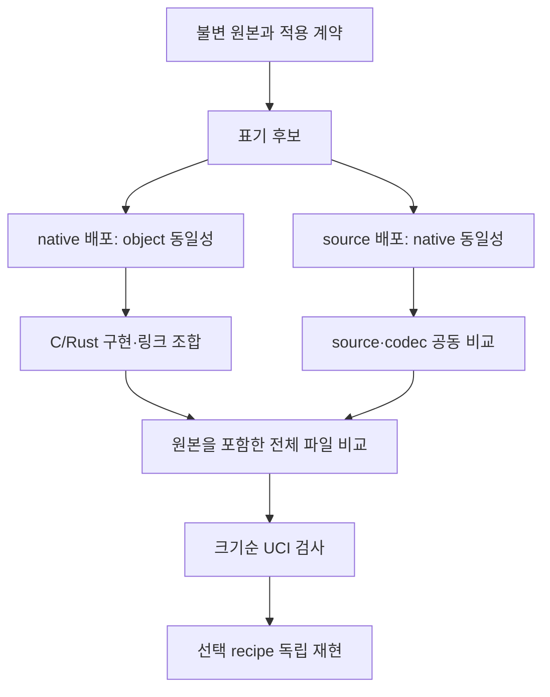

# NVCompact 0.2 — 실제 TCEC 4K 엔진 압축·표기 변환·UCI 검증

작성·확인일: 2026-10-19.

## 1. 결과와 비교 범위

**11개 비교 파일 모두 원본 이하 크기였고, 10개는 더 작아졌다. 합계 43,449→43,155B, 294B 감소다. 실제 완성 파일 5개가 최종 로컬 UCI와 독립 재현을 통과했다.** 모든 11개의 선택 recipe는 별도 프로세스에서 완성 파일 SHA를 재현했다. 총 214,796개 recipe를 생성·비교했으며 전역 최적성은 주장하지 않는다.

0.2에서는 **숫자와 토큰 표기의 자동 후보 생성, 링크 전 동일 object 확인, 기존 압축 엔진의 재패킹, 실제 최종 파일의 TCEC 4K 필수 UCI 검사, 별도 프로세스 recipe 재현**을 구현했다. 이전 C/Rust 구현 조합과 전용 linker script 경로는 유지했다.

비교 대상은 공식 PGN 17개와 발표 명단 2개에서 확인한 11개 구현의 확보 가능한 공개 대표 파일이다. we4k와 후계 STRO4K를 한 계보로 묶으면 10개 계열이다. 이 범위에는 과거 참가 엔진을 포함하며, 모든 역사적 버전이나 최신 대회 제출 파일 전체를 확보했다는 뜻은 아니다. [범위·버전·출처 조사](sandbox:/workspace/scratch/d70af21bae00/nvcompact-v02/research/ENGINE-ROSTER.md), [입력 manifest](sandbox:/workspace/scratch/d70af21bae00/nvcompact-v02/research/available-artifacts.json)가 정확한 기준이다.

### 실제 최종 비교

크기는 header·launcher·압축 데이터가 들어 있는 **제출 파일 전체의 바이트 수**다. `측정 최소`는 복원·표기 계약을 만족한 최소 파일이다. `채택`은 실제 UCI와 최종 재현까지 확인한 파일이다. 미채택 후보를 성공적인 대회 제출물로 취급하지 않는다.

| 엔진·실제 기준본 | 원본 B | 측정 최소 B | 절감 B | 채택 B | 최소 파일 UCI |
|---|---:|---:|---:|---:|---|
| ice4 · 공개 6.1 TCEC | 4,087 | **4,082** | 5 | — | 실행 차단 |
| 4ku · 공개 5.1 mini | 4,093 | **4,088** | 5 | 4,088 | 통과 |
| STRO4K · 공개 5.0 TCEC | 4,096 | **4,078** | 18 | — | 실행 차단 |
| 4k.c · 공개 9.0 mini | 3,932 | **3,932** | 0 | — | 시작 실패 |
| c4ke · 공개 3.0 TCEC | 4,093 | **4,092** | 1 | — | 실행 차단 |
| pygone · 2-11b142 보존 파일 | 4,093 | **4,020** | 73 | 4,020 | 통과 |
| sunfish · 2022-12-24 classic | 2,844 | **2,776** | 68 | 2,776 | 통과 |
| moonfish · 저자 공개본·버전 미표기 | 3,941 | **3,889** | 52 | 3,889 | 통과·원본 launcher 복구 |
| M4sseur · 1.0 upstream 재빌드 | 4,095 | **4,092** | 3 | — | 실행 차단 |
| molly · e317a0c7b8 upstream 재빌드 | 4,096 | **4,095** | 1 | — | 실행 차단 |
| we4k · 공개 기본 4T/32MiB 재빌드 | 4,079 | **4,011** | 68 | 4,011 | 통과 |

원자료는 [results.json](sandbox:/workspace/scratch/d70af21bae00/nvcompact-v02/evidence/full-campaign/results.json), [results.csv](sandbox:/workspace/scratch/d70af21bae00/nvcompact-v02/evidence/full-campaign/results.csv), 엔진별 `summary.json`, `candidates.json`, `uci-*.json`, `independent-replay/replay.json`에 있다. 같은 bytes를 만드는 여러 recipe가 후보 수에 포함되므로 이를 모두 서로 다른 프로그램 수로 해석하지 않는다.

M4sseur·molly·we4k는 변경 없는 공개 소스와 upstream 빌드 경로로 만든 **재빌드 기준본**이다. 그 결과를 독립적으로 입수한 TCEC 업로드와 byte 대조한 것은 아니다. 4ku 공개 mini는 1스레드·64MiB, we4k 공개 기본 프로필은 4스레드·32MiB다. 실제 TCEC의 큰 Hash·Threads 프로필과 구분한다.

### 최신 버전과의 차이

ice4는 공개 v6.1을 사용했으며 대회 6.1.1과 같다고 주장하지 않는다. STRO4K는 공개 일반 부문 v5.0 wrapper이며 최신 5.0.1·LESS_STRO4K·6.0 제출 bytes는 미확보다. 4k.c는 공개 v9.0 mini를 사용했고 최신 9.15.1은 확보하지 못했다. Moonfish의 저자 배포 파일에는 버전 표기가 없어 대회 4aa32a0c와의 일치는 미확인이다. we4k의 대회 104th-64G 파일도 공개 기본 프로필과 다르다. 공식 발표의 현재 버전과 실제 측정 입력을 분리했다. [공식 현재 현황](https://wiki.chessdom.org/Current_Engine_Status)

## 2. 숫자를 짧게 쓰는 것과 의미 보존

`100000`의 같은 수학적 값은 `1e5`이며, `1e6`은 `1000000`이다. 그러나 C/C++의 `100000`은 정수이고 `1e5`는 `double`이다. Python도 `int`와 `float`를 구분하며 Rust는 추론 종류가 바뀐다. 따라서 정수에서 지수 표기로 맹목적으로 바꾸지 않는다.

| 대상 | 생성·검토하는 표현 | 보존 조건 |
|---|---|---|
| C/C++ 정수 | 10·8·16진수, 지원 target의 2진수, separator·suffix 조합 | 값과 LP64의 실제 타입이 같음; long과 long long도 구분 |
| C/C++ float | 소수점·지수의 위치·불필요한 0, 가능한 hex float | 정확한 유리수·literal 타입 및 실제 compiler 결과 확인 |
| Rust 정수·float | 기수·밑줄·소수점·지수 | 명시 suffix 또는 원래 추론 종류 보존; macro token 보호 |
| Python literal | 정수 기수, 동일 float 값의 표기, 문자열·bytes quote/escape | 값·타입·float bits 및 전체 typed AST 일치 |
| 비숫자 표기 | C++ alternative operator, C/C++ digraph, 주석·공백 | 실제 token 경계와 source 비관측 계약 |

LP64에서 `2147483648`은 `long`이지만 `0x80000000`은 `unsigned int`다. 같은 32비트 패턴 또는 같은 수학적 값이라는 이유로 교환하면 안 된다. 반대로 이미 float인 `100000.0 → 1e5`, `0.8 → .8`, `596.0 → 596.`, `0.0004 → 4e-4`는 대상 언어와 주변 token 조건을 만족할 때 후보가 된다. 근거는 [C++ 정수 literal 규칙](https://eel.is/c++draft/lex.icon), [Rust tokens](https://doc.rust-lang.org/reference/tokens.html), [Python lexical analysis](https://docs.python.org/3/reference/lexical_analysis.html)이다.

default `opaque`는 원본만 반환한다. 표기를 관측하지 않는다는 `no-token-observation` 계약을 선언해야 변환한다. C/C++ preprocessing directive·가능한 macro 호출, Rust macro·attribute·doc comment, raw string, 확장 literal을 단순 텍스트로 치환하지 않는다. `__LINE__`, 문자열화·token paste, traceback 위치나 자기 소스를 읽는 동작이 계약에 포함되면 더 강한 근거가 필요하다.

포트폴리오는 `raw`, `shortest`, `hex`, `decimal`, `scientific`, `octal`, `binary`와 compact 조합으로 최대 13개 파일 recipe를 만든다. 개별 literal마다 가능한 모든 표기를 곱한 무한·전수 탐색은 아니다. 미지원 표현이나 불명확한 경계는 원문과 사유를 남긴다. 변수 binding을 해석해 이름을 압축하거나 임의 수식을 재배치하는 기능은 이번에 구현하지 않았다. [지원 범위와 API](sandbox:/workspace/scratch/d70af21bae00/nvcompact-v02/docs/NOTATION.md)

## 3. 언제 링크 전에 표기를 확정하는가

**native 파일을 배포할 때는 전체 object가 같은 표기끼리 링크 전에 정리한다.** 읽기 쉬운 원본을 먼저 build하고, 후보별 독립 source overlay에서 원래 compiler argv를 그대로 실행한다. 전체 object bytes가 같으면 더 짧은 source 표기를 기록하고 실제 링크에는 원래 동일 object를 재사용한다. object가 달라지는 후보는 이 보수적인 사전 확정 단계에서 제외하며 그 이유를 audit에 기록한다.

**source를 압축한 뒤 시작할 때 compile하는 엔진은 source 후보를 유지한다.** 같은 native 엔진을 만들더라도 source bytes가 LZMA dictionary와 반복 패턴을 바꾸므로 최종 제출 크기가 달라진다. 이 경로에서 token 하나의 최단 표기를 미리 고정하면 전체 압축의 최선을 놓칠 수 있다.



실제 C/Rust 혼합 예제는 **9개 링크 조합·18개 전체 파일**을 검사했다. 여섯 구현 모두 원본과 같은 object를 만드는 범위에서 source를 줄였고 합계 642B를 절약했다. size-only 프로필의 최종 파일은 **520B**, 다른 디렉터리의 fresh rebuild와 199,360개 유효 레코드의 full oracle를 통과했다. [실제 혼합 예제 결과](sandbox:/workspace/scratch/d70af21bae00/nvcompact-v02/evidence/mixed-notation-final/report.json)

이 예시는 작은 정수 kernel이며 체스 엔진이 아니다. 서로 다른 C/Rust 소스가 같은 의미인지 자동 번역·증명하는 도구라는 뜻도 아니다. 0.1의 별도 size-lto 탐색에서 얻은 504B와 이번 size-only 프로필 520B를 같은 후보 범위의 회귀로 비교하지 않는다.

## 4. 실제 제출 파일 압축 포트폴리오

`nvenvelope.py`는 검토된 manifest의 원본 SHA와 정확한 header를 확인하고 payload를 분리한다. 임의 shell 프로그램의 의미를 자동 추론하지 않는다. `tail -n` 또는 `tail -c`의 실제 경계와 독립적으로 고정한 payload SHA를 검증한다.

원본 전체 파일과 원본 압축 blob을 유지한 header 축약을 후보로 포함한다. 여기에 LZMA-alone, XZ, raw LZMA2, x86 BCJ+raw LZMA2, gzip, bzip2를 비교한다. 일반 4K의 native ELF에는 기존 memfd packer도 비교하되 ELF header 자체는 임의로 고치지 않는다. ELF-only에 외부 shell wrapper를 더하는 경로는 거부한다.

thorough 탐색은 허용되는 lc/lp/pb 조합, 두 preset, format/filter를 살피고, source별 두 유망 codec 계열에서 5개 match finder와 `nice_len=4..273`을 비교한다. 마지막 파일에서 실제 tail과 decoder를 실행해 의도한 payload가 나오는지 확인한다. 높은 preset 하나가 모든 짧은 입력의 최저 크기를 보장하지 않는다. [XZ 공식 문서](https://tukaani.org/xz/man/xz.1.html)

### 절감량의 분해

양수는 절감, 음수는 증가다. header와 packed payload의 경계는 실제 제출 구조를 기준으로 계산했다.

| 엔진 | header 절감 B | 압축 payload 절감 B | 총 절감 B | 선택 source |
|---|---:|---:|---:|---|
| ice4 | 1 | 4 | **5** | shortest |
| 4ku | 5 | 0 | **5** | raw |
| STRO4K | 2 | 16 | **18** | raw |
| 4k.c | 0 | 0 | **0** | raw |
| c4ke | 1 | 0 | **1** | raw |
| pygone | 0 | 73 | **73** | raw |
| sunfish | 2 | 66 | **68** | shortest-compact |
| moonfish | 5 | 47 | **52** | shortest-compact |
| M4sseur | 3 | 0 | **3** | raw |
| molly | 1 | 0 | **1** | raw |
| we4k | -17 | 85 | **68** | raw |
| 합계 | 3 | 291 | **294** | |

**ice4**는 source 8,750→8,741B의 숫자 표기 여섯 곳을 바꿨다. `0xFFF→4095`, `0.8→.8`, `0.32→.32`, `596.0→596.`, `0.0004→4e-4`, `0.000055→55e-6`이다. 원본과 선택 source로 만든 112,736B native 파일 전체가 동일했다. header에서 1B, source·codec 조합에서 4B를 줄여 4,082B가 됐다. 더 긴 decimal source 8,766B도 같은 최종 4,082B를 만들어 source 길이와 압축 길이가 단조 관계가 아님을 확인했다.

**Sunfish**는 source 5,837→5,825B, 최종 2,844→2,776B다. 원본 XZ보다 LZMA-alone이 유리했고, Python의 `.8` 표기와 공백 후보도 기여했다. source를 그대로 둔 최선 파일 2,782B와 비교하면 표기·공백 포트폴리오가 6B를 더 줄였다. 이것은 source마다 codec을 함께 고른 차이이며, 모든 이득을 문자 하나의 독립 인과 효과로 돌리지 않는다.

**pygone**은 선택 source가 `raw`이며 4,093→4,020B다. 최선 raw source 파일은 4,020B다. 원래 압축 스트림을 재구성하는 codec 선택과 실제 전체 크기를 기준으로 판단했다. 공백 처리 개선은 이미 minify된 source를 13,613B로 다시 늘리던 후보 생성 문제를 제거했다.

**Moonfish**는 source 10,608→10,591B와 더 나은 codec을 결합했다. 원본 source만 재압축한 최선 3,898B에서 표기·공백 포트폴리오가 9B를 더 줄였다. header 변화에는 고장 난 원래 decoder의 호환성 복구도 포함하므로 전체 배포 동작의 무손실 보존으로 표현하지 않는다.

**we4k**는 XZ에서 x86 BCJ+raw LZMA2로 옮기면서 decoder header가 17B 길어졌다. 압축 stream은 85B 줄어 순 68B를 절약했다. payload만 최단으로 고르거나 header만 짧게 고르면 이런 결과를 놓칠 수 있다. **STRO4K**는 같은 ELF payload의 codec 설정을 바꿔 stream 16B와 header 2B를 줄였다.

**4ku·M4sseur·c4ke·molly**는 원래 압축 stream이 그대로 최선이었다. 각각 5·3·1·1B는 header에서 줄었다. 4ku는 20B 더 짧은 source가 있어도 최종 파일은 6B 더 컸고, M4sseur 역시 26B 짧은 source가 9B 더 큰 제출물을 만들었다. molly의 변경 source들은 전체 native SHA가 달라 이번 동일성 게이트에서 제외됐다. 이를 의미가 틀린 코드라고 단정하지 않고, 이번 근거로 채택하지 못한 후보로 남겼다.

4k.c는 이미 자체 해제 ELF이며 header에 실행 코드도 들어 있다. 이번에 비교한 외부 포장 후보가 원본보다 작지 않아 원본 3932B를 선택했다. 확인한 범위에서 무리한 변환을 적용하지 않는 것이 목표의 “최소 동등 크기”에 해당한다. 이것이 더 작은 자체 압축기가 불가능하다는 증명은 아니다.

## 5. 실제 UCI 검사와 채택 의미

TCEC 4K 규칙의 필수 부분집합은 `uci/uciok`, `isready/readyok`, `position startpos`와 moves, `go` 또는 clock을 포함한 go, `bestmove`, `quit`다. `stop`·`ucinewgame` 같은 명령은 지원하지 않아도 견뎌야 한다. `id`, FEN, fixed depth/nodes, infinite, 탐색 중 비동기 제어를 기본 4K 필수 항목과 섞지 않는다. 추가 기능은 `--extensions` 또는 일반 `--profile uci`에서 별도로 검사한다. [공식 규칙](https://wiki.chessdom.org/TCEC_4k_Rules), [UCI 원문](https://backscattering.de/chess/uci/)

검사기는 소스나 해제된 중간 ELF만 검사하지 않고 **실제 최종 제출 파일을 실행**한다. 최초 컴파일·해제부터 준비까지 최대 60초, 합법적인 startpos 수열 여섯 개, bestmove·ponder의 합법성, 중복 응답, quit, 지연 cleanup helper와 임시 파일 정리를 관측한다. 여섯 수열에는 흰색·흑색, 캐슬링, 앙파상, 중반, 양측 승격이 들어 있다.

합법수 oracle는 `chess==1.11.2`이며 개발 검사기에서만 사용한다. 엔진 payload나 제출 크기에 외부 rules library를 숨겨 넣지 않는다. 시간·SMP 실행의 bestmove 문자열을 원본과 무조건 일치시키지 않는다. 고정 depth/nodes에서도 호출자가 결정성을 확인한 계약이 있을 때만 exact 비교를 요청한다.

측정 최소 파일이 실패하면 크기순으로 다음 고유 후보를 검사한다. 실제 실행 한도에 도달해도 이미 확인한 정상 원본을 fallback으로 보존한다. 원본도 실패하면 그 실패를 통과로 상속하지 않는다. 마지막 재생성 파일의 검사에서 실패하면 `accepted`로 공개하지 않는다. 이번 캠페인의 후보별 UCI 검사 상한은 4개다. 이는 크기 탐색 전체를 매번 실행 검증했다는 뜻이 아니다.

### 로컬 시간 제어와 pygone

최초 캠페인은 도구 기본값인 **남은 시간 2초·증분 0**을 사용했다. pygone 원본은 `remaining_seconds // 50 + 3`을 탐색 시간으로 잡는다. 따라서 남은 시간보다 긴 약 3초 탐색을 하여 첫 probe에서 원본과 압축본 모두 timeout이 났다. 해당 결과는 [short-clock-campaign](sandbox:/workspace/scratch/d70af21bae00/nvcompact-v02/evidence/short-clock-campaign/results.json)에 보존했다.

이 결과를 실제 TCEC의 30분+3초 대국에서 UCI를 지원하지 않는다는 결론으로 확대하지 않았다. 별도 진단 후 최종 전체 캠페인에는 **모든 엔진에 같은 15초 남은 시간·증분 0 프로필**을 적용했다. 응답 한도는 16초로 clock과 로컬 grace 1초를 반영한다. `profiles/protocol-15s.json`을 함께 제공한다. 이는 프로토콜 관측을 위한 짧은 샘플이며 대회 시간의 장기 대국을 수행한 것은 아니다.

최종 pygone 원본과 4,020B 선택 파일은 이 공통 프로필의 여섯 수열과 quit를 모두 통과했다. 앞선 15초 clock/5초 별도 cap의 일부 timeout도 진단 기록에 보존했다. 5초 cap의 일시적 초과를 원본의 영구 hang이나 실제 15초 clock 소진으로 단정하지 않는다. [시간 제어 진단](sandbox:/workspace/scratch/d70af21bae00/nvcompact-v02/evidence/pygone-clock-diagnostic/clock-aligned-summary.json)

### 실행 환경 때문에 남은 검증

이번 환경은 Linux x86-64, glibc 2.39, CPython 3.12.14, GCC 13.3.0, ld 2.42, XZ 5.4.5, Rust 1.99.1이다. cgroup은 8GiB RAM과 약 8 CPU의 실행량을 허용한다. PyPy3는 pygone을 위해 별도 설치했으며 개발 도구의 CPython과 구분했다.

| 엔진 | 확인한 관측과 남은 범위 |
|---|---|
| ice4 | 정확한 payload가 256GiB calloc을 요청하고 실패를 확인하지 않는다. 같은 할당 probe는 NULL/ENOMEM, 실제 원본·초기 후보는 첫 탐색에서 SIGSEGV. 자원 상수를 변경하지 않았다. |
| c4ke | 같은 크기의 256GiB 할당과 256 worker를 요구하므로 현 환경에서 사전 차단. 실제 검색 crash를 별도로 관측한 것처럼 서술하지 않는다. |
| M4sseur | 64GiB TT를 시작 시 초기화하고 103스레드 사용. 8GiB 환경에서 원래 조건의 UCI를 실행하지 않았다. |
| molly | UCI 전에 96GiB TT 할당, 101스레드. compile은 확인했으나 원래 실행 조건은 차단. |
| STRO4K | 원본·초기 후보 모두 시작 SIGSEGV. 약 266GiB는 ELF의 가상 LOAD 크기이며 물리 사용량과 같지 않다. 구체적인 crash 원인은 미확정. |
| 4k.c | 원본과 byte-identical 최소 파일 모두 첫 UCI 교환 전 SIGSEGV. 로더의 22GiB 예약과 특수 ELF header를 확인했지만 인과 원인은 미확정. |

큰 TT나 스레드 상수를 줄인 별도 엔진을 만들어 통과로 기록하지 않았다. 적합한 서버에서는 실제 동일 입력과 recipe를 다시 사용해 이 차단을 재평가할 수 있다. UCI 도구는 광고된 Threads·Hash 옵션이 있을 때만 설정값을 보내고 보낸 값을 기록한다. 많은 코어에서의 속도·기력·TT race 검증은 이번 로컬 protocol 검사와 별도다.

### Moonfish의 호환성 복구

원본의 `unxz -Fraw`는 현재 XZ 5.4.5에서 stdout 지정이 없어 실패했다. compiler에는 비어 있는 입력이 전달되어 main 링크 오류가 나고 원본 wrapper도 시작하지 못했다. 새 후보는 독립 SHA로 고정한 원본 payload를 복원하고 동작하는 decoder를 쓴다.

최종 3,889B 파일은 UCI와 독립 replay를 통과했다. 선택 source와 원본 source를 제출 recipe로 compile한 **30,128B native 파일 전체가 동일**했다.

따라서 결과의 의미는 **같은 native 엔진을 생성하는 표기·압축 개선과 현재 환경에서의 launcher 호환성 복구**다. 실패하는 원본 전체 파일의 관측 가능한 동작까지 그대로 유지했다고 주장하지 않는다. `original_deployment_equivalent: false`를 숨기지 않는다.

## 6. 검토에서 수정한 근본 로직

첫 결과를 만들고 크기·의미·실제 실행·재현을 다시 비교하며 다음을 수정했다.

| 확인한 문제 | 적용한 일반 수정 |
|---|---|
| raw decoder의 stdout 옵션 누락 | canonical raw 명령에 `-c`와 filter를 포함하고 실제 외부 decoder로 최종 파일 검증 |
| header 축약으로 tail offset 변화 | line/byte header 후보를 만들고 1-based byte offset의 길이 고정점 및 실제 tail 결과 검사 |
| 원래 압축 설정보다 새 설정이 큼 | 원본 전체 파일과 원래 압축 blob을 필수 비교 후보로 유지 |
| 최소 파일의 UCI 실패 | 크기순 고유 후보 검사와 검증된 원본 fallback, 실패 원본은 통과로 승격하지 않음 |
| 선택 파일 재현 실패 위험 | 별도 Python 프로세스에서 source·codec·header를 다시 만들고 SHA 확인; 기대 hash 자동 수정 없음 |
| Rust `extern "C" fn` 공백 제거 | 문자열 suffix·예약 prefix와 식별자 경계를 lexer에 반영; compiler gate가 발견한 일반 경계 문제 수정 |
| 이미 minify된 Python에 공백 재삽입 | 원래 source 위치를 이용해 검증된 주석·수평 공백만 삭제; shebang·encoding·BOM·들여쓰기·줄 연결·LF/CRLF와 전체 token/AST 확인 |
| PyPy 설치의 python3 alias 혼입 | 엔진용 pypy3 경로와 CPython builder를 분리하고 원래 엔진 코드는 유지 |
| 독립 replay의 다른 작업 디렉터리에서 상대 oracle 경로가 깨짐 | coordinator 진입 시 실제 경로로 정규화; 상대 경로를 사용하는 실제 Sunfish CLI·독립 UCI replay로 확인 |
| 측정 최소와 채택 후보가 다르거나 외부 replay가 실패 | 서로 다른 두 선택을 각각 재현하고 채택 파일에 UCI 적용; 실패한 실행의 accepted는 격리하고 coordinator 상태 기록 |
| 엔진이 죽었지만 cleanup helper가 pipe 보유 | leader 종료와 EOF를 별도로 관측, 유한 cleanup grace와 강제 종료 후 잔여물의 불명확성을 구분 |

수정 후 공통 기능 테스트 **52개**가 통과했고, coordinator의 다른 채택 후보·외부 재현 실패·격리 동작을 위한 추가 테스트 **3개**도 통과했다. 두 집합은 중복 없는 총 **55개**다. [52개 테스트 로그](sandbox:/workspace/scratch/d70af21bae00/nvcompact-v02/evidence/tests/final-tests.txt), [coordinator 3개 로그](sandbox:/workspace/scratch/d70af21bae00/nvcompact-v02/evidence/tests/coordinator-tests.txt)가 있다. 실제 상대 oracle 경로를 사용하는 Sunfish CLI도 UCI 및 자식 프로세스 재현을 통과했다. [실제 CLI 근거](sandbox:/workspace/scratch/d70af21bae00/nvcompact-v02/evidence/relative-oracle-cli/INVOCATION.json)

전체 엔진 캠페인 시작 뒤 coordinator의 경로 정규화·다른 accepted 재현·실패 격리 처리를 추가 개선했다. 실행 중이던 캠페인은 절대 oracle 경로를 사용했고, 실제 accepted가 모두 smallest와 같으며 독립 UCI replay가 통과했다. 그 실행에 나중 코드가 소급 적용됐다고 기록하지 않았다. 시작 시 coordinator 사본과 [실행 설정](sandbox:/workspace/scratch/d70af21bae00/nvcompact-v02/evidence/full-campaign/CAMPAIGN-CONFIG.json)을 보존했으며, 추가 분기는 별도 focused tests의 근거를 따른다.

원인이 확인되지 않은 실패는 확인되지 않은 채로 보고했다. 엔진 이름별 성공 예외, 기대값 교체, 숨은 resource 축소로 통과를 만들지 않았다. Python 공백 문제처럼 선택 단계가 회귀를 막았어도 원인 로직을 개선할 수 있으면 그쪽을 수정했다.

## 7. 사용 방법

ZIP을 풀면 소스 폴더 `nvcompact-v02/`와 형제 핸드오프 폴더 `nvcompact-v02-handoff/`가 생긴다. 아래 명령은 소스 폴더에서 실행한다. CPython 3.11 이상과 해당 엔진의 compiler/runtime가 필요하다.

```sh
python3 -m pip install --target .deps chess==1.11.2

python3 nvenvelope.py engines/sunfish.json \
  --output runs/sunfish-01 --thorough --jobs 2 \
  --uci --oracle-path .deps \
  --uci-config profiles/protocol-15s.json

python3 nvreproduce.py runs/sunfish-01/summary.json \
  --output runs/sunfish-01-replay --selection accepted \
  --uci --oracle-path .deps \
  --uci-config profiles/protocol-15s.json

python3 run_engines.py --output runs/all-01 \
  --thorough --jobs 2 --oracle-path .deps \
  --uci-config profiles/protocol-15s.json
```

출력 경로는 새 디렉터리여야 한다. `--jobs`는 압축 도구의 병렬 작업 수이며 엔진의 스레드 수를 바꾸지 않는다. `--only`로 일부 엔진만 고르거나 `--pack-only`로 UCI 없이 측정할 수 있다. 후자는 accepted를 만들지 않는다.

표기 후보와 C/Rust 링크 경로는 다음과 같다.

```sh
python3 nvnotation.py engine.cpp \
  --language cpp --target cpp17-lp64 \
  --token-contract no-token-observation --compact \
  --portfolio runs/spellings-01

python3 nvcompact.py run examples/mixed/manifest-notation.json \
  --out runs/mixed-01 --jobs 2
```

실제 완성 파일만 다시 검사하려면 다음처럼 실행한다. CLI의 clock 설정도 final profile과 맞춘다.

```sh
python3 nvuci.py --binary runs/sunfish-01/accepted \
  --oracle-path .deps --clock-ms 15000 --search-seconds 16 \
  --report runs/sunfish-01/uci-manual.json
```

`nvnotation.py`는 표기 후보, `nvcompact.py`는 구현·링크 조합, `nvenvelope.py`는 기존 packed 엔진, `nvuci.py`는 protocol, `nvreproduce.py`는 고정 recipe 재현을 담당한다. API와 manifest 상세는 [README](sandbox:/workspace/scratch/d70af21bae00/nvcompact-v02/README.md), [MANIFEST](sandbox:/workspace/scratch/d70af21bae00/nvcompact-v02/docs/MANIFEST.md), [NOTATION](sandbox:/workspace/scratch/d70af21bae00/nvcompact-v02/docs/NOTATION.md), [UCI](sandbox:/workspace/scratch/d70af21bae00/nvcompact-v02/docs/UCI.md)에 있다.

## 8. 전달물·공통 규약·남은 설계 공간

vendor에는 11개 엔진의 소스 archive와 실제 라이선스를 동봉했다. 소스 멤버 274개와 라이선스 13개의 SHA를 확인했다. compiler·runtime 설치물 전체와 모든 Cargo/Python 의존성 캐시를 포함한 오프라인 toolchain 이미지는 아니다. 원래 편집 소스부터 release를 만드는 요구 사항과, 이번에 제공한 원본 단일 파일을 다시 압축하는 요구 사항을 구분한다.

Sunfish는 당시 minifier로 payload 동일성을 재현했고, pygone은 정확한 commit의 배포 파일이 원본과 완전히 같음을 확인했다. 4k.c의 저자 GCC fork, we4k의 Zig 0.10.1과 외부 sstrip·autovndh, STRO4K의 upstream 빌드 helper 같은 추가 요구는 [빌드 요구 사항](sandbox:/workspace/scratch/d70af21bae00/nvcompact-v02/research/BUILD-REQUIREMENTS.md)에 기록했다. 모든 upstream 빌드를 완전하게 재현한 것으로 확대하지 않는다.

공통 규약은 [AGENTS](sandbox:/workspace/scratch/d70af21bae00/nvcompact-v02/AGENTS.md), [CONTRIBUTING](sandbox:/workspace/scratch/d70af21bae00/nvcompact-v02/CONTRIBUTING.md), [ENGINEERING-CONTRACT](sandbox:/workspace/scratch/d70af21bae00/nvcompact-v02/docs/ENGINEERING-CONTRACT.md)에 있다. 의미·소유권·수명·전체 비용·원인 수정·근거 있는 검증만 공통으로 두고, 언어·board·평가·탐색·병렬 모델이나 특정 압축 recipe를 강제하지 않는다. 이전 설계와 PALS 탐색·소통 검토는 [저장소 폴더 밖 핸드오프](sandbox:/workspace/scratch/d70af21bae00/nvcompact-v02-handoff/V02-HANDOFF.md)와 그 안의 원래 설계 archive에 보존했다.

추가로 유망한 압축 방향은 literal별 또는 반복 상수별 공동 탐색, binding-aware 이름 변경, AST 기반 expression 후보, compiler·linker·layout·codec 공동 탐색이다. 이들은 이번에 구현한 기능과 구분한다. 현재의 유한 후보 집합에서 원본 이하 크기를 달성한 것이지 모든 프로그램·모든 표기·모든 toolchain에서의 전역 최소나 완전한 의미 동등성을 증명한 것은 아니다.

최종 출전 판단에는 실제 TCEC 서버에서의 시작·파일 정리, 명령·라이브러리 허용, 같은 Hash·Threads 프로필, 장시간 안정성과 실전 기력이 남는다. 규칙의 외부 명령 목록과 예제·공개 launcher 사이 차이도 유지한다. 전체 규칙·언어·도구의 1차 출처는 [SOURCES](sandbox:/workspace/scratch/d70af21bae00/nvcompact-v02/docs/SOURCES.md)에 있다.
